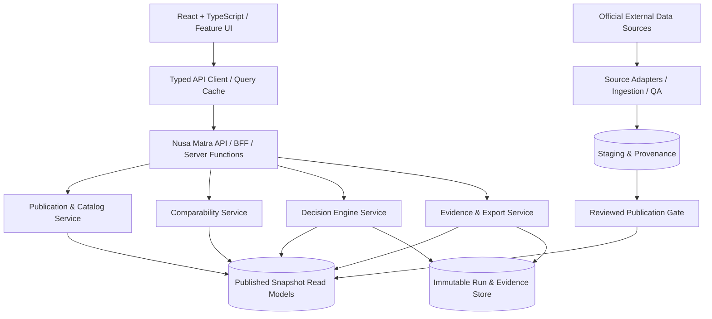

# 08 — API Specification & Frontend–Backend Contracts

> **Product:** Nusa Matra — WIA 2026  
> **Repository path:** `docs/08-API-SPECIFICATION.md`  
> **Document version:** 1.0  
> **Updated:** 2026-10-19  
> **Audience:** Claude Code, frontend/backend engineers, data engineers, QA, reviewers  
> **Documentation language:** English; **end-user UI text:** Bahasa Indonesia  
> **Status:** `PROPOSED` first-party API contract; **not** a claim that these routes have been implemented or deployed.

---

> **Repository scope (owner decision 2026-10-20):** this website repository is the React frontend only. Backend, database, ingestion and validated datasets belong to the separate **Data Hub** service and repository. Read the backend sections of this document as the contract the Data Hub is expected to satisfy, not as code to build here. See `docs/adr/0001-frontend-foundation.md`.

## 0. Instructions for Claude Code — read first

This document specifies **Nusa Matra's own application-facing API**, not the upstream APIs of BPS, BIG, BNPB or other providers. Source integration belongs behind backend adapters and the data-publication pipeline. The frontend must not directly couple itself to unverified external schemas.

### 0.1 Required reading and precedence

1. `../CLAUDE.md` — agent workflow, clean code and mandatory checks.
2. `../project_guidelines.md` — project-wide identity and quality requirements.
3. `01-PRODUCT-REQUIREMENTS.md` — product priorities and functional requirements.
4. `02-USER-FLOWS.md` — screen interactions and URL state.
5. `03-UI-UX-DESIGN-SYSTEM.md` — verified Figma UI, including Normal/Glass modes.
6. `04-TECH-STACK-ARCHITECTURE.md` — React + TypeScript locked; backend implementation TBD.
7. `05-DATA-SOURCES.md` — source provenance and approval gates.
8. `06-DATA-MODEL.md` — authoritative logical entities, snapshot and analysis persistence.
9. `07-DECISION-ENGINE.md` — authoritative analytical formulas, eligibility, rounding and sensitivity policy.
10. This document — transport representation, resources, HTTP semantics and API-specific safeguards.

When a transport example conflicts with domain invariants, **the domain invariants win**. Record the discrepancy rather than silently changing statistical methodology or data meaning.

### 0.2 Evidence and decision labels

| Label                | Meaning                                         | Implementation rule                                                                |
| -------------------- | ----------------------------------------------- | ---------------------------------------------------------------------------------- |
| `LOCKED`             | User-approved requirement                       | React + TypeScript, Clean Code, product name **Nusa Matra**, Indonesian UI copy.   |
| `FIGMA-VERIFIED`     | Seen in final Figma                             | The workflow exists; illustrated numbers are **demo mockups**, not observed facts. |
| `SPECIFIED_FOR_DEMO` | Safe educational implementation contract        | May run using clearly labeled synthetic data.                                      |
| `PROPOSED`           | Reference engineering design                    | Implement only after checking repository conventions and documenting ADR/approval. |
| `TBD`                | Requires product/engineering ownership decision | Do not pretend a decision or production integration is already made.               |
| `BLOCKED_LIVE`       | Unverified data/method or forbidden comparison  | Do not emit public production ranking or misleading numerical result.              |

### 0.3 Non-negotiable API invariants (`API-INV-*`)

| ID           | Invariant                                                                                                                                                                                                                                                            |
| ------------ | -------------------------------------------------------------------------------------------------------------------------------------------------------------------------------------------------------------------------------------------------------------------- |
| `API-INV-01` | `DEMO` and `LIVE` observations/results never mix in one snapshot, comparison, ranking, analysis run or evidence artifact.                                                                                                                                            |
| `API-INV-02` | Every numerical analysis response (including scores, explanation, sensitivity results and evidence) identifies or embeds an immutable provenance manifest with its source snapshot, model version, normalization reference, cohort, input fingerprint and data mode. |
| `API-INV-03` | A missing/suppressed value is never serialized as `0`; measured zero is valid.                                                                                                                                                                                       |
| `API-INV-04` | React never fabricates scores/ranks or infers unavailable upstream data. The decision engine is the single source of analytical truth.                                                                                                                               |
| `API-INV-05` | Public score/rank fields for blocked or excluded regions are `null` and accompanied by machine-readable reasons.                                                                                                                                                     |
| `API-INV-06` | Source year, unit, definition, methodology, geography edition, provenance and data-quality status are discoverable via API.                                                                                                                                          |
| `API-INV-07` | Unsupported comparability returns an explicit `BLOCKED` assessment; no percentage, ratio or prose declaring one region better.                                                                                                                                       |
| `API-INV-08` | The browser never receives BPS API keys, private ingestion credentials, database secrets or provider-only endpoints requiring protected tokens.                                                                                                                      |
| `API-INV-09` | Input validation and authorization happen **server-side**, not solely in the React application.                                                                                                                                                                      |
| `API-INV-10` | JSON transport is versioned, runtime-validated and covered by automated contract tests.                                                                                                                                                                              |
| `API-INV-11` | Calculated results bind immutably to the exact published snapshot and model used. A dataset update never rewrites prior Paspor Bukti evidence.                                                                                                                       |
| `API-INV-12` | Repeated creation requests under one idempotency key cannot create conflicting duplicate runs or exports.                                                                                                                                                            |
| `API-INV-13` | Figma example values (e.g. `0.79`, `500`, `92%`, `514`) are fixtures, never production constants.                                                                                                                                                                    |
| `API-INV-14` | Theme, 3D animation and viewport preferences may change presentation only, never transport-side analytical outcomes.                                                                                                                                                 |
| `API-INV-15` | Server errors do not expose stack traces, raw provider responses, database structure, secrets or confidential metadata.                                                                                                                                              |

**Scope note:** React is the final frontend framework; neither a particular backend framework nor PostgreSQL/PostGIS is finally approved. Examples below are technology-neutral HTTP contracts.

---

## 1. System context and authority boundaries



### 1.1 Explicit trust zones

| Zone             | Allowed                                                                  | Forbidden                                                                                 |
| ---------------- | ------------------------------------------------------------------------ | ----------------------------------------------------------------------------------------- |
| Browser          | Published public data, typed UI requests, user-selected criteria         | Provider secrets, unchecked URLs, direct use of privileged source APIs, private artifacts |
| Application API  | Public read routes, request validation, comparability, run orchestration | Silent synthetic replacement of missing official data                                     |
| Worker/server    | Provider credentials, licensed extraction, authorized storage            | Logging raw tokens or distributing restricted publisher content                           |
| Data publication | Review, normalization, source permission, immutable versioning           | Editing an already published snapshot in place                                            |
| Decision engine  | Pure deterministic calculations from pinned validated inputs             | Reading UI theme, mutable global datasets or random unseeded state                        |

### 1.2 Architectural defaults (`PROPOSED`)

- Public API root: `/api/v1`.
- REST/JSON for read operations; POST for user-defined calculation jobs.
- Long-running analysis uses an asynchronous job resource.
- Public catalog reads **may** be unauthenticated, subject to deployment and abuse controls.
- Write/analysis creation permissions and quotas remain `TBD`; do not add accounts as a hidden prerequisite without approval.
- Read-only static JSON snapshots can implement P0 before a running backend exists **if** they obey the same response schemas.
- All third-party source calls are isolated behind adapters and source governance checks.

Do not install a framework, ORM, auth service, message queue or state library simply because this document discusses its possible role. Prefer existing repository conventions and record an ADR for material decisions.

---

## 2. API resource map, dependencies and priorities

**Paths in this section are `PROPOSED`; none are asserted to be deployed.**

| Priority | Method | Path                                                    | Primary consumer      | Result                                             |
| -------- | ------ | ------------------------------------------------------- | --------------------- | -------------------------------------------------- |
| P0       | GET    | `/api/v1/meta`                                          | All routes            | Version, capabilities, active publication pointers |
| P0       | GET    | `/api/v1/snapshots`                                     | Startup/data selector | Published snapshot catalog                         |
| P0       | GET    | `/api/v1/snapshots/{snapshotId}`                        | All data screens      | Immutable snapshot manifest                        |
| P0       | GET    | `/api/v1/regions`                                       | Jelajahi, Bandingkan  | Region search/list                                 |
| P0       | GET    | `/api/v1/regions/{regionId}`                            | Details, map          | Region metadata                                    |
| P0       | GET    | `/api/v1/indicators`                                    | Jelajahi, Bandingkan  | Indicator catalog                                  |
| P0       | GET    | `/api/v1/indicators/{indicatorId}`                      | Indicator info        | Semantics, methods, provenance                     |
| P0       | GET    | `/api/v1/observations`                                  | Explorer and charts   | Versioned region measurements                      |
| P0       | POST   | `/api/v1/comparisons/evaluate`                          | Bandingkan            | Computed comparability verdict                     |
| P0       | GET    | `/api/v1/quality/issues`                                | Explorer notices      | Data quality warnings/blockers                     |
| P0       | GET    | `/api/v1/geography/manifests`                           | Peta/Jelajahi         | Approved boundary edition, tiles/geometry pointers |
| P1       | GET    | `/api/v1/models`                                        | Lab Prioritas         | Available models and approval status               |
| P1       | GET    | `/api/v1/cohorts`                                       | Lab Prioritas         | Approved/reference ranking cohorts                 |
| P1       | POST   | `/api/v1/analysis/runs`                                 | Lab Prioritas         | Starts pinned scenario calculation                 |
| P1       | GET    | `/api/v1/analysis/runs/{runId}`                         | Lab, Paspor           | State, metadata, quality summary                   |
| P1       | GET    | `/api/v1/analysis/runs/{runId}/scores`                  | Lab Prioritas         | Paged ranks and eligibility                        |
| P1       | GET    | `/api/v1/analysis/runs/{runId}/explanations/{regionId}` | Mengapa               | Contribution ledger, counterfactual refs           |
| P1       | GET    | `/api/v1/quality/summary`                               | Titik Buta Data       | Scoped quality audit summary                       |
| P2       | POST   | `/api/v1/analysis/runs/{runId}/sensitivity`             | Uji Rekomendasi       | Starts reproducible sensitivity job                |
| P2       | GET    | `/api/v1/sensitivity-runs/{sensitivityRunId}`           | Uji Rekomendasi       | Job status, valid trial counts                     |
| P2       | GET    | `/api/v1/sensitivity-runs/{sensitivityRunId}/results`   | Uji Rekomendasi       | Region rank-range results                          |
| P2       | POST   | `/api/v1/evidence`                                      | Paspor Bukti          | Immutable evidence manifest creation               |
| P2       | GET    | `/api/v1/evidence/{evidenceId}`                         | Paspor Bukti          | Verified report data and lineage                   |
| P2       | GET    | `/api/v1/evidence/{evidenceId}/download`                | Paspor Bukti          | Approved export (format if enabled)                |
| P2       | GET    | `/api/v1/stories`                                       | Cerita Wilayah        | Approved story registry                            |
| P2       | GET    | `/api/v1/stories/{storyId}`                             | Cerita Wilayah        | Story chapters and data references                 |

**Not public resources by default:** ingestion start, raw artifact downloads, source-token status, publication approval, model certification, user administration and private licensing information. These need separately scoped internal/admin specifications if ever required.

### 2.1 Feature traceability to final Figma

| Feature                | Figma node           | API responsibility                                                         |
| ---------------------- | -------------------- | -------------------------------------------------------------------------- |
| Landing                | `27:2`, `27:118`     | Meta and curated data references, not mandatory expensive analytics.       |
| Peta Utama             | `61:1183`, `61:1619` | Catalog, geography manifest, snapshot-qualified data.                      |
| Jelajahi               | `29:34`, `29:485`    | Region search, indicators, observations, data quality.                     |
| Bandingkan             | `12:840`             | Validated comparison assessment.                                           |
| Lab Prioritas          | `11:152`             | Model/cohort discovery and scenario run.                                   |
| Mengapa Diprioritaskan | `12:263`             | Explanation from exact completed run.                                      |
| Titik Buta Data        | `14:541`             | Quality issues and scoped summaries.                                       |
| Uji Rekomendasi        | `13:854`             | Seeded versioned robustness job.                                           |
| Paspor Bukti           | `13:446`             | Reproducible evidence manifest and optional export.                        |
| Cerita Wilayah         | `14:927`             | Editorial storyline + authenticated data references, not fabricated facts. |

All feature route names in `04-TECH-STACK-ARCHITECTURE.md` are user-facing React paths (such as `/jelajahi`); they are **not** API endpoints.

---

## 3. HTTP conventions and versioning

### 3.1 Transport contract

- API path version: `/api/v1`; an incompatible representation requires a deliberate `/api/v2` or backward-compatible migration.
- Requests and responses: `application/json; charset=utf-8` by default.
- Structured error content type: `application/problem+json` (`PROPOSED` using RFC 9457-style fields).
- UTF-8 text, including Indonesian names; keep canonical identifiers independent of labels.
- Timestamps: ISO 8601 in UTC, e.g. `2026-10-19T13:00:00Z`; source period intervals use explicit start/end and timezone semantics.
- Query parameter and JSON property names: `camelCase` for application-facing API.
- Resource IDs: opaque strings. When persisted in proposed SQL, database IDs may be UUIDs; clients MUST NOT parse/construct these IDs.
- Dates and numerical observations MUST be returned with units, reference period and mode.
- HTTP methods: GET is safe; GET MUST NOT create a run, update a model or publish anything.
- Route IDs are URL-encoded with standard client primitives; NEVER interpolate user input into upstream provider URLs.

### 3.2 Response envelope (`PROPOSED`)

Use a consistent success envelope and keep domain metadata with data rather than in random optional headers:

```ts
export interface ApiSuccess<T> {
  data: T;
  meta: {
    requestId: string;
    apiVersion: 'v1';
    generatedAt: string; // UTC date-time; transport metadata, not source observation time
    dataMode?: 'DEMO' | 'LIVE';
    snapshotId?: string;
    warnings?: readonly ApiWarning[];
    pagination?: PaginationMeta;
  };
}

export interface ApiWarning {
  code: string;
  messageId: string; // map to localized UI text
  details?: Record<string, unknown>;
}

export interface PaginationMeta {
  nextCursor: string | null;
  pageSize: number;
  hasMore: boolean;
}
```

No envelope for binary files or standard `application/problem+json` errors. Distinguish generatedAt from publisher-issued source dates and snapshot publish time.

### 3.3 Request identification and headers

| Header                           | Direction       | Contract                                                                                         |
| -------------------------------- | --------------- | ------------------------------------------------------------------------------------------------ |
| `Accept: application/json`       | Client → server | Default JSON response.                                                                           |
| `Content-Type: application/json` | Client → server | Required when posting JSON.                                                                      |
| `X-Request-ID`                   | Server → client | Server-generated safe correlation ID; do not trust user-provided IDs as authoritative.           |
| `Idempotency-Key`                | Client → server | Mandatory for creating async runs/sensitivity/evidence; stable across **retries of one action**. |
| `If-None-Match`                  | Client → server | Conditional cache validation for immutable or catalog reads.                                     |
| `ETag`                           | Server → client | Entity or representation tag as documented per resource.                                         |
| `Retry-After`                    | Server → client | Rate limit or service-unavailable retry guidance where appropriate.                              |
| `Cache-Control`                  | Server → client | Prevent caching of user-specific/sensitive responses.                                            |

If authentication is introduced, use appropriate session/authorization mechanisms with explicit security review. **Do not propose `X-API-Key` in browser JS for provider tokens.**

### 3.4 Status code matrix

| HTTP                         | Use                                                                                         | Client action                                                |
| ---------------------------- | ------------------------------------------------------------------------------------------- | ------------------------------------------------------------ |
| `200 OK`                     | Successful read / non-creating validation POST                                              | Render validated payload.                                    |
| `202 Accepted`               | Async run/evidence operation accepted, not complete                                         | Poll returned resource with backoff; do not claim completed. |
| `304 Not Modified`           | ETag conditional read                                                                       | Use the previously validated cached representation.          |
| `400 Bad Request`            | Malformed JSON, unknown query key, unparsable request                                       | Fix client/request.                                          |
| `401 Unauthorized`           | Authentication required and absent/invalid, if auth enabled                                 | Ask for authorized flow, not silent retry.                   |
| `403 Forbidden`              | Authenticated but not allowed / restricted data                                             | Show restricted/blocked state.                               |
| `404 Not Found`              | Unknown ID or deliberately concealed resource                                               | Show not found.                                              |
| `409 Conflict`               | Snapshot/mode mismatch, immutable state conflict, idempotency-key reuse with different body | Refresh context or stop operation.                           |
| `410 Gone`                   | Deliberately retired/unavailable short-lived export endpoint                                | Explain expired link; never silently replace evidence.       |
| `412 Precondition Failed`    | Optional write precondition violated                                                        | Refetch authoritative version.                               |
| `413 Payload Too Large`      | Unreasonably large request/export filter                                                    | Reduce payload.                                              |
| `415 Unsupported Media Type` | Wrong content type                                                                          | Correct header.                                              |
| `422 Unprocessable Content`  | Syntactically valid but invalid domain request                                              | Highlight specific field / explain blocked analysis.         |
| `429 Too Many Requests`      | Rate quota exceeded                                                                         | Honor `Retry-After`, limit UI retries.                       |
| `500 Internal Server Error`  | Unexpected defect                                                                           | Safe fallback + correlation ID.                              |
| `502/503/504`                | External dependency, maintenance, timeout                                                   | Retry only if idempotent/allowed.                            |

A valid comparison request with incompatible observations is usually **`200` with `status: BLOCKED`** because the assessment succeeded; do not conflate methodological incomparability with transport failure.

### 3.5 Version compatibility and lifecycle

- Existing client fields cannot silently change meaning.
- Added optional fields are generally compatible; removing mandatory fields or changing metric precision semantics is breaking.
- Version both **API schema** (`v1`) and independent **domain provenance** (`snapshotId`, model version, methodology ID).
- A new publication changes the active pointer only; a pinned older snapshot remains immutable when access/retention policy permits.
- `DEMO` to `LIVE` must be an explicit user/action choice and checked server-side; never automatic fallback on upstream failure.
- Do not write frontend code that picks "whatever the newest snapshot is" after the user has pinned a historical analysis.

---

## 4. Shared canonical types and decimal/enum semantics

The TypeScript interfaces below are **contract sketches** for an eventual shared schema package. Generate types from one maintained OpenAPI schema or runtime schema when the tooling is selected; **do not manually maintain divergent backend and frontend copies**.

```ts
export type DataMode = 'DEMO' | 'LIVE';
export type SnapshotStatus = 'PUBLISHED' | 'RETIRED';
export type AdminLevel = 'PROVINCE' | 'REGENCY' | 'CITY';
export type ValueStatus = 'AVAILABLE' | 'MISSING' | 'SUPPRESSED';
export type Origin = 'SOURCE_REPORTED' | 'DERIVED' | 'DEMO';
export type QualitySeverity = 'INFO' | 'WARNING' | 'BLOCKED';
export type JobStatus = 'PENDING' | 'RUNNING' | 'COMPLETED' | 'FAILED';

// Financial-grade exact transport: numeric database values as decimal strings.
// Parse/validate with selected decimal strategy; NEVER use a formatted UI string as input.
export type DecimalString = string;
export type ResourceId = string;

export interface ReferencePeriod {
  periodId: ResourceId;
  label: string; // e.g., "2023"; display only
  granularity: 'YEAR' | 'QUARTER' | 'MONTH' | 'AS_OF';
  startsOn: string; // ISO local date, inclusive
  endsBefore: string; // ISO local date, exclusive
}

export type ObservationValue =
  | { status: 'AVAILABLE'; decimal: DecimalString }
  | { status: 'MISSING'; decimal: null; reasonCode: string }
  | { status: 'SUPPRESSED'; decimal: null; reasonCode: string };

export interface SourceCitation {
  publisherId: ResourceId;
  publisherName: string;
  datasetId: ResourceId;
  datasetEditionId: ResourceId;
  publicSourceUrl: string | null; // null if restricted, never raw private endpoint
  licenseLabel: string | null;
  retrievedAt: string | null;
  publishedAt: string | null;
}

export interface DataQualityIssue {
  issueId: ResourceId;
  code: string;
  severity: QualitySeverity;
  affectedRegionId: ResourceId | null;
  affectedIndicatorId: ResourceId | null;
  affectedObservationId: ResourceId | null;
  messageId: string;
  details: Record<string, unknown>;
}

export interface RegionDTO {
  regionId: ResourceId;
  nameId: string; // Indonesian official display name
  adminLevel: AdminLevel;
  parentRegionId: ResourceId | null;
  identifiers: readonly {
    codeSystem: string;
    code: string;
    boundaryEditionId: ResourceId;
  }[];
}

export interface IndicatorDTO {
  indicatorId: ResourceId;
  labelId: string;
  definitionId: string;
  unitCode: string;
  unitLabelId: string;
  preferredDirection: 'HIGHER_IS_WORSE' | 'HIGHER_IS_BETTER' | 'CONTEXTUAL' | 'UNAPPROVED';
  methodologyIds: readonly ResourceId[];
  category: string;
}

export interface ObservationDTO {
  observationId: ResourceId;
  regionId: ResourceId;
  indicatorId: ResourceId;
  methodologyId: ResourceId;
  comparabilityGroupId: ResourceId | null;
  period: ReferencePeriod;
  result: ObservationValue;
  origin: Origin;
  unitCode: string;
  boundaryEditionId: ResourceId;
  source: SourceCitation;
  qualityIssueCodes: readonly string[];
}
```

**Critical:** `DecimalString` is an illustrative alias, not sufficient runtime validation. Validate a precise decimal grammar and supported magnitude before arithmetic. Reject NaN/Infinity, locale-formatted `"0,86"`, bare JSON floats for exact computed values, trailing garbage and unsafe precision truncation.

### 4.1 Decimal conventions

- Observation, normalized criterion, score, contribution, effective weight and simulation frequency: **base-10 decimal string** in transport.
- Weight input: integer **basis points** (`basisPoints`, 0–10,000), not floats; their sum must equal 10,000.
- Rank positions, trial counts, denominators and list counts: integers.
- UI may display `0,86` to Indonesian locale, but transmits/receives `"0.86"`.
- Round presentation separately; persisted run/evidence ledger retains engine's canonical precision from `07-DECISION-ENGINE.md`.
- Never interpret `"0.79"` as 79% probability. It is a conditional composite score only if the method says so.

### 4.2 Null and omission semantics

| Representation        | Meaning                                                                           |
| --------------------- | --------------------------------------------------------------------------------- |
| Absent optional field | Not requested or outside this representation; **not** automatically missing data. |
| `null`                | The field intentionally has no value; see status/reason for explanation.          |
| `"0"`                 | Actual measured or calculated zero, only with `AVAILABLE`/eligible semantics.     |
| `""`                  | Invalid for numerical data or required identifier.                                |
| `status: MISSING`     | No eligible observation for that semantic key; not a measured zero.               |
| `status: SUPPRESSED`  | Source intentionally did not publish the number.                                  |
| `BLOCKED`             | Requested comparison or analytical use is invalid under current rules.            |

The API must **never** convert missing database rows into `AVAILABLE + 0` to simplify chart rendering.

---

## 5. Snapshot, publication and capability endpoints (P0)

### 5.1 `GET /api/v1/meta`

Purpose: determine deployed API version, public feature flags and active snapshot _pointers_ without disclosing internal secrets or server configuration.

```json
{
  "data": {
    "product": "Nusa Matra",
    "apiVersion": "v1",
    "capabilities": {
      "comparison": true,
      "analysis": false,
      "sensitivity": false,
      "evidence": false,
      "storytelling": false
    },
    "activeSnapshots": {
      "DEMO": "22222222-2222-4222-8222-222222222222",
      "LIVE": null
    }
  },
  "meta": {
    "requestId": "req_demo_001",
    "apiVersion": "v1",
    "generatedAt": "2026-10-19T13:00:00Z"
  }
}
```

Example values are **synthetic**; do not infer that a LIVE snapshot or any backend exists. A capability flag cannot be substituted for server-side access and model approval.

### 5.2 `GET /api/v1/snapshots`

**Query:** `dataMode=DEMO|LIVE` (optional), `cursor`, `pageSize` (bounded; proposed default 25, maximum 100), `includeRetired=false`.

**Response item fields:** `snapshotId`, `snapshotKey`, `dataMode`, `status`, `publishedAt`, `digestSha256`, `boundaryEditionIds`, `availableIndicatorIds`, `coverageSummary`, `dataQualitySummary`, `disclaimerId`.

Acceptance:

- Public list returns only snapshots allowed for the caller and route's intended usage.
- Never leak `DRAFT` or `VALIDATING` snapshots publicly.
- A retired snapshot referenced by evidence can remain resolvable subject to authorized retention policy, but not become active by accident.
- Catalogue listing is not itself a promise that a model is approved for LIVE analysis.

### 5.3 `GET /api/v1/snapshots/{snapshotId}`

```json
{
  "data": {
    "snapshotId": "22222222-2222-4222-8222-222222222222",
    "snapshotKey": "nm-demo-2026-v1",
    "dataMode": "DEMO",
    "status": "PUBLISHED",
    "digestSha256": "aaaaaaaaaaaaaaaaaaaaaaaaaaaaaaaaaaaaaaaaaaaaaaaaaaaaaaaaaaaaaaaa",
    "publishedAt": "2026-10-19T09:00:00Z",
    "boundaryEditionIds": ["77777777-7777-4777-8777-777777777777"],
    "indicatorIds": ["44444444-4444-4444-8444-444444444444"],
    "provenanceReview": "SYNTHETIC_FIXTURE",
    "disclaimerId": "DEMO_NOT_OFFICIAL"
  },
  "meta": {
    "requestId": "req_demo_002",
    "apiVersion": "v1",
    "generatedAt": "2026-10-19T13:00:00Z",
    "dataMode": "DEMO",
    "snapshotId": "22222222-2222-4222-8222-222222222222"
  }
}
```

**Snapshot cache:** immutable published snapshot payloads can be cached by snapshot ID + content digest; **active pointer `/meta` must be refreshed independently**. Avoid claiming permanent retention without owner decision.

---

## 6. Region catalog and lookup (P0)

### 6.1 `GET /api/v1/regions`

**Allowed query parameters:**

| Parameter           | Type                                          | Behavior                                                                                       |
| ------------------- | --------------------------------------------- | ---------------------------------------------------------------------------------------------- |
| `q`                 | string (1–100 Unicode code points after trim) | Search official Indonesian display name and approved aliases; not substring SQL interpolation. |
| `adminLevel`        | `PROVINCE`/`REGENCY`/`CITY`                   | Exact level filter.                                                                            |
| `parentRegionId`    | ID                                            | Restrict to administrative parent.                                                             |
| `boundaryEditionId` | ID                                            | Required where multiple geography editions would otherwise make lookup ambiguous.              |
| `cursor`            | opaque string                                 | Cursor pagination (not raw SQL offset).                                                        |
| `pageSize`          | integer                                       | Default 25, max 100 (`PROPOSED`).                                                              |

**Successful result**: array of `RegionDTO`, with pagination in `meta.pagination`. Stable deterministic sort is `normalized display name + regionId`, while searching may explicitly use scored relevance + deterministic tie break. No country-scale full dataset on each keystroke.

For debounced search: frontend must cancel superseded network requests and avoid displaying previous search results under a newly typed query without a stale/loading indication.

### 6.2 `GET /api/v1/regions/{regionId}`

Returns `RegionDTO`, including published code aliases and boundary context. `404` for an unknown ID. If a region is replaced, merged or split, a resolution pointer may be included but must never guess a crosswalk.

**Crosswalk policy:** identifiers from BPS vs Kemendagri are NOT assumed equivalent. The backend resolves codes by versioned mapping from `05-DATA-SOURCES.md` / `06-DATA-MODEL.md`. Never fuzzy-match names as the final production join.

### 6.3 Browser URL versus API ID

If the UI route uses `?wilayah=<CODE>`, resolve `(codeSystem, code, boundaryEditionId)` into the canonical `regionId` once via catalog/lookup. Do not infer the code system from digit count alone. Alternatively, deliberately choose public opaque IDs and update routing documentation through an ADR. Both approaches must preserve deep links and Back/Forward behavior.

---

## 7. Indicator catalog and observations (P0)

### 7.1 `GET /api/v1/indicators`

**Query:** `snapshotId` (required for displayed availability), `category`, `q`, `cursor`, `pageSize`.

Returns catalog descriptors with:

- Indicator ID, Indonesian label, definition, unit and display format.
- Dataset editions and reviewed methodology versions.
- Numeric direction semantics, explicitly allowing `UNAPPROVED`.
- Source attribution and period coverage.
- Applicable admin levels and geographic editions.
- Whether the indicator may be **viewed**, **compared**, or **used in model** as distinct capabilities.
- Applicable quality notices and limitations.

An indicator available for display must **not** automatically be eligible for scoring; scoring requires methodology and LIVE approval.

### 7.2 `GET /api/v1/indicators/{indicatorId}`

Returns full definition and publicly safe source/method metadata; list associated periods or a separate facets field. Never remove an old method revision referenced by an immutable analysis run without an authorized archival policy.

### 7.3 `GET /api/v1/observations`

**Request:** query params `snapshotId` (**required**), `regionId` (one or comma-separated bounded values), `indicatorId` (one or comma-separated bounded values), `periodId` (optional if an explicit current-period selection policy exists), `cursor`, `pageSize`.

**Bounds (PROPOSED):** maximum 10 region IDs and 10 indicator IDs per call, maximum 200 result items/page; otherwise return `413` or documented `422`. If period omitted, never silently combine incomparable periods; disclose the server's explicit selection policy and return source period on each item.

**Example (`DEMO`, synthetic observations):**

```json
{
  "data": {
    "items": [
      {
        "observationId": "88888888-8888-4888-8888-888888888888",
        "regionId": "11111111-1111-4111-8111-111111111111",
        "indicatorId": "44444444-4444-4444-8444-444444444444",
        "methodologyId": "99999999-9999-4999-8999-999999999999",
        "comparabilityGroupId": "aaaaaaaa-aaaa-4aaa-8aaa-aaaaaaaaaaaa",
        "period": {
          "periodId": "bbbbbbbb-bbbb-4bbb-8bbb-bbbbbbbbbbbb",
          "label": "2023",
          "granularity": "YEAR",
          "startsOn": "2023-01-01",
          "endsBefore": "2024-01-01"
        },
        "result": { "status": "AVAILABLE", "decimal": "0.86" },
        "origin": "DEMO",
        "unitCode": "ratio",
        "boundaryEditionId": "77777777-7777-4777-8777-777777777777",
        "source": {
          "publisherId": "cccccccc-cccc-4ccc-8ccc-cccccccccccc",
          "publisherName": "Synthetic fixture — NOT an official source",
          "datasetId": "dddddddd-dddd-4ddd-8ddd-dddddddddddd",
          "datasetEditionId": "eeeeeeee-eeee-4eee-8eee-eeeeeeeeeeee",
          "publicSourceUrl": null,
          "licenseLabel": "DEMO ONLY",
          "retrievedAt": null,
          "publishedAt": null
        },
        "qualityIssueCodes": []
      }
    ]
  },
  "meta": {
    "requestId": "req_demo_003",
    "apiVersion": "v1",
    "generatedAt": "2026-10-19T13:00:00Z",
    "dataMode": "DEMO",
    "snapshotId": "22222222-2222-4222-8222-222222222222",
    "pagination": { "nextCursor": null, "pageSize": 200, "hasMore": false }
  }
}
```

**Value status alternatives:**

```json
{ "status": "MISSING", "decimal": null, "reasonCode": "NOT_PUBLISHED" }
```

```json
{ "status": "SUPPRESSED", "decimal": null, "reasonCode": "PUBLISHER_SUPPRESSION" }
```

These statuses are **mutually exclusive** with `AVAILABLE`. For `AVAILABLE`, a zero is represented by `"0"` or `"0.000"` with explicit status and unit.

### 7.4 Observation selection rules

1. Query only exact members of the named published snapshot.
2. Return provenance attached to each observation; references cannot be replaced by unverified generic URLs.
3. Do not collapse historical revisions across dataset editions.
4. For the same requested canonical indicator/region/period, snapshot publication must define one unambiguous representative.
5. Never infer missingness solely from absence in an upstream table; record coverage as verified.
6. If an observation is unavailable but expected, a validated coverage artifact may materialize `MISSING`; the app otherwise reports that no record is available without asserting publisher suppression.
7. Preserve raw units and normalized-criterion units separately; map display color categories are not observation values.
8. For unapproved external dataset, return a source-unavailable/blocked state rather than substitute synthetic `LIVE` values.

---

## 8. Geography and map delivery (P0)

### 8.1 `GET /api/v1/geography/manifests`

**Query:** `snapshotId`, `adminLevel`, optional `regionId` and `boundaryEditionId`.

**Proposed payload**

```ts
interface GeographyManifestDTO {
  boundaryEditionId: string;
  authority: string;
  attributionText: string;
  licenseUrl: string | null;
  projection: string;
  geometryFormat: 'GEOJSON' | 'VECTOR_TILES';
  geographicCoverage: { adminLevels: AdminLevel[]; regionIds?: string[] };
  geometryUrl: string | null;
  tileTemplate: string | null;
  minZoom: number | null;
  maxZoom: number | null;
  publishedAt: string;
  isIllustrative: boolean;
}
```

The server MUST generate URLs from an **allowlisted** controlled asset host or audited provider with permission to display/redistribute. It MUST NOT accept arbitrary client-supplied provider URLs or return licensed private URLs. An illustrative hexa-map and an accurate administrative polygon set are **different assets with different claims**.

### 8.2 Map join and accessible fallback

- Join the map's boundary feature to a canonical region ID through a versioned authoritative join manifest.
- Mismatched editions must be flagged and excluded/blocked; do not color neighboring region as a fallback.
- `geometryUrl` and `tileTemplate` are mutually exclusive in one manifest for simplicity; choose the appropriate key by format.
- Return a text-list alternative to map selection and expose sources even when WebGL is unavailable.
- Avoid returning megabytes of polygon coordinates inside generic `/regions` or `/observations` responses.

---

## 9. Comparison API and comparability outcomes (P0)

### 9.1 `POST /api/v1/comparisons/evaluate`

**Rationale:** comparison does real domain work. It checks indicator identity, units, methodology, period, geography and provenance before displaying numerical differences. POST here is non-persistent and returns `200`; it MUST NOT create a resource.

**Request:**

```json
{
  "dataMode": "DEMO",
  "snapshotId": "22222222-2222-4222-8222-222222222222",
  "regionAId": "11111111-1111-4111-8111-111111111111",
  "regionBId": "66666666-6666-4666-8666-666666666666",
  "indicatorIds": ["44444444-4444-4444-8444-444444444444"],
  "periodSelection": { "mode": "LATEST_MUTUALLY_REVIEWED" }
}
```

`LATEST_MUTUALLY_REVIEWED` is a **proposal**: the provider must select periods using an approved policy, not by picking an arbitrary latest timestamp. The request may alternatively use `{ "mode": "EXPLICIT", "periodIds": [...] }` with per-indicator selection and validation (detailed period selector TBD). Keep request schema discriminated; never accept both modes simultaneously.

**Response shape:**

```ts
type ComparisonStatus = 'COMPARABLE' | 'WARNING' | 'BLOCKED';

interface ComparisonRowDTO {
  indicatorId: string;
  status: ComparisonStatus;
  leftObservation: ObservationDTO | null;
  rightObservation: ObservationDTO | null;
  differenceDecimal: DecimalString | null;
  ratioDecimal: DecimalString | null;
  issueCodes: string[];
  periodMismatch: boolean;
  explanationId: string; // templated explanation keyed to verified inputs
}

interface ComparisonResultDTO {
  dataMode: DataMode;
  snapshotId: string;
  leftRegionId: string;
  rightRegionId: string;
  rows: ComparisonRowDTO[];
  overallQuality: 'COMPARABLE' | 'HAS_WARNINGS' | 'HAS_BLOCKED_ITEMS';
}
```

### 9.2 Guardrails

- A request can succeed (`200`) while **one or more rows are `BLOCKED`**.
- A `BLOCKED` row MUST have `differenceDecimal = null` and `ratioDecimal = null`; attach issue codes and available individual observations where permitted.
- Different years may be a `WARNING` **only if reviewed comparability rules permit it**; otherwise `BLOCKED`.
- Ratio requires nonzero, meaningful denominator and compatible dimension/definition; otherwise `ratioDecimal = null` plus reason. `0` in denominator is not silently replaced.
- Never emit positive/negative language like “lebih baik” from an unreviewed direction or mismatched methods.
- The server must not convert region A/B positioning into substantive analytical preference; swap changes display order only.
- Figma's example of differing water-access definitions is a design warning, not proof that two specific published series are actually incompatible.

### 9.3 Bandingkan acceptance example

Synthetic approved-in-demo row:

```json
{
  "indicatorId": "44444444-4444-4444-8444-444444444444",
  "status": "BLOCKED",
  "leftObservation": null,
  "rightObservation": null,
  "differenceDecimal": null,
  "ratioDecimal": null,
  "issueCodes": ["INCOMPATIBLE_DEFINITION"],
  "periodMismatch": false,
  "explanationId": "comparison.definition_incompatible"
}
```

The example illustrates the blocked outcome contract, not real indicator values. A production response must also identify exact affected methods/periods in safe diagnostic details when available.

---

## 10. Decision-model discovery, cohorts and analysis runs (P1)

The decision engine's **mathematics and quality gates belong to** `07-DECISION-ENGINE.md`. The API only specifies how the existing domain contract is requested, versioned, returned and secured.

### 10.1 `GET /api/v1/models`

**Query:** optional `snapshotId`, `dataMode`, `includeUnapproved=false` (restricted/unapproved details may remain internal).

Each public model descriptor MUST expose:

```ts
interface ModelDescriptorDTO {
  modelVersionId: string;
  modelKey: string;
  versionLabel: string;
  approvalStatus: 'DEMO_ONLY' | 'PENDING' | 'APPROVED' | 'REJECTED';
  allowedDataModes: DataMode[];
  eligibleIndicatorIds: string[];
  normalizationReferenceIds: string[];
  requiredMissingValuePolicyId: string;
  methodSummaryId: string;
  publicMethodologyUrl: string | null;
  implementationDigestSha256: string;
}
```

A `DEMO_ONLY` model is never eligible for `LIVE` scoring, regardless of whether a LIVE snapshot happens to contain identically named indicators. A model's existence is not methodology approval.

### 10.2 `GET /api/v1/cohorts`

**Query:** `snapshotId` (**required**), `modelVersionId` (optional), `adminLevel` (optional), `cursor`, `pageSize`.

Return available _versioned cohort definitions_, their region counts, boundary edition and approval state. Do not silently add a different number of administrative areas when a cohort is pinned. A label such as `514 kabupaten/kota` in Figma is illustrative and must be computed from the chosen dataset/edition/eligibility.

### 10.3 `POST /api/v1/analysis/runs`

Starts a new immutable analysis run from a validated scenario. **Always returns `202 Accepted` in this proposed v1 contract**, with a polling location; an implementation can finish immediately but still preserves the same job/resource semantics. This avoids multiple incompatible modes of operation.

**Required headers:**

```http
Content-Type: application/json
Accept: application/json
Idempotency-Key: 8b1a5c5e-1fe6-4ecb-bb98-c4b210000001
```

**Request (illustrative, not a policy-approved scoring scenario):**

```json
{
  "dataMode": "DEMO",
  "snapshotId": "22222222-2222-4222-8222-222222222222",
  "cohortId": "55555555-5555-4555-8555-555555555555",
  "modelVersionId": "33333333-3333-4333-8333-333333333333",
  "normalizationReferenceId": "ffffffff-ffff-4fff-8fff-ffffffffffff",
  "criteria": [
    {
      "indicatorId": "44444444-4444-4444-8444-444444444444",
      "methodologyVersionId": "99999999-9999-4999-8999-999999999999",
      "basisPoints": 4500
    },
    {
      "indicatorId": "44444444-4444-4444-8444-444444444445",
      "methodologyVersionId": "99999999-9999-4999-8999-999999999998",
      "basisPoints": 3000
    },
    {
      "indicatorId": "44444444-4444-4444-8444-444444444446",
      "methodologyVersionId": "99999999-9999-4999-8999-999999999997",
      "basisPoints": 1500
    },
    {
      "indicatorId": "44444444-4444-4444-8444-444444444447",
      "methodologyVersionId": "99999999-9999-4999-8999-999999999996",
      "basisPoints": 1000
    }
  ]
}
```

**Important:** this vector is based on a **synthetic Figma example** and is not a recommended allocation of real resources. Every `basisPoints` is an integer in `[0,10000]`; sum **exactly** `10000`. Repeated indicator IDs are invalid. Methodologies and normalization references must be approved and available within the named snapshot.

**Accepted response:**

```json
{
  "data": {
    "runId": "12121212-1212-4212-8212-121212121212",
    "status": "PENDING",
    "pollAfterMs": 1000,
    "links": {
      "self": "/api/v1/analysis/runs/12121212-1212-4212-8212-121212121212"
    }
  },
  "meta": {
    "requestId": "req_demo_004",
    "apiVersion": "v1",
    "generatedAt": "2026-10-19T13:00:00Z",
    "dataMode": "DEMO",
    "snapshotId": "22222222-2222-4222-8222-222222222222"
  }
}
```

**Server processing sequence:**

1. Authenticate/rate-limit as configured; validate size, schema, IDs and idempotency key.
2. Resolve the named immutable published snapshot. Verify `dataMode` matches snapshot mode; do not switch modes automatically.
3. Resolve model, indicator methodology versions, normalization reference and cohort.
4. Check model approval (`DEMO_ONLY` cannot process `LIVE`), publisher authorization and region/period comparability.
5. Normalize/validate the canonical weight vector; DO NOT quietly alter client-submitted weights or select different criteria.
6. Derive a deterministic input fingerprint per `07-DECISION-ENGINE.md` (including engine version and policy).
7. Atomically return the prior run for exact idempotent replay or create a pending run. A reused key with a different canonical body is `409`.
8. Invoke pure scoring engine, record exact inputs/observation lineage, score/contributions, eligibility counts and warnings.
9. Mark the run `COMPLETED` only after reconciliation and storage validation; otherwise `FAILED` with safe typed error.
10. Never partially publish a completed ranking list without the matching run manifest.

**Idempotency scope:** key is scoped to operation, authorized principal (or anonymous session/request scope), and a bounded validity period (`TBD`). Identical payload with same key yields same resource. Distinct user actions should use distinct keys even when weights happen to match. The _analytical input fingerprint_ is separate from the idempotency key and may support result deduplication independently.

### 10.4 `GET /api/v1/analysis/runs/{runId}`

Response must identify status and inputs, even before scores are ready:

```ts
interface AnalysisRunDTO {
  runId: string;
  status: JobStatus;
  dataMode: DataMode;
  snapshotId: string;
  cohortId: string;
  modelVersionId: string;
  normalizationReferenceId: string;
  fingerprintSha256: string;
  criteria: ReadonlyArray<{
    indicatorId: string;
    methodologyVersionId: string;
    basisPoints: number;
  }>;
  createdAt: string;
  completedAt: string | null;
  quality: {
    cohortCount: number;
    eligibleCount: number;
    blockedCount: number;
    excludedCount: number;
    issuesByCode: Record<string, number>;
  } | null;
  error: { code: string; messageId: string } | null;
  links: { scores: string | null };
}
```

- `quality` and `links.scores` are null until completed.
- A `FAILED` run retains safe diagnostic code and immutable failure metadata, not raw stack traces.
- For completed runs, the quality counts satisfy `cohortCount = eligibleCount + blockedCount + excludedCount` as defined in the decision-engine document.
- An in-progress run does not imply stability, quality or reliable ranking.

### 10.5 `GET /api/v1/analysis/runs/{runId}/scores`

**Query:** `status=ELIGIBLE|BLOCKED|EXCLUDED` (optional), `sort=RANK_ASC` (default, only when eligible), `cursor`, `pageSize` (default 25, max 100). Complete eligible results should be shown separately from blocked/excluded results; do not sort null ranks as top-ranked areas.

```ts
interface RegionScoreDTO {
  regionId: string;
  regionNameId: string;
  eligibility: 'ELIGIBLE' | 'BLOCKED' | 'EXCLUDED';
  scoreDecimal: DecimalString | null;
  rankPosition: number | null;
  rankTieGroupId: string | null;
  issueCodes: string[];
}

interface RankedScoresPageDTO {
  runId: string;
  fingerprintSha256: string;
  dataMode: DataMode;
  snapshotId: string;
  cohortId: string;
  modelVersionId: string;
  normalizationReferenceId: string;
  eligibleDenominator: number;
  cohortDenominator: number;
  items: RegionScoreDTO[];
}
```

**Server-side ranking:** deterministic tie policy, exact score ordering and denominator are defined in `07-DECISION-ENGINE.md`. The browser may sort the display of **already finalized scores** for accessibility, but must never recompute or invent model ranks.

If run is not `COMPLETED`, return `409` with `RUN_NOT_READY` and `Retry-After`, or direct UI to poll the run resource. Do not return `[]` and allow the UI to misinterpret it as “no ranked areas”.

### 10.6 Lab Prioritas immediate-feedback requirement

Figma shows the ranked list updating with a weight slider. **Proposed split:**

- `DEMO`: run the same tested pure domain engine client-side (or in a Web Worker) on the **exact pinned synthetic snapshot** for instant preview; mark `Simulasi` and derive all values from computation.
- `LIVE`: submit validated/debounced requests to the server; show `Menghitung…` state, cancel/supersede older UI requests; only show ranking for the matching current canonical input fingerprint.
- Do not ship two mathematical implementations with diverging rounding, ties or eligibility. Share a single TypeScript domain package when architecture permits, or verify parity with golden vectors.
- Do not submit a new network request for every pointer pixel; throttle/debounce commits separately from tactile slider feedback.
- Showing the previous ranking during a pending update requires an explicit **stale previous result** label; it must not appear to reflect the new weights.

### 10.7 `GET /api/v1/analysis/runs/{runId}/explanations/{regionId}`

Only valid for completed runs. Blocked/excluded regions return a typed **explanation of ineligibility**, not invented weighted contributions.

```ts
interface ContributionDTO {
  indicatorId: string;
  methodologyVersionId: string;
  sourceObservationId: string | null;
  normalizedDecimal: DecimalString | null;
  basisPoints: number;
  contributionDecimal: DecimalString | null;
  qualityIssueCodes: string[];
}

interface ExplanationDTO {
  runId: string;
  regionId: string;
  dataMode: DataMode;
  snapshotId: string;
  modelVersionId: string;
  cohortId: string;
  normalizationReferenceId: string;
  inputFingerprintSha256: string;
  eligibility: 'ELIGIBLE' | 'BLOCKED' | 'EXCLUDED';
  scoreDecimal: DecimalString | null;
  rankPosition: number | null;
  eligibleDenominator: number;
  contributions: ContributionDTO[];
  explanatoryFactCodes: string[];
  limitationCodes: string[];
  sourceObservationIds: string[];
}
```

**Mandatory reconciliation:** unrounded contribution values sum to the model's stored score within its defined exact tolerance; provide the model version that defines rounding. API adapters MUST NOT recalculate contributions with frontend floats. Summary text is assembled from verified contribution ordering and bounded Indonesian templates, **not from unsupported causal inference**.

### 10.8 Counterfactuals

To compare alternative weighting, create a second analysis run through `POST /analysis/runs` with the **same immutable baseline snapshot/cohort/model/reference** and an explicit new complete weight vector. Responses may include `comparedToRunId` only after server validation of comparable cohorts and reference manifests. A different eligible population blocks direct rank-difference claims unless an approved common-cohort comparison is explicitly implemented.

Do not invent a separate `/why` scoring implementation. One validated decision engine serves Lab Prioritas, explanations, sensitivity and evidence.

---

## 11. Uji Rekomendasi — asynchronous sensitivity API (P2)

### 11.1 `POST /api/v1/analysis/runs/{runId}/sensitivity`

**Precondition:** base run `COMPLETED`, method supports the experiment, snapshot unchanged, and caller permitted to request the work. Required `Idempotency-Key`.

```json
{
  "experiment": "RELATIVE_WEIGHT_PERTURBATION",
  "config": {
    "relativeBoundDecimal": "0.10",
    "trialCount": 500,
    "seed": 4262026,
    "topK": 5
  }
}
```

This is a **synthetic configuration example**, not a claim that 500 trials have been run. In `07-DECISION-ENGINE.md`, `±10%` means _relative_ weight perturbation, not ±10 percentage points. Zero-weight criteria remain zero, the pinned reference remains unchanged, and each trial is made deterministic with a named PRNG version.

Supported experiment kinds (`PROPOSED`):

| Experiment                     | Validated configuration                                      | Rules                                                                                     |
| ------------------------------ | ------------------------------------------------------------ | ----------------------------------------------------------------------------------------- |
| `RELATIVE_WEIGHT_PERTURBATION` | `relativeBoundDecimal`, `trialCount`, integer `seed`, `topK` | Approved bounds, integer-based normalization, seeded PRNG, denominator disclosure.        |
| `LEAVE_ONE_CRITERION_OUT`      | Optional explicit list of criterion IDs                      | Requires ≥2 positive criteria; each viable omission is a separate deterministic scenario. |
| `HISTORICAL_SUBSTITUTION`      | Published historical snapshot/reference manifest             | **TBD / BLOCKED_LIVE** until historical comparability and method approved.                |

Use a discriminated union, rejecting config fields belonging to other experiment kinds. Upper bound on `trialCount` is an operational `TBD` and must be enforced server-side with quotas; never accept unlimited client-controlled jobs.

**`202 Accepted`:** return `sensitivityRunId`, `status: PENDING`, safe `pollAfterMs`, and self link. A user cannot infer completed confidence from an accepted job.

### 11.2 `GET /api/v1/sensitivity-runs/{sensitivityRunId}`

```ts
interface SensitivityRunDTO {
  sensitivityRunId: string;
  baseAnalysisRunId: string;
  status: JobStatus;
  dataMode: DataMode;
  experiment: string;
  prngAlgorithm: string;
  prngVersion: string;
  seed: number;
  requestedTrialCount: number;
  completedTrialCount: number;
  validTrialCount: number;
  invalidTrialCount: number;
  topK: number | null;
  resultDigestSha256: string | null;
  startedAt: string | null;
  completedAt: string | null;
  failureCode: string | null;
  links: { results: string | null };
}
```

A “92% stable” indicator must be generated from `matchingValidTrials / validTrialCount`, where the inclusion rule is explicitly named and persisted. Avoid pooling unrelated experiment types into one meaningless stability percentage.

### 11.3 `GET /api/v1/sensitivity-runs/{sensitivityRunId}/results`

Only completed runs can supply final results; return `409 RUN_NOT_READY` otherwise. Results are paginated by deterministic region order; the **top-level result DTO** MUST carry the complete base-run provenance (`dataMode`, `snapshotId`, `modelVersionId`, `normalizationReferenceId`, `cohortId`, `inputFingerprintSha256`), sensitivity configuration, source fingerprints and denominators. The per-region DTO below is nested inside this complete envelope.

```ts
interface SensitivityRegionDTO {
  regionId: string;
  baseRank: number | null;
  minRank: number | null;
  maxRank: number | null;
  validTrialsConsidered: number;
  topKCount: number | null;
  topKFrequencyDecimal: DecimalString | null;
  issues: string[];
}
```

`topKFrequencyDecimal` is **null** when the defined statistic is inapplicable; do not replace by zero unless there were valid applicable trials and the observed success count was actually zero. Persist the trial denominator and generator version required for exact replay.

### 11.4 Progress, cancellation, recovery

- Poll only while status is `PENDING` or `RUNNING`, honor `pollAfterMs`/`Retry-After`, back off and stop when route closes or inputs supersede the run.
- Optional cancel endpoint is `TBD`; no backend cancellation assumed. Client AbortController cancels only the HTTP request, not necessarily a submitted server job.
- Retry a **failed** job only as a new explicit action with a new idempotency key unless the server supports safe job resumption.
- Work queues, cron workers and execution budgets are technology choices, not locked decisions.

---

## 12. Paspor Bukti — immutable evidence API (P2)

### 12.1 `POST /api/v1/evidence`

**Intent:** create a snapshot of an existing completed analytical claim, not generate a report from raw unverified request-provided numbers.

**Required:** `Idempotency-Key`, permissible completed `runId`, and optional completed sensitivity run belonging to the same analysis. The server resolves lineage from its stored run records; it does **not** trust client-supplied data values, rankings, source URLs, trial counts or model parameters.

```json
{
  "analysisRunId": "12121212-1212-4212-8212-121212121212",
  "sensitivityRunId": null,
  "reportPurposeId": "priority_risk_exploration",
  "preferredLocale": "id-ID"
}
```

**Processing:**

1. Verify run exists, is `COMPLETED`, and is permitted for the user; forbid unsupported source redistribution.
2. Resolve exact pinned snapshot, model, weights, contribution ledger, eligible cohort and quality reports.
3. If sensitivity linked, ensure sensitivity is `COMPLETED` **and** `baseAnalysisRunId` matches.
4. Produce a deterministic canonical evidence manifest containing origin mode, all relevant IDs, timestamps, limits, issue codes and a fingerprint of referenced content.
5. Never edit an existing manifest when new datasets publish. A revised report must be a new immutable evidence resource.
6. If a PDF export is enabled, render using this validated manifest; optional watermark `Simulasi — bukan rekomendasi resmi` for DEMO.

**Response:** `202 Accepted` with evidence job ID / evidence resource ID and state, or an idempotently resolved existing completed evidence resource (same JSON schema with `status: COMPLETED`). Document exact chosen lifecycle during implementation; UI must never claim creation until server confirms.

### 12.2 `GET /api/v1/evidence/{evidenceId}`

```ts
interface EvidencePassportDTO {
  evidenceId: string;
  status: JobStatus;
  createdAt: string;
  dataMode: DataMode;
  analysisRunId: string;
  sensitivityRunId: string | null;
  snapshotId: string;
  snapshotDigestSha256: string;
  modelVersionId: string;
  implementationDigestSha256: string;
  normalizationReferenceId: string;
  cohortId: string;
  inputFingerprintSha256: string;
  evidenceDigestSha256: string | null;
  questionId: string;
  rankResultIds: string[];
  sourceReferences: SourceCitation[];
  assumptions: string[];
  limitations: string[];
  qualityIssueCodes: string[];
  disclaimerId: string;
  exportFormats: Array<'PDF' | 'JSON'>;
}
```

All claims in the generated document must have machine-readable evidence or explicit methodology/limitations. `Paspor Bukti` is not an official certification or endorsement of an unapproved LIVE model.

### 12.3 `GET /api/v1/evidence/{evidenceId}/download?format=PDF|JSON`

- Export only when enabled for that evidence resource and permitted by source/data licensing.
- Respond with actual content type, safe content-disposition filename and appropriate `Cache-Control`.
- Signed temporary export URLs are optional; if used, expiration must be disclosed and server-signed. Never accept arbitrary return URLs or storage keys from clients.
- For `DEMO`, watermark the document and expose synthetic provenance on every relevant page, not just in an easily removed cover page.
- For `JSON`, return a validated evidence manifest rather than confidential internal records.
- For `PDF`, include accessible text where feasible, page metadata, date and exact source/method notes.
- If not rendered or not enabled, return documented `409`/`404`/`422` with clear code, never a fabricated download.

---

## 13. Titik Buta Data — quality API (P0/P1)

### 13.1 `GET /api/v1/quality/issues`

**Query:** `snapshotId` (required), optional `regionId`, `indicatorId`, `severity`, `code`, `cursor`, `pageSize`. If scoped to a run, use `runId` that must bind to the _same snapshot_; mismatches are `409`.

Each issue includes a stable code and type, severity, public-safe explanation, source/version reference, affected entities, and relevant exclusion/limitation consequences. Never expose unpublished raw source data through internal issue notes.

### 13.2 `GET /api/v1/quality/summary`

**Query:** `snapshotId` (required) and optional `runId`/`cohortId` (validated pairings).

```ts
interface QualitySummaryDTO {
  dataMode: DataMode;
  snapshotId: string;
  runId: string | null;
  scope: { cohortId: string | null; regionIdsCount: number | null };
  observationCount: number;
  availableCount: number;
  missingCount: number;
  suppressedCount: number;
  issueCountBySeverity: Record<QualitySeverity, number>;
  issueCountByCode: Record<string, number>;
  blockedComparisonsCount: number | null;
  eligibilitySummary: {
    cohortCount: number;
    eligibleCount: number;
    blockedCount: number;
    excludedCount: number;
  } | null;
  auditStatus: 'COMPLETED' | 'NOT_RUN' | 'FAILED';
  methodologyNotes: string[];
}
```

**Important:** `auditStatus: NOT_RUN` is **not** the same as “0 quality issues.” Aggregation counts must use documented scopes/denominators. In the standalone Titik Buta Data page, users can open the precise affected methodology/sources and understand whether an issue blocks comparison, analysis or merely warrants a warning.

---

## 14. Cerita Wilayah — editorial and data-reference APIs (P2)

### 14.1 `GET /api/v1/stories`

**Query:** optional `regionId`, `topic`, `dataMode`, `cursor`, `pageSize`. Only published approved stories.

### 14.2 `GET /api/v1/stories/{storyId}`

```ts
interface StoryChapterDTO {
  chapterId: string;
  ordinal: number;
  titleId: string;
  bodyId: string;
  altSummaryId: string;
  illustrationAssetId: string | null;
  referencedObservationIds: string[];
  referencedAnalysisRunId: string | null;
  warnings: string[];
}

interface RegionStoryDTO {
  storyId: string;
  titleId: string;
  dataMode: DataMode;
  snapshotId: string;
  reviewedAt: string;
  chapters: StoryChapterDTO[];
  editorialStatus: 'PUBLISHED';
  illustrationDisclaimerId: string | null;
}
```

Every quantitative assertion in body/chapters must resolve to the story's verified snapshot and observation/run IDs; copy must not be generated from geographic stereotypes or an LLM guess. A 3D diorama can be marked illustrative independently of underlying data. Reduced-motion users require equivalent sequential reading order and chapter controls.

---

## 15. Errors, machine codes and localization

### 15.1 `application/problem+json` structure (`PROPOSED`)

Use RFC 9457-style fields plus stable extension keys. Treat the type URI as a documented public stable identifier; choose a real base URL only when deployment domain is decided.

```json
{
  "type": "about:blank",
  "title": "Unprocessable request",
  "status": 422,
  "detail": "The requested analysis weights are invalid.",
  "instance": "/api/v1/analysis/runs",
  "code": "WEIGHT_SUM_INVALID",
  "messageId": "analysis.weight_sum_invalid",
  "requestId": "req_demo_err_001",
  "errors": [
    {
      "path": "/criteria",
      "code": "WEIGHT_SUM_INVALID",
      "expected": "Sum of basisPoints equals 10000"
    }
  ]
}
```

`title`/`detail` are safe developer-facing messages and must not be presented to end users without review. React maps `messageId`/code to **Bahasa Indonesia** copy. `errors[].path` uses JSON Pointer referencing request body or an explicit query-path convention; never leak stack frame filenames or database column details.

### 15.2 Error code registry (`API-ERR-*`)

| HTTP | Code                              | Meaning                                                         | UI behavior                                       |
| ---- | --------------------------------- | --------------------------------------------------------------- | ------------------------------------------------- |
| 400  | `INVALID_JSON`                    | Malformed request                                               | “Permintaan tidak valid.”                         |
| 400  | `UNKNOWN_PARAMETER`               | Unsupported query key                                           | Developer/reporting error, no retry loop.         |
| 401  | `AUTHENTICATION_REQUIRED`         | Login required by chosen deployment                             | Show approved auth flow.                          |
| 403  | `ACCESS_DENIED`                   | User lacks authorization                                        | Explain access limit.                             |
| 403  | `SOURCE_LICENSE_RESTRICTED`       | Publisher terms forbid requested use/export                     | Do not bypass.                                    |
| 404  | `RESOURCE_NOT_FOUND`              | No accessible resource                                          | “Data tidak ditemukan.”                           |
| 409  | `MODE_MISMATCH`                   | DEMO/LIVE inconsistency                                         | Ask for explicit mode/snapshot selection.         |
| 409  | `SNAPSHOT_NOT_CURRENT`            | Caller requested an operation requiring active approved edition | Pin or refresh by user choice.                    |
| 409  | `RUN_NOT_READY`                   | Asynchronous output unavailable                                 | Poll job instead of blank results.                |
| 409  | `RUN_MISMATCH`                    | Evidence/sensitivity references different base runs             | Correct association.                              |
| 409  | `IDEMPOTENCY_CONFLICT`            | Key reused for different operation content                      | New key for new user action.                      |
| 409  | `SNAPSHOT_UNAVAILABLE`            | Retired/inaccessible pinned source                              | Show unavailable; never swap snapshot.            |
| 422  | `FIELD_VALIDATION_FAILED`         | Invalid enum/array/decimal/ID format                            | Form feedback.                                    |
| 422  | `WEIGHTS_INVALID`                 | Out-of-range/duplicate/empty weights                            | Correct slider scenario.                          |
| 422  | `WEIGHT_SUM_INVALID`              | Basis points do not total 10000                                 | Explain total = 100%.                             |
| 422  | `MODEL_NOT_APPROVED`              | Model may not process requested LIVE inputs                     | Offer DEMO only if explicitly chosen.             |
| 422  | `INDICATOR_INVALID`               | Inapplicable metric/method                                      | Choose eligible indicator.                        |
| 422  | `INCOMPATIBLE_DEFINITION`         | Comparison/analysis definitions conflict                        | See quality details.                              |
| 422  | `NORMALIZATION_REFERENCE_INVALID` | Missing/unreviewed normalization rule                           | Block scoring and report.                         |
| 422  | `MISSING_REQUIRED_INDICATOR`      | Complete-case required value absent                             | Explain blocked cohort member.                    |
| 422  | `COHORT_INVALID`                  | Cohort/reference invalid                                        | Select valid cohort.                              |
| 422  | `SENSITIVITY_TRIALS_INVALID`      | Unsupported trial config/quota                                  | Reduce/repair.                                    |
| 422  | `EVIDENCE_RUN_MISMATCH`           | Incompatible evidence request                                   | Select matching completed runs.                   |
| 429  | `RATE_LIMITED`                    | Per-client/operation quota                                      | Honor retry hint; no tight retry.                 |
| 500  | `CALCULATION_FAILED`              | Unexpected calculation failure                                  | Safe error + request ID.                          |
| 502  | `UPSTREAM_UNAVAILABLE`            | Provider service issue                                          | Show source unavailable; no simulated substitute. |
| 503  | `SERVICE_UNAVAILABLE`             | Maintenance/overloaded service                                  | Backoff / informative error.                      |

**Nuance:** when inspecting a requested comparison is itself a valid operation, return `200` with a `BLOCKED` row, rather than `422 INCOMPATIBLE_DEFINITION`. Use `422` when the request **cannot be evaluated at all** or for unsupported analytical use; document the distinction in tests.

### 15.3 Safe user-copy examples (`id-ID`)

| Message ID                           | Indonesian copy                                                            |
| ------------------------------------ | -------------------------------------------------------------------------- |
| `data.demo_disclaimer`               | `Simulasi — bukan data atau rekomendasi resmi.`                            |
| `data.no_observation`                | `Data untuk wilayah dan periode ini belum tersedia.`                       |
| `data.suppressed`                    | `Nilai tidak dipublikasikan oleh sumber.`                                  |
| `comparison.definition_incompatible` | `Indikator ini tidak dapat dibandingkan karena definisinya berbeda.`       |
| `comparison.year_warning`            | `Tahun data berbeda. Baca catatan sebelum menyimpulkan.`                   |
| `analysis.weight_sum_invalid`        | `Total bobot harus 100%.`                                                  |
| `analysis.model_not_approved`        | `Metode analisis belum tersedia untuk data resmi.`                         |
| `analysis.running`                   | `Menghitung hasil berdasarkan bobot terpilih…`                             |
| `analysis.stale`                     | `Hasil sebelumnya — menunggu perhitungan terbaru.`                         |
| `analysis.blocked`                   | `Sebagian wilayah tidak dapat dihitung karena data belum memenuhi syarat.` |
| `quality.audit_not_run`              | `Pemeriksaan kualitas data belum dijalankan.`                              |
| `evidence.not_ready`                 | `Paspor Bukti masih disiapkan.`                                            |
| `network.unavailable`                | `Koneksi sedang bermasalah. Silakan coba lagi.`                            |

These are suggested copy identifiers and not a substitute for the exact approved Figma content.

---

## 16. Pagination, filtering, sorting and data minimization

### 16.1 Cursor pagination

- Cursor is an **opaque, server-generated** token, bound to resource, ordering, filter set and published snapshot; do not decode or alter it client-side.
- Deterministic sorting has a stable tie-break key (`regionId` or resource ID).
- Defaults and maximums are enforced server-side and documented per endpoint.
- An invalid/expired cursor returns a typed client error; do not silently restart at page 1 and mix results.
- Changes to any filter, cohort, snapshot, mode, indicator, rank sort or search string invalidate the previous cursor.
- `hasMore` and `nextCursor` are internally consistent. `nextCursor = null` when no further page is possible.
- Avoid unbounded `limit=999999`; expose export jobs for legitimate bulk uses with permissions.

### 16.2 Safe server filtering

- Validate enums with allowlists, cap string lengths and array sizes, normalize Unicode safely.
- Do not construct raw SQL or search expressions by concatenating query strings.
- A public endpoint may expose only necessary metadata for UI; do not return full raw ETL artifacts or internal unpublished QA notes.
- Geographic bounds and expensive spatial selection require explicit radius/geometry limits; do not accept arbitrary unvalidated polygons or unrestricted viewport queries.

### 16.3 Sorting rules for ranked results

- Default score order: rank ascending only for eligible regions.
- Do not put `null` scores/ranks into top-ranked lists.
- Exact deterministic tie policy lives in `07-DECISION-ENGINE.md`; sorting the same score with a different client tie-breaker must not change official `rankPosition`.
- A rank denominator is _eligible cohort size_, not automatically the population of all Indonesia or whatever administrative count appears in Figma.

---

## 17. HTTP caching, freshness, ETag and snapshot consistency

| Resource class                        | Cache proposal                                                       | Invalidation                                                                          |
| ------------------------------------- | -------------------------------------------------------------------- | ------------------------------------------------------------------------------------- |
| Immutable published snapshot manifest | Long-lived by snapshot ID/digest if retention policy permits         | Content digest change requires **new** snapshot ID.                                   |
| Geometry files/vector tiles           | Versioned URLs + public cache where licensed                         | Publish new boundary edition, do not rewrite older URL in place.                      |
| Region/indicator catalog              | Short shared cache + ETag if public                                  | Catalog revision or active snapshot pointer changes.                                  |
| Observation query                     | Snapshot-scoped cache keyed by all filters                           | New snapshot ID; never reuse data across modes.                                       |
| Comparison evaluation                 | Private/no-store by default unless stateless public sharing approved | Request body fingerprint includes snapshot/period/method.                             |
| Analysis run status                   | `Cache-Control: no-store` while pending/running                      | Completed run may use version-aware caching if public.                                |
| Completed scores/explanations         | By immutable run ID, subject to access policy                        | No in-place mutation; never cache sensitive per-user data publicly.                   |
| Sensitivity status                    | no-store until completed                                             | Completed results by sensitivityRunId + digest.                                       |
| Evidence JSON/PDF                     | private/no-store by default                                          | Immutable manifest, but expiring signed download tokens must not be cached as public. |

### 17.1 Mandatory frontend cache-key dimensions

At minimum include identity of:

```ts
const observationsKey = [
  'observations',
  'v1',
  dataMode,
  snapshotId,
  regionIds.slice().sort().join(','),
  indicatorIds.slice().sort().join(','),
  periodId ?? 'explicit-default-policy',
] as const;
```

- Include mode even if snapshot IDs are intended unique; defense-in-depth against ambiguous client state.
- Include `boundaryEditionId` for map geometry or region code lookups.
- Include `runId` and `fingerprintSha256` where available for run-derived results.
- Do not cache one region's response under another region's query key.
- Don't carry over cached LIVE results to DEMO mode when a provider errors.

### 17.2 Freshness vocabulary

- `generatedAt`: when this API response was produced.
- `retrievedAt`: when the source artifact was acquired.
- `sourcePublishedAt`: when publisher issued or revised the dataset (may be unknown).
- `period`: when the observation represents the measured phenomenon.
- `snapshotPublishedAt`: when Nusa Matra reviewed/published this coherent snapshot.
- `runCompletedAt`: when the model finished processing that pinned snapshot.

**Never label any of these as “data tahun ini” unless the actual measured period supports the claim.**

---

## 18. Authentication, authorization, quotas and idempotency

### 18.1 Authentication scope (`TBD`)

A public information website may read public catalog and published data without accounts, but computation and evidence endpoints may need abuse protection. Until owner approves authentication, implement boundaries that support either anonymous quotas or future authenticated principals. **Do not create user registration, social login or personal-data collection without explicit product decision.**

| Endpoint class                       | Proposed access                                           | Required checks                                                  |
| ------------------------------------ | --------------------------------------------------------- | ---------------------------------------------------------------- |
| Public published catalogs            | Anonymous read where licensed                             | Rate limits, published/allowlisted records only.                 |
| Public observations/quality          | Anonymous read for licensed aggregate data                | Snapshot/mode/usage review, pagination.                          |
| Analytical create endpoints          | Anonymous with strict quotas **or** authenticated (`TBD`) | Server-side validation, rate limit, idempotency, model approval. |
| Evidence export                      | Only authorized requester/public-share policy if approved | Licensing, resource access, export rate limits.                  |
| Ingestion/publication/model approval | Internal-only; not in this public spec                    | Privileged roles, audit log, protected secrets.                  |

### 18.2 Idempotency-key behavior

- For `POST /analysis/runs`, `POST /analysis/runs/{id}/sensitivity` and `POST /evidence`, require unique key per logical user action.
- Atomically reserve/check `(principalScope, operation, idempotencyKey)` and canonical body hash.
- Same key + exact same normalized body ⇒ return same stable resource (`202` while queued or status as documented).
- Same key + different body ⇒ `409 IDEMPOTENCY_CONFLICT`.
- Same body + different key ⇒ may create another run or reuse by content fingerprint, according to documented dedup policy; do not promise either without implementation.
- A transport timeout after submission should retry with **same key**, not generate another operation.
- Key lifetime and personal/session scoping need an ADR; never expose keys in analytics logs.

### 18.3 Rate limiting and cost control

- Separate quotas for catalog reads, source/geometry downloads, analysis creation, sensitivity compute and export.
- Expensive work runs with bounded compute budgets and queue concurrency; don't let one client monopolize server.
- Return `429` plus `Retry-After` and a safe error body when appropriate.
- Do not automatically retry POST with a newly generated idempotency key.
- Validate trial-count bounds, region count, number of criteria and export size before enqueuing.

---

## 19. Security and privacy baseline

### 19.1 Threats and mitigations

| Threat                                        | Mitigation                                                                                        |
| --------------------------------------------- | ------------------------------------------------------------------------------------------------- |
| BPS provider token leaks                      | Server-only credentials, secret manager, log redaction, no Vite public env token.                 |
| SSRF via arbitrary upstream URLs              | Fixed allowlisted adapter hosts, no user-controlled URL fetches or redirects to private IP space. |
| SQL injection                                 | Parameterized SQL/repository layer, typed filters, no string concatenation.                       |
| XSS through region/source names               | React escaped text and safe Markdown handling; sanitize rich content, CSP as deployed.            |
| Open redirects / malicious download target    | Server-generated allowlisted asset URLs, validated content disposition.                           |
| Enumeration of restricted evidence            | Resource-level authorization and nonpredictable IDs; rate limiting.                               |
| Dataset poisoning / malformed upstream format | Quarantine ingestion, schema validation, manual publication review, versioned parser.             |
| IDOR on analysis runs                         | Principal/resource authorization on every GET and export if runs are private.                     |
| CSRF if cookie sessions added                 | SameSite/CSRF defenses, origin checking, suitable auth mechanism.                                 |
| Unlimited job spam                            | Quotas, idempotency, bounded queues, dedup and throttling.                                        |
| Cross-mode cache poisoning                    | Cache keys and server enforcement include dataMode/snapshot/auth context.                         |
| Fabricated statistical claims                 | Provenance checks, methodology approval, evidence manifests, explicit DEMO labels.                |

### 19.2 CORS and cookies

- Default same-origin API is preferred if the deployment permits.
- If cross-origin required, configure exact allowed origins; no broad wildcard with credentials.
- Choose CSRF, cookie and token policies with actual hosting architecture and privacy requirements; not all projects require authentication.
- Keep data-source licensing and terms of use in deployment review; geographic tiles are not automatically free to mirror.

### 19.3 Privacy policy constraints

- Favor anonymous/aggregate data without user accounts.
- Never log personally identifying search terms or potentially private information unnecessarily.
- If IP-based rate limiting is used, set appropriate retention and disclosure policies.
- Analytics, profiling and third-party trackers are not automatically authorized by technical documentation.
- Use explicit ownership approval for collecting/persisting user-authored scenarios, exported reports or named users.

---

## 20. OpenAPI 3.1: machine-readable source of truth (`PROPOSED`)

A full release should include a checked-in **single canonical** API contract file, e.g. `api/openapi.yaml`, from which reference docs, typed clients and mock handlers may be generated. The following is a **minimal compilable design example** for shared conventions and selected routes; it is **not** the entire production OpenAPI specification.

```yaml
openapi: 3.1.0
info:
  title: Nusa Matra Application API
  version: 1.0.0
  description: Proposed internal application-facing contract, not deployed.
servers:
  - url: /api/v1
paths:
  /meta:
    get:
      operationId: getMeta
      responses:
        '200':
          description: Public capability and snapshot pointers
          content:
            application/json:
              schema:
                type: object
                required: [data, meta]
                properties:
                  data:
                    $ref: '#/components/schemas/Meta'
                  meta:
                    $ref: '#/components/schemas/ResponseMeta'
  /snapshots/{snapshotId}:
    get:
      operationId: getSnapshot
      parameters:
        - name: snapshotId
          in: path
          required: true
          schema: { type: string, minLength: 1 }
      responses:
        '200':
          description: Exact published snapshot metadata
          content:
            application/json:
              schema:
                type: object
                required: [data, meta]
                properties:
                  data:
                    $ref: '#/components/schemas/Snapshot'
                  meta:
                    $ref: '#/components/schemas/ResponseMeta'
        '404':
          $ref: '#/components/responses/NotFound'
  /analysis/runs:
    post:
      operationId: createAnalysisRun
      parameters:
        - in: header
          name: Idempotency-Key
          required: true
          schema: { type: string, minLength: 8, maxLength: 200 }
      requestBody:
        required: true
        content:
          application/json:
            schema:
              $ref: '#/components/schemas/CreateRunRequest'
      responses:
        '202':
          description: Analysis request accepted; not necessarily complete
          content:
            application/json:
              schema:
                type: object
                required: [data, meta]
                properties:
                  data:
                    $ref: '#/components/schemas/AcceptedRun'
                  meta:
                    $ref: '#/components/schemas/ResponseMeta'
        '409':
          $ref: '#/components/responses/Conflict'
        '422':
          $ref: '#/components/responses/Unprocessable'
components:
  schemas:
    ResponseMeta:
      type: object
      required: [requestId, apiVersion, generatedAt]
      additionalProperties: false
      properties:
        requestId: { type: string }
        apiVersion: { const: v1 }
        generatedAt: { type: string, format: date-time }
        dataMode: { enum: [DEMO, LIVE] }
        snapshotId: { type: string }
    Meta:
      type: object
      required: [product, apiVersion, capabilities, activeSnapshots]
      properties:
        product: { const: Nusa Matra }
        apiVersion: { const: v1 }
        capabilities:
          type: object
          additionalProperties: { type: boolean }
        activeSnapshots:
          type: object
          required: [DEMO, LIVE]
          properties:
            DEMO: { type: [string, 'null'] }
            LIVE: { type: [string, 'null'] }
    Snapshot:
      type: object
      required: [snapshotId, snapshotKey, dataMode, status, digestSha256, publishedAt]
      properties:
        snapshotId: { type: string }
        snapshotKey: { type: string }
        dataMode: { enum: [DEMO, LIVE] }
        status: { enum: [PUBLISHED, RETIRED] }
        digestSha256: { type: string, pattern: '^[a-f0-9]{64}$' }
        publishedAt: { type: string, format: date-time }
    WeightedCriterion:
      type: object
      required: [indicatorId, methodologyVersionId, basisPoints]
      additionalProperties: false
      properties:
        indicatorId: { type: string, minLength: 1 }
        methodologyVersionId: { type: string, minLength: 1 }
        basisPoints: { type: integer, minimum: 0, maximum: 10000 }
    CreateRunRequest:
      type: object
      required: [dataMode, snapshotId, cohortId, modelVersionId, normalizationReferenceId, criteria]
      additionalProperties: false
      properties:
        dataMode: { enum: [DEMO, LIVE] }
        snapshotId: { type: string, minLength: 1 }
        cohortId: { type: string, minLength: 1 }
        modelVersionId: { type: string, minLength: 1 }
        normalizationReferenceId: { type: string, minLength: 1 }
        criteria:
          type: array
          minItems: 1
          maxItems: 32
          items: { $ref: '#/components/schemas/WeightedCriterion' }
    AcceptedRun:
      type: object
      required: [runId, status, pollAfterMs, links]
      properties:
        runId: { type: string }
        status: { enum: [PENDING, RUNNING, COMPLETED] }
        pollAfterMs: { type: integer, minimum: 0 }
        links:
          type: object
          required: [self]
          properties:
            self: { type: string }
    Problem:
      type: object
      required: [type, title, status, code, messageId, requestId]
      properties:
        type: { type: string }
        title: { type: string }
        status: { type: integer }
        detail: { type: string }
        code: { type: string }
        messageId: { type: string }
        requestId: { type: string }
  responses:
    NotFound:
      description: Resource not found
      content:
        application/problem+json:
          schema: { $ref: '#/components/schemas/Problem' }
    Conflict:
      description: Conflict with existing resource or analysis state
      content:
        application/problem+json:
          schema: { $ref: '#/components/schemas/Problem' }
    Unprocessable:
      description: Request cannot be processed under domain rules
      content:
        application/problem+json:
          schema: { $ref: '#/components/schemas/Problem' }
```

**OpenAPI TODO for the actual implementation:** describe **every** endpoint from Section 2, request/response schemas, all typed errors, nullable unions, security scheme if applicable, pagination, response headers and examples. The schema above cannot express total weight sum by itself; implement cross-field validation server-side and test it.

---

## 21. Reference TypeScript implementation patterns (`PROPOSED`)

The examples below emphasize **boundaries and validation** rather than prescribing an HTTP server framework. If the repository already has a compliant API client, extend it instead of installing a second library.

### 21.1 HTTP client with abort, correct error handling and mode-aware paths

```ts
// src/services/api/api-error.ts
export class ApiError extends Error {
  constructor(
    readonly status: number,
    readonly code: string,
    readonly requestId: string | null,
    readonly messageId: string,
  ) {
    super(`${code} (HTTP ${status})`);
    this.name = 'ApiError';
  }
}
```

```ts
// src/services/api/http-client.ts
// Reference sketch: use a shared generated client/validator in production.
import { ApiError } from './api-error';

export interface RuntimeSchema<T> {
  parse(input: unknown): T;
}

export class HttpClient {
  constructor(private readonly baseUrl: string) {}

  async get<T>(path: string, schema: RuntimeSchema<T>, signal?: AbortSignal): Promise<T> {
    return this.request(path, { method: 'GET', signal }, schema);
  }

  async post<T>(
    path: string,
    body: unknown,
    schema: RuntimeSchema<T>,
    options: { signal?: AbortSignal; idempotencyKey?: string } = {},
  ): Promise<T> {
    return this.request(
      path,
      {
        method: 'POST',
        signal: options.signal,
        headers: {
          'Content-Type': 'application/json',
          ...(options.idempotencyKey ? { 'Idempotency-Key': options.idempotencyKey } : {}),
        },
        body: JSON.stringify(body),
      },
      schema,
    );
  }

  private async request<T>(path: string, init: RequestInit, schema: RuntimeSchema<T>): Promise<T> {
    // Use only application-controlled relative API paths; reject absolute/foreign URLs.
    if (!path.startsWith('/') || path.startsWith('//')) {
      throw new Error('API client requires a relative application API path');
    }

    const response = await fetch(`${this.baseUrl}${path}`, {
      ...init,
      headers: { Accept: 'application/json', ...init.headers },
    });

    if (!response.ok) {
      // Parse safely. A malformed proxy error must not crash error display.
      let problem: unknown;
      try {
        problem = await response.json();
      } catch {
        problem = null;
      }
      const fields = isObject(problem) ? problem : {};
      throw new ApiError(
        response.status,
        readString(fields.code) ?? 'HTTP_ERROR',
        readString(fields.requestId),
        readString(fields.messageId) ?? 'network.unavailable',
      );
    }

    // json() yields unknown at the trust boundary; schema validates it.
    const unknownPayload: unknown = await response.json();
    return schema.parse(unknownPayload);
  }
}

function isObject(value: unknown): value is Record<string, unknown> {
  return typeof value === 'object' && value !== null && !Array.isArray(value);
}

function readString(value: unknown): string | null {
  return typeof value === 'string' ? value : null;
}
```

**Review notes for implementation:**

- This simplified `get()` method does not implement `304`, binary exports, or content-type checking; add those in the actual production client and test them.
- Never treat `fetch()` network rejection as the same as a validated `422` domain problem.
- Provide actual `RuntimeSchema<T>` implementations, e.g., generated schemas or a chosen runtime validation library. A cast like `json as ApiSuccess<ObservationDTO[]>` **is not validation**.
- `baseUrl` must be deployment-controlled (e.g., `/api/v1`), not user-editable. Encode query parameters with `URLSearchParams`; do not concatenate untrusted strings into URLs.
- `response.ok` includes `202`; a created run still needs polling and completion checks.
- Aborts are not authentication errors or missing data. Treat `AbortError` separately and do not show spurious toast notifications for cancelled searches.
- For `204`, `304` and binary responses, use separate helpers with explicit types; do not call `response.json()` unconditionally.

### 21.2 Query parameter serialization

```ts
// src/services/api/build-query.ts
export function buildQuery(
  entries: Readonly<Record<string, string | number | boolean | null | undefined>>,
): string {
  const params = new URLSearchParams();
  for (const [key, value] of Object.entries(entries)) {
    if (value !== undefined && value !== null) {
      params.set(key, String(value));
    }
  }
  const serialized = params.toString();
  return serialized ? `?${serialized}` : '';
}
```

Do not use `encodeURI` for arbitrary query values; use URLSearchParams. For arrays, document one canonical convention (repeated keys vs comma separated), implement it once and contract-test it. This specification proposes comma-separated bounded IDs for observation filters but can be revised through one ADR before implementation.

### 21.3 Domain repository boundary

```ts
// src/domain/regions/region-repository.ts
export interface RegionRepository {
  searchRegions(input: {
    query: string;
    boundaryEditionId: string;
    signal?: AbortSignal;
  }): Promise<readonly RegionDTO[]>;
}

// src/domain/observations/observation-repository.ts
export interface ObservationRepository {
  getObservations(input: {
    dataMode: DataMode;
    snapshotId: string;
    regionIds: readonly string[];
    indicatorIds: readonly string[];
    periodId: string | null;
    signal?: AbortSignal;
  }): Promise<readonly ObservationDTO[]>;
}
```

The feature UI consumes an interface / hook, not third-party data provider URLs or directly a specific backend framework. A `DemoObservationRepository` and `ApiObservationRepository` may implement the same interface, but a DEMO repository must visibly mark synthetic data; no silent fallback.

### 21.4 TanStack Query integration (`PROPOSED`, not locked)

```ts
const queryKey = [
  'region-observations',
  'v1',
  input.dataMode,
  input.snapshotId,
  [...input.regionIds].sort().join(','),
  [...input.indicatorIds].sort().join(','),
  input.periodId,
] as const;

const query = useQuery({
  queryKey,
  queryFn: ({ signal }) => repository.getObservations({ ...input, signal }),
  enabled: Boolean(input.snapshotId && input.regionIds.length && input.indicatorIds.length),
  retry: (failureCount, error) => failureCount < 2 && !(error instanceof ApiError && error.status < 500),
});
```

Illustrative code assumes `useQuery` is imported, `repository` is injected and `input` is typed in the enclosing hook. It is **not a complete copy-paste module**.

**Important:** distinct states must stay distinct:

```ts
type RemoteState<T> =
  | { status: 'idle' }
  | { status: 'loading' }
  | { status: 'success'; data: T; sourceSnapshotId: string }
  | { status: 'empty'; reason: string }
  | { status: 'error'; code: string; requestId: string | null }
  | { status: 'stale'; previous: T; loadingForSnapshotId: string };
```

Never render a prior region's data as fresh current data after a region or snapshot switch; stale views must be clearly labeled. Loading/empty/error panels use design-system components from `03-UI-UX-DESIGN-SYSTEM.md`.

### 21.5 Server-side HTTP adapter responsibilities

```text
HTTP request
  -> route schema validator
  -> authentication/authorization & rate-limit middleware
  -> resource controller (translate HTTP to application commands)
  -> application service (use-case orchestration)
  -> repository interface and/or pure domain engine
  -> canonical result / typed domain error
  -> response DTO mapper
  -> response schema check (test/staging)
  -> safe HTTP envelope / problem response
```

Avoid the anti-pattern of one endpoint/controller with thousands of lines of database queries, upstream API parsing, ranking math, response formatting and HTTP exception handling. Instead keep domain arithmetic pure, provider adapters isolated and transport mapping thin.

### 21.6 Feature integration checkpoints

| UI feature      | Hook/service boundary                             | Must verify                                                |
| --------------- | ------------------------------------------------- | ---------------------------------------------------------- |
| Region picker   | `useRegionSearch` / `RegionRepository`            | Debounce, cancel, boundaries, accessible alternatives.     |
| Map selection   | `useRegionObservations` / `ObservationRepository` | Mode + snapshot scoped, no DEMO/LIVE cross-contamination.  |
| Bandingkan      | `useComparison` / `ComparisonService`             | BLOCKED and WARNING rows reflect comparability service.    |
| Lab Prioritas   | `usePriorityScenario` / `AnalysisService`         | Exactly 10000 bps, versioned inputs, stale-run prevention. |
| Mengapa         | `useRunExplanation`                               | Explanation uses same `runId` and does not recompute.      |
| Titik Buta      | `useDataQuality`                                  | No false “no issues” if audit not run.                     |
| Uji Rekomendasi | `useSensitivityRun`                               | Real valid-trial counts and seed; no fake 92%.             |
| Paspor Bukti    | `useEvidencePassport`                             | Immutable references, correct mode/source, safe export.    |

---

## 22. Testing strategy: contract, domain, security and UI

Tests must be automated where possible and discoverable in repository scripts. A green TypeScript compile alone does not mean the API correctly handles provenance or methodology.

### 22.1 Contract tests (`API-T-001`–`API-T-016`)

| ID          | Test                                                                                            |
| ----------- | ----------------------------------------------------------------------------------------------- |
| `API-T-001` | All successful JSON endpoints return schema-valid `ApiSuccess<T>` and `apiVersion: v1`.         |
| `API-T-002` | Unknown path/identifier gives documented 404 problem, not 200 `{data:null}`.                    |
| `API-T-003` | Invalid JSON gives sanitized `400 INVALID_JSON`; no stack trace.                                |
| `API-T-004` | Unsupported enum, negative integer, invalid decimal and unknown required field fail validation. |
| `API-T-005` | `AVAILABLE decimal="0"` remains valid measured zero.                                            |
| `API-T-006` | `MISSING` and `SUPPRESSED` serialize as null with distinct reason codes.                        |
| `API-T-007` | Pinned snapshot/mode mismatch returns `409 MODE_MISMATCH`.                                      |
| `API-T-008` | Catalog pagination has deterministic order, valid nextCursor and stable sort keys.              |
| `API-T-009` | Cursor for other filter/snapshot is rejected, not silently reused.                              |
| `API-T-010` | Observation query returns source/method, unit, period and boundary edition per result.          |
| `API-T-011` | Incompatible comparison yields `200` with `BLOCKED` row and null ratio/difference.              |
| `API-T-012` | Unready score endpoint does not return successful empty ranking.                                |
| `API-T-013` | 202 job response includes stable ID, status, self link and polling advice.                      |
| `API-T-014` | Error `messageId` maps to reviewed Indonesian copy and `requestId` is visible safely.           |
| `API-T-015` | OpenAPI spec validates and generated client response types align with runtime schemas.          |
| `API-T-016` | A new compatible metadata property does not break strict core field requirements.               |

### 22.2 Data and decision-engine tests (`API-T-017`–`API-T-030`)

| ID          | Test                                                                                         |
| ----------- | -------------------------------------------------------------------------------------------- |
| `API-T-017` | Unapproved source never appears in LIVE published observation collection.                    |
| `API-T-018` | DEMO and LIVE cannot share one analysis run, comparison response or evidence manifest.       |
| `API-T-019` | Same pinned validated inputs produce same input fingerprint and scores.                      |
| `API-T-020` | Weight sum 9999/10001 fails and 10000 passes.                                                |
| `API-T-021` | Duplicate indicator IDs or wrong methodology-version mapping fail.                           |
| `API-T-022` | Invalid normalization reference and unknown indicator direction block scoring.               |
| `API-T-023` | Blocked region score/rank are null; eligible denominator is accurate.                        |
| `API-T-024` | Ranking ties and stable deterministic ordering match domain golden vectors.                  |
| `API-T-025` | Contributions reconcile to canonical score within model-defined precision.                   |
| `API-T-026` | Different approved cohort/period prevents unsupported direct rank comparisons.               |
| `API-T-027` | Seeded sensitivity replay generates byte-equivalent canonical results/digest.                |
| `API-T-028` | Sensitivity valid/invalid trial counts reconcile; percentage uses correct valid denominator. |
| `API-T-029` | Evidence manifest includes exact original sources, method and run fingerprints.              |
| `API-T-030` | Publishing a later snapshot does not mutate an existing run or Paspor Bukti.                 |

### 22.3 Reliability, authorization and abuse tests (`API-T-031`–`API-T-043`)

| ID          | Test                                                                                                 |
| ----------- | ---------------------------------------------------------------------------------------------------- |
| `API-T-031` | Same idempotency key + same payload returns stable resource, not duplicate job.                      |
| `API-T-032` | Same idempotency key + different payload gives `409 IDEMPOTENCY_CONFLICT`.                           |
| `API-T-033` | Retry after simulated network timeout preserves same operation identity.                             |
| `API-T-034` | Rate limit returns bounded `429` with retry guidance; client backs off.                              |
| `API-T-035` | Oversized arrays, long search input, huge sensitivity trial count are rejected before compute.       |
| `API-T-036` | Anonymous caller cannot access restricted evidence/run if principal policies require private access. |
| `API-T-037` | Raw source keys, database URLs and ingestion artifacts never enter public responses/logs.            |
| `API-T-038` | No arbitrary upstream URL/SSRF or unapproved asset host accepted.                                    |
| `API-T-039` | CORS rules match approved origins, not permissive wildcard with credentials.                         |
| `API-T-040` | Pending runs support safe polling; cancelled client query does not show stale/new scenario mismatch. |
| `API-T-041` | Publisher outage never promotes DEMO values into LIVE.                                               |
| `API-T-042` | Download only returns authorized real binary/JSON artifact with correct MIME and safe filename.      |
| `API-T-043` | Source/geography license restrictions block prohibited redistribution/export.                        |

### 22.4 Figma-aligned E2E tests (`API-T-044`–`API-T-053`)

| ID          | Scenario                                                                                                      |
| ----------- | ------------------------------------------------------------------------------------------------------------- |
| `API-T-044` | Landing → Peta/Jelajahi loads approved map/catalog, no missing-API crash.                                     |
| `API-T-045` | Search Cianjur (or synthetic region) changes selection; old region results never masquerade as current.       |
| `API-T-046` | Indicator changes update observation and legend with source/period labeling.                                  |
| `API-T-047` | Compare two regions; incompatible method shows explicit blocked row, no ratio.                                |
| `API-T-048` | Lab weight slider updates demo rankings deterministically and preserves total 100%.                           |
| `API-T-049` | LIVE model not approved → safe blocked page, no synthetic fallback.                                           |
| `API-T-050` | Mengapa page shows exact stored contributions for the selected run and region.                                |
| `API-T-051` | Uji Rekomendasi shows pending/completed and computed valid-trial denominator.                                 |
| `API-T-052` | Paspor Bukti export keeps historical pinned sources after new snapshot publishes.                             |
| `API-T-053` | Switching Normal ↔ Kaca or reducing motion does not trigger domain recomputation or change any model results. |

### 22.5 Testing fixtures and mocking

- Use **synthetic, intentionally labeled** fixtures with invented IDs and explicitly defined values, methodologies and boundary editions.
- No test should depend on live BPS/BIG/BNPB network availability. Test upstream adapters separately through approved sandbox/recorded sanitized fixtures.
- Mock HTTP responses using MSW or equivalent **if chosen**, generated from the canonical API schemas; do not create an entirely separate fictional API shape for frontend tests.
- Include snapshots with measured zero, missing, suppressed, incompatible units, methodology difference, period mismatch, retired snapshot, ties and incomplete region coverage.
- Validate fixture JSON against shared runtime schemas at test startup.
- Keep fixtures tiny and deterministic so reviewers can trace the expected scores by hand.
- Ensure critical run/evidence lifecycle is tested with the actual chosen persistence backend before production.

### 22.6 CI quality gates

Before calling the API implementation finished:

```text
[ ] TypeScript strict typecheck passes
[ ] Lint + formatter checks pass
[ ] OpenAPI file parses and lints (if added)
[ ] Generated client and runtime schemas are in sync
[ ] Unit + contract + integration tests pass
[ ] Domain golden vectors and property tests pass
[ ] Database migrations validated if applicable
[ ] No real credentials committed or exposed to browser
[ ] Auth/access/rate limit/security tests pass when enabled
[ ] E2E flows for P0/P1 behave as specified
[ ] Error, loading, empty, blocked and stale UI states reviewed
[ ] Provenance, DEMO labeling and LIVE approval gates verified
[ ] No unresolved high-severity issues in required features
```

If one gate has not been run, Claude Code must state **not run** rather than saying all tests passed.

---

## 23. Observability, operational targets and reliability

### 23.1 Safe structured logging

Recommended fields (not raw payload dumps):

```ts
interface ApiLogRecord {
  event: string;
  requestId: string;
  apiRouteTemplate: string;
  method: string;
  responseStatus: number;
  durationMs: number;
  dataMode?: DataMode;
  snapshotId?: string;
  modelVersionId?: string;
  runId?: string;
  errorCode?: string;
}
```

Redact client identifiers, provider keys, sensitive search text, request bodies and exact private export URLs. Use route **templates** instead of full path/query strings for metrics to avoid high-cardinality sensitive logs.

### 23.2 Suggested metrics

- Error rate per route class and status code.
- p50/p95/p99 latency for catalog/observations/comparisons.
- Analysis run queue time, execution time and failure rate.
- Sensitivity job valid/invalid trial counts and compute budget consumption.
- Snapshot selection/mode mismatch rates.
- Data freshness and source ingestion validation failures (internal-only dashboards).
- ETag hit/miss and geometry cache efficiency.
- Live model approval rejection counts (without storing private user intent).

### 23.3 Initial performance targets (`PROPOSED`, not benchmarked)

| Task                      | Candidate objective                                  | Constraints                                      |
| ------------------------- | ---------------------------------------------------- | ------------------------------------------------ |
| Catalog/indicator read    | p95 ≤ 500 ms after warm cache                        | Benchmark on selected hosting environment.       |
| Region search             | p95 ≤ 500 ms for bounded query                       | Indexed names and controlled result size.        |
| Observations read         | p95 ≤ 800 ms for bounded request                     | Published read model and pagination.             |
| Comparison evaluation     | p95 ≤ 1000 ms on cached approved data                | Comparability rules may require backend lookups. |
| Accepted analysis enqueue | p95 ≤ 500 ms, excluding async compute                | Ack does not mean computed result.               |
| Sensitivity job           | Bounded concurrency and explicit job timeout         | No blanket guarantee for 500 trials.             |
| Map visual first use      | Progressive rendering with skeleton/text alternative | Geometry/tiles loaded by area and edition.       |

These are **engineering targets**, not achieved measurements. Set official targets after deployment profiling. Do not speed up the UI by removing required provenance or eligibility checks.

---

## 24. Implementation workflow for Claude Code

### Stage API-0 — Inspect before coding

1. Read listed docs and inspect existing repository structure, package manager, dependencies, API code, tests and environment patterns.
2. Determine whether a backend exists; if none, do not create a production service without agreed stack/hosting decision.
3. Identify unresolved choices (`TBD`), write one decision log/ADR and avoid inventing production credentials or approved live datasets.
4. Record a contract-versus-implementation gap list, prioritized by P0/P1/P2.

### Stage API-1 — Schema-first domain boundaries

1. Extract `RegionDTO`, `IndicatorDTO`, `ObservationDTO`, `SourceCitation`, `DataQualityIssue`, `PublishedSnapshot` and `ApiSuccess` into a single canonical contracts package/source.
2. Create runtime schemas for incoming JSON and strict decoders for decimal strings/status unions.
3. Add a minimal OpenAPI contract for `/meta`, `/snapshots`, `/regions`, `/indicators`, `/observations`.
4. Add contract tests and synthetic fixtures before UI wiring.
5. Protect DOM/user strings through safe rendering; keep examples labeled DEMO.

### Stage API-2 — DEMO read-only vertical slice (P0)

1. Implement a published **synthetic** snapshot with clear source labels and fixed input IDs.
2. Implement region search, indicator catalog, observations and quality notices via repository adapters.
3. Wire `Jelajahi` to those API contracts; include all remote states and correct Indonesian labels.
4. Implement `Bandingkan` assessment with tested comparability rules and blocked outcomes.
5. Validate React URL state, query cache, cancellation and stale result management.
6. Verify no provider credentials are exposed, and no backend is falsely described as live.

### Stage API-3 — Reviewed LIVE data adoption (`TBD`, gated)

1. Gain explicit publisher permission and actual data-source token(s) if needed.
2. Verify schema, geography edition, units, period coverage, methodology and source licensing.
3. Build backend ETL adapters and a publication gate from `05/06` docs.
4. Publish one coherent verified snapshot and test exact output against source evidence.
5. Turn on public `LIVE` observations **only for approved indicators and uses**; do not enable LIVE ranking merely because LIVE observations exist.

### Stage API-4 — Decision engine (P1)

1. Implement pure domain logic from `07-DECISION-ENGINE.md` and golden vectors.
2. Add model/cohort discovery, pinned analysis job endpoint and score retrieval.
3. Add run-specific explanation with contribution reconciliation and quality issues.
4. Bind slider interaction to deterministic DEMO preview, validated server job for persistent runs.
5. Block unsupported LIVE model decisions; never export an unapproved result as official.

### Stage API-5 — Sensitivity and evidence (P2)

1. Implement seeded reproducible sensitivity jobs, trial denominators and resume/poll behavior.
2. Build immutable evidence manifest from exact completed base run and optional matching sensitivity run.
3. Add authenticated/allowed export mechanism where warranted and license-compatible.
4. Implement Titik Buta summary and editorial story references.

### Stage API-6 — Production hardening

1. Finish OpenAPI specification and generated/runtime clients.
2. Add rate limiting, authorization where required, secure storage, structured logs and tracing.
3. Test concurrent/idempotent creation, cache behavior, dataset revisions and graceful upstream outages.
4. Conduct security, accessibility, performance and regression testing.
5. Remove unused mocks and check all release-mode switches.
6. Record exact commands and results; do not claim successful verification without running it.

### 24.1 Expected implementation report from Claude Code

When finishing a feature, report:

```markdown
## Implementation summary

- Feature(s):
- Endpoint(s) added/changed:
- Files changed:
- Decisions made (LOCKED / PROPOSED / TBD):

## Domain and source integrity

- Data mode: DEMO or LIVE
- Snapshot/model versions:
- Verified source and licensing evidence:
- Data-quality and comparability behavior:

## Verification

- Typecheck: command + result
- Lint: command + result
- Unit/contract tests: command + result
- E2E/manual checks: what was actually performed
- Unexecuted checks / blockers:

## Security and compatibility

- New secrets/permissions/dependencies: none or details
- API contract compatibility / version impact:
- Open decisions needing approval:
```

Treat **Clean Code and explainable contracts as evaluation requirements**, not optional polish. Refactor duplicated HTTP request or data-mapping code before marking feature complete.

---

## 25. Acceptance criteria for the API specification (`API-AC-*`)

| ID          | Acceptance criterion                                                                                                                                                                        |
| ----------- | ------------------------------------------------------------------------------------------------------------------------------------------------------------------------------------------- |
| `API-AC-01` | A single normative OpenAPI 3.1 file describes implemented endpoints with schemas and errors.                                                                                                |
| `API-AC-02` | Browser-visible data contains no protected upstream provider credentials or direct privileged token URLs.                                                                                   |
| `API-AC-03` | Every snapshot-scoped numerical/analytical response provides an unambiguous `DEMO`/`LIVE` identity and pinned snapshot context; mode-agnostic catalogue/meta responses declare their scope. |
| `API-AC-04` | Every displayed numeric observation resolves to period, unit, indicator definition and provenance.                                                                                          |
| `API-AC-05` | Missing and suppressed observations are typed distinctly from measured zero.                                                                                                                |
| `API-AC-06` | Comparison returns safe blocked/warning statuses and withholds unsupported differences.                                                                                                     |
| `API-AC-07` | Lab run creation validates weights, cohort, model and source/mode eligibility before calculating.                                                                                           |
| `API-AC-08` | Scores/ranks/explanations refer to one immutable completed run and reconciled contribution ledger.                                                                                          |
| `API-AC-09` | Request retries do not create duplicate jobs for the same idempotency key.                                                                                                                  |
| `API-AC-10` | Pending/failed analysis and sensitivity runs never render fabricated completed results.                                                                                                     |
| `API-AC-11` | Sensitivity is replayable by seed, algorithm version, trial configuration and snapshot.                                                                                                     |
| `API-AC-12` | Paspor Bukti includes immutable lineage and preserves historic results after source updates.                                                                                                |
| `API-AC-13` | React UI handles loading, blocked, empty, stale, expired and network error states with Indonesian text.                                                                                     |
| `API-AC-14` | Route/query state, API cache keys and dataset modes are isolated and deterministic.                                                                                                         |
| `API-AC-15` | Public API error responses are typed and omit stack traces, raw SQL, secrets and private artifacts.                                                                                         |
| `API-AC-16` | Every endpoint enforces bounded inputs and pagination or job quotas as relevant.                                                                                                            |
| `API-AC-17` | Security, contract, domain and selected UI E2E tests are executed and reported.                                                                                                             |
| `API-AC-18` | No P0 route requires a P2 analytics service just to render accessible basic information.                                                                                                    |
| `API-AC-19` | Changing Normal/Kaca visual mode does not change API request meaning, scores, or data mode.                                                                                                 |
| `API-AC-20` | Owner decisions are documented before rolling out unapproved LIVE ranking, export or restricted datasets.                                                                                   |

---

## 26. Unresolved decisions and approval register

Do **not** treat any of the following as finalized until project owners agree and record a decision:

| Decision ID  | Question                                                        | Interim safe behavior                                                                 |
| ------------ | --------------------------------------------------------------- | ------------------------------------------------------------------------------------- |
| `API-TBD-01` | Backend runtime/framework and hosting                           | Define contracts and DEMO repository adapters only.                                   |
| `API-TBD-02` | Persistent DB vs versioned static snapshots initially           | Keep domain repository interface; no database dependency in React.                    |
| `API-TBD-03` | Authentication and authorization for analysis jobs              | Public reads only; bounded/demo calculation if allowed; no personal accounts assumed. |
| `API-TBD-04` | Public origin/domain, CORS and asset CDN                        | Same-origin relative `/api/v1` where possible.                                        |
| `API-TBD-05` | Whether `/api/v1` is an independent server or BFF               | Hide behind one typed client contract.                                                |
| `API-TBD-06` | Live indicator list, data licenses and publication approvals    | All LIVE claims blocked until reviewed.                                               |
| `API-TBD-07` | Approved model methodology, weights, normalization and policies | DEMO_ONLY educational method.                                                         |
| `API-TBD-08` | Geographic edition and public region identifier strategy        | Use canonical opaque ID and explicit code-system mapping.                             |
| `API-TBD-09` | Observation default period-selection policy                     | Require explicit period if no reviewed default.                                       |
| `API-TBD-10` | Sensitivity maximum trials, quotas and execution budgets        | Conservative fixed caps in local demo; no unrestricted jobs.                          |
| `API-TBD-11` | Idempotency lifetime and dedup scope                            | Implement documented bounded scope when server is chosen.                             |
| `API-TBD-12` | Export formats, licensing and evidence retention                | No unrestricted exports; immutable JSON manifest only when permitted.                 |
| `API-TBD-13` | Public/shareable analysis visibility and privacy                | Treat run/evidence as private if a principal exists.                                  |
| `API-TBD-14` | Full-precision decimal codec library                            | Validate exact decimal strings and golden vectors.                                    |
| `API-TBD-15` | Geometry provider, map tiles and redistribution rights          | No unlicensed geographic vector reuse.                                                |
| `API-TBD-16` | Operational latency SLO and monitoring provider                 | Measure after first deployment, do not claim achieved values.                         |
| `API-TBD-17` | Historical snapshot retention and deletion policy               | Never silently replace evidence pointers.                                             |
| `API-TBD-18` | Canonical JSON/OpenAPI generation tooling                       | Choose one maintained schema source, avoid divergence.                                |
| `API-TBD-19` | Verified localization IDs and end-user error wording            | Indonesian fallback copy reviewed before launch.                                      |
| `API-TBD-20` | Counterfactual pairing and rank-difference API extension        | Create second run, compare only if cohort and semantics permit.                       |

### 26.1 Approval checklist for changing status to LIVE

- [ ] Official dataset and permitted usage documented.
- [ ] Correct raw-to-canonical region crosswalk and boundary edition verified.
- [ ] Indicator methodology, denominator, period and unit fully reviewed.
- [ ] Ingestion artifacts and quality audit reproducible.
- [ ] Exact publication snapshot immutable and source-citable.
- [ ] LIVE model direction, weights and normalization approved if ranking is enabled.
- [ ] Missing-data, comparability and cohort policies reviewed.
- [ ] Regression tests and security checks passed.
- [ ] Public disclaimers avoid policy, disaster probability and official endorsement overclaim.
- [ ] Owner explicitly authorizes release of that specific model+snapshot+use case.

---

## 27. Further references and cross-document consistency

### Repository documentation

- [`../CLAUDE.md`](../CLAUDE.md) — Claude Code global operating rules.
- [`../project_guidelines.md`](../project_guidelines.md) — name, React, Clean Code and animations.
- [`01-PRODUCT-REQUIREMENTS.md`](./01-PRODUCT-REQUIREMENTS.md) — features and P0/P1/P2.
- [`02-USER-FLOWS.md`](./02-USER-FLOWS.md) — user interactions and screens.
- [`03-UI-UX-DESIGN-SYSTEM.md`](./03-UI-UX-DESIGN-SYSTEM.md) — Kapur & Kobalt, Normal/Kaca and UX states.
- [`04-TECH-STACK-ARCHITECTURE.md`](./04-TECH-STACK-ARCHITECTURE.md) — repository structure, API repository abstraction.
- [`05-DATA-SOURCES.md`](./05-DATA-SOURCES.md) — source access and governance.
- [`06-DATA-MODEL.md`](./06-DATA-MODEL.md) — regions, observations, snapshots, runs, evidence schema.
- [`07-DECISION-ENGINE.md`](./07-DECISION-ENGINE.md) — formulas, golden vectors and decision safeguards.
- [`09-ANIMATION-GUIDELINES.md`](./09-ANIMATION-GUIDELINES.md) — future motion and 3D implementation contract.
- [`10-TESTING-STRATEGY.md`](./10-TESTING-STRATEGY.md) — future unified test strategy.
- [`11-SECURITY-AND-PRIVACY.md`](./11-SECURITY-AND-PRIVACY.md) — future expanded threat model/privacy decisions.
- [`12-IMPLEMENTATION-ROADMAP.md`](./12-IMPLEMENTATION-ROADMAP.md) — future execution order and milestones.
- [`13-ACCEPTANCE-CRITERIA.md`](./13-ACCEPTANCE-CRITERIA.md) — future cross-feature acceptance checks.

### Official upstream source entry points (discovery only, not app API routes)

- BPS WebAPI documentation: https://webapi.bps.go.id/documentation/
- BIG Geoportal: https://geoportal.big.go.id/
- BNPB InaRISK: https://inarisk.bnpb.go.id/
- Satu Data Indonesia: https://data.go.id/
- BMKG Open Data: https://data.bmkg.go.id/

Each provider's allowed API contract must be verified independently against official source documentation and licenses as stated in `05-DATA-SOURCES.md`. **Never present this proposed Nusa Matra `/api/v1` specification as if those government providers already offer these exact paths.**

### Final direction for Claude Code

> Build **one verifiable, versioned API boundary** between Nusa Matra's React application and its data/decision services. Do not fabricate production sources, conceal data gaps, bypass methodological approvals or sacrifice code readability for delivery speed. Make every region number traceable, every comparison defensible, every ranking reproducible and every exported claim accountable.

**End of `docs/08-API-SPECIFICATION.md`.**
