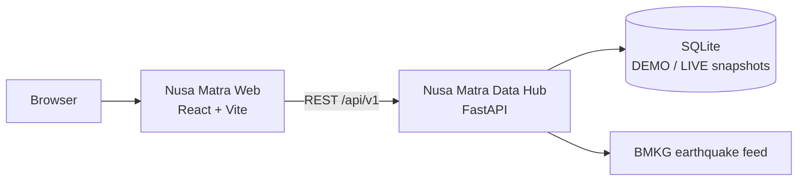

<div align="center">

# 🗺️ Nusa Matra Data Hub
### *National Geographic Decision-Support Engine & Unified Data Hub (WIA 2026)*

Backend API geospasial terintegrasi penyedia data 30 indikator publik (33 baris warehouse; 3 indikator restricted di-retire) pembangunan, kebencanaan, infrastruktur, dan pemantauan gempa bumi *real-time* BMKG untuk 514 Kabupaten/Kota dan 38 Provinsi di Indonesia.

**Frontend resmi:** [masean24/NusaMatra](https://github.com/masean24/NusaMatra) — React 19 + TypeScript + Vite, mengonsumsi API ini melalui `/api/v1`.

[](https://api.orangkeren.me)
[](https://github.com/masean24/NusaMatra)
[-brightgreen.svg?style=for-the-badge&logo=pytest&logoColor=white)](tests/)

[](https://fastapi.tiangolo.com)
[](https://www.python.org/)
[](https://docs.pydantic.dev/)
[](https://www.sqlite.org/)
[](https://data.bmkg.go.id)
[](https://api.orangkeren.me/docs)

---

[🚀 Status Produksi](#-status-produksi--deployment) •
[🔗 Ekosistem & Integrasi Frontend](#-ekosistem--integrasi-frontend) •
[📌 Ringkasan Eksekutif](#-ringkasan-eksekutif) •
[🏛️ Sumber Data Pemerintah](#-katalog-sumber-data-pemerintah-6-instansi) •
[🌋 Integrasi Real-Time BMKG](#-integrasi-pemantauan-gempa-bumi-real-time-bmkg) •
[⚙️ Keunggulan Teknis](#-keunggulan-teknis--engineering-excellence) •
[🧪 Panduan Uji Coba Cepat](#-panduan-uji-coba-cepat-dewan-juri) •
[📖 Dokumentasi Interaktif](#-dokumentasi-interaktif-api)

---

</div>

## 🚀 Status Produksi & Deployment

Nusa Matra Data Hub telah **aktif secara live di production** dengan SSL terenkripsi, CDN caching, dan dual runtime environment (DEMO & Official LIVE):

- 🌐 **Base Production URL:** [`https://api.orangkeren.me`](https://api.orangkeren.me)
- 🌟 **Interactive Scalar API Reference:** [`https://api.orangkeren.me/docs`](https://api.orangkeren.me/docs) *(atau [`/scalar`](https://api.orangkeren.me/scalar))*
- 📖 **Formal ReDoc Schema View:** [`https://api.orangkeren.me/redoc`](https://api.orangkeren.me/redoc)
- 📄 **OpenAPI 3.1 JSON Specification:** [`https://api.orangkeren.me/openapi.json`](https://api.orangkeren.me/openapi.json)

---

## 🔗 Ekosistem & Integrasi Frontend

Repo ini adalah **backend/Data Hub**. Antarmuka pengguna berada di repo terpisah dan tidak diimplementasikan di sini.

| Komponen | Repo | Stack | Peran |
|---|---|---|---|
| **Nusa Matra Data Hub** | repo ini | FastAPI + SQLite (DEMO/LIVE) | API, snapshot immutable, composite query, boundary, BMKG |
| **Nusa Matra Web** | [masean24/NusaMatra](https://github.com/masean24/NusaMatra) | React 19 + TypeScript + Vite | Landing, Jelajahi, Bandingkan, Lab Prioritas |



### Menjalankan backend + frontend secara lokal

**1. Backend** (dari root repo ini):

```bash
pip install -r requirements.txt
uvicorn app.main:app --reload --port 8000
```

Cek: `http://localhost:8000/api/v1/health`

**2. CORS lokal** — `localhost` sudah diizinkan oleh regex, tetapi tetap bisa eksplisit:

```env
NM_CORS_ORIGINS=http://localhost:5173,http://127.0.0.1:5173
```

**3. Frontend**:

```bash
git clone https://github.com/masean24/NusaMatra.git
cd NusaMatra
npm install
```

Buat `.env.local`:

```env
VITE_DATA_MODE=live
VITE_API_BASE_URL=http://localhost:8000
```

> `VITE_API_BASE_URL` berisi **origin saja**, bukan `http://localhost:8000/api/v1`.
> Frontend menambahkan `/api/v1` sendiri dan akan membuang suffix `/api/v1` jika tidak sengaja dimasukkan.

Jalankan:

```bash
npm run dev
```

Buka `http://localhost:5173`.

### Konfigurasi production

Backend (Coolify):

```env
NM_ENABLE_LIVE_MODE=true
NM_CORS_ORIGINS=https://domain-frontend-production
```

Frontend (Coolify build argument):

```env
VITE_DATA_MODE=live
VITE_API_BASE_URL=https://api.orangkeren.me
```

Tanpa trailing slash. Origin frontend harus sama persis dengan yang ada di `NM_CORS_ORIGINS`.

### Kontrak yang dipakai frontend

- [`docs/FRONTEND_HANDOFF_V2_4.md`](docs/FRONTEND_HANDOFF_V2_4.md) — error envelope, `boundary_version`, snapshot aktif, rate limit, arah persentil.
- [`docs/staging_samples/contract_v2_4/`](docs/staging_samples/contract_v2_4/) — fixture JSON untuk tes kontrak FE.
- `GET /api/v1/health` — health check.
- `GET /docs`, `/redoc`, `/openapi.json` — referensi API.
- `meta.score_direction = "higher_is_need"` — persentil dan skor tinggi berarti kebutuhan intervensi lebih tinggi.
- `data[].is_active_default` — penanda snapshot aktif; tidak ada field `status`/`is_active`.
- Error `422`/`404`/`429` memakai envelope `{status, code, message, detail?}`.

---

## 📌 Ringkasan Eksekutif

Dalam perencanaan pembangunan dan mitigasi kebencanaan nasional, pengambil kebijakan kerap terhambat oleh **fragmentasi data (*data silos*)**: data kemiskinan berada di BPS, risiko bencana di BNPB, fasilitas pendidikan di Kemendikdasmen, prevalensi stunting di Kemenkes, batas peta wilayah di BIG/Kemendagri, dan peringatan gempa di BMKG. Sistem pengkodean wilayah antar-instansi pun kerap berbeda (kode titik Kemendagri `32.01` vs kode numerik BPS `3201`).

**Nusa Matra Data Hub** hadir sebagai **lapisan agregasi data dan mesin pendukung keputusan geospasial (*decision-support backend engine*)** yang:
1. **Menyelaraskan Kode Wilayah (*Cross-Agency Code Bridging*)** untuk 514 Kabupaten/Kota dan 38 Provinsi (termasuk 4 provinsi baru Papua).
2. **Menyajikan 33 Indikator Pembangunan Strategis** dalam format kamus ringkas `values_by_region` (*sub-10ms response time*). Snapshot LIVE saat ini memuat **29 indikator berdata** (mayoritas 514/514 kab/kota; frekuensi bencana 510/514). Empat indikator sisanya ditandai `UNAVAILABLE`: 2 memang tidak tersedia publik, 2 menunggu akses Dapodik sync dan microdata Podes tingkat kab/kota.
3. **Dynamic Composite Query Engine berbasis Integer Basis-Points (10.000 bps = 100%)** dengan **Automatic Fair Renormalization** global dan **coverage gate per wilayah**: missing data tidak pernah dihitung nol, wilayah dengan cakupan bobot di bawah ambang dipindahkan ke `insufficient_data`.
4. **Pemantauan Gempa Bumi *Real-Time* BMKG** dengan output GeoJSON (RFC 7946) lengkap dengan radius visual 3D, kedalaman hiposenter, dan status potensi tsunami.
5. **Dual Architecture (DEMO vs LIVE Mode)** dengan prinsip integritas tinggi (*Fail-Closed Architecture*).
6. **Immutable Snapshot v2.2:** setiap perubahan data menghasilkan ID baru `2026.10.0-live-<sha16>` dan `content_sha256` kanonik. Snapshot lama tidak ditimpa; `2026.10.0-official-live` ditandai `is_reproducible: false` karena ID-nya pernah dipakai ulang. Lihat `docs/SNAPSHOT_VERSIONING_V2_2.md`.

---

## 🏛️ Katalog Sumber Data Pemerintah (6 Instansi)

Backend mengintegrasikan data terverifikasi dari 6 kementerian dan lembaga resmi Republik Indonesia:

| Instansi | Jenis Data Terintegrasi | Cakupan Wilayah | Status di Hub |
|---|---|---|---|
| **Badan Informasi Geospasial (BIG)** | Batas administrasi resmi polygon 2026 (Kepmendagri No. 300.2.2-2430) | 514 Kab/Kota & 38 Provinsi | ✅ Low & High Resolution GeoJSON |
| **Badan Pusat Statistik (BPS)** | 11 indikator sosial-ekonomi + 3 indikator infrastruktur SDGs | 514 Kab/Kota | ✅ WebAPI Resmi (Live Ingested) |
| **BNPB (InaRISK / IRBI 2024)** | Indeks Risiko Bencana Indonesia multi-hazard & spesifik | 514 Kab/Kota | ✅ IRBI 2024 Terbitan Resmi |
| **Kementerian Kesehatan (Kemenkes)** | Prevalensi stunting balita (Survei Status Gizi Indonesia 2024) | 514 Kab/Kota | ✅ SSGI 2024 Resmi |
| **Kemendikdasmen** | Jumlah sekolah & peserta didik (SD, SMP, SMA, SMK, SLB) | 514 Kab/Kota | ✅ Data Pokok Pendidikan 2026 |
| **BMKG** | Feed kejadian gempa bumi terkini, M ≥ 5.0, dan gempa dirasakan | Nasional Real-Time | ✅ Auto-Feed dengan Cache TTL 60s |

---

## 🌋 Integrasi Pemantauan Gempa Bumi Real-Time BMKG

Nusa Matra menyediakan 5 endpoint khusus pemantauan seismik nasional dari feed terbuka BMKG (`data.bmkg.go.id`):

- `GET /api/v1/earthquakes/latest` — Informasi gempa bumi paling mutakhir dipublikasikan BMKG.
- `GET /api/v1/earthquakes/recent` — 15 kejadian gempa bumi berkekuatan M ≥ 5.0.
- `GET /api/v1/earthquakes/felt` — 15 kejadian gempa bumi yang dirasakan masyarakat (disertai skala intensitas MMI).
- `GET /api/v1/earthquakes/geojson` — Fitur GeoJSON Point standar (RFC 7946) hasil *deduplication* yang diperkaya atribut visual 3D:
  - `visual_radius_px`: Ukuran radius dinamis berdasarkan magnitudo.
  - `visual_color`: Kode warna hex gradien urgensi (`#ef4444`, `#f97316`, `#eab308`, `#3b82f6`).
  - `depth_km`, `tsunami_risk`, `felt_mmi`, `shakemap_url`.
- `GET /api/v1/earthquakes/summary` — Ringkasan analitik seismik nasional dan status cache upstream.

> [!TIP]
> **Kebijakan Caching & Fail-Closed Upstream:**  
> Endpoint gempa menggunakan in-memory cache dengan TTL 60 detik (`Cache-Control: no-cache, must-revalidate, max-age=0`). Jika server BMKG mengalami gangguan saat request `mode=live`, endpoint bersikap **fail-closed** (HTTP 503) dengan penanda `data_origin`, bukan menyamarkan data simulasi sebagai gempa resmi.

---

## ⚙️ Keunggulan Teknis & Engineering Excellence

### 1. Integer Basis Points, Semantik Kanonik & Coverage Gate (BE-01 & BE-08)
Perhitungan skor komposit multivariat menggunakan integer **basis points (bps)** ($10.000\text{ bps} = 100\%$):
$$\text{Composite Score} = \sum_{i=1}^{n} \left( \text{Normalized Score}_i \times \frac{\text{Effective Weight}_i}{10000} \right)$$
- Menolak bobot negatif, bobot kosong `{}`, dan bobot melebihi batas (HTTP 422).
- **Semantik kanonik:** `score_direction: "higher_is_need"`. Skor 100 selalu berarti paling rentan/paling butuh intervensi, konsisten di DEMO maupun LIVE.
- **Global renormalization:** indikator yang kosong secara nasional dikeluarkan dan bobot sisanya diskalakan ke 10.000 bps (`renormalized: true`).
- **Coverage gate per wilayah:** wilayah dengan cakupan bobot ≥70% dan minimal 2 komponen diranking menggunakan `effective_weights_region`. Wilayah di bawah ambang dikembalikan di `insufficient_data` dan **tidak** diranking. Missing tidak pernah dihitung sebagai nol.
- `rank` adalah posisi dalam hasil filter; `national_rank` adalah posisi se-Indonesia.
- **Data resmi kab/kota:** air minum layak dan sanitasi layak ditarik langsung dari BPS WebAPI 2025 (var 2830 & 2748) melalui `scripts/fetch_bps_sdgs_kabkota.py`; provenance dan checksum tersimpan di `data/bps_kabkota_water_sanitation_2025.provenance.json`.

### 2. Transparansi Cakupan Data (BE-03)
- Setiap endpoint nilai menyertakan blok `meta.coverage` lengkap dengan jumlah wilayah yang memiliki data, total 514 wilayah, dan daftar `missing_region_ids`.
- Endpoint `GET /api/v1/indicators/coverage` menyajikan status ketersediaan seluruh indikator dalam satu panggilan ringan agar klien peta 3D dapat menonaktifkan layer yang kosong tanpa query berulang.
- Setiap region pada composite query menyertakan `coverage_pct`, `components_used`, `missing_indicators`, `effective_weights_region`, dan `quality_flags`.

### 3. Standarisasi Skema Amplop Respons
Semua respons terstruktur konsisten dengan generic envelope `ApiResponse[T]`:
```json
{
  "status": "success",
  "meta": {
    "snapshot_id": "2026.10.0-live-<content-sha16>",
    "mode": "LIVE",
    "content_sha256": "<64-char canonical dataset digest>",
    "snapshot_immutable": true,
    "snapshot_reproducible": true,
    "score_direction": "higher_is_need",
    "boundary_version": "BIG-20260601",
    "total_count": 514,
    "coverage": {
      "available": 487,
      "total_regions": 514,
      "missing_region_ids": [],
      "mode": "LIVE"
    }
  },
  "data": { ... }
}
```

---

## 🧪 Panduan Uji Coba Cepat (Live Production cURL)

Anda dapat menguji langsung API production di `https://api.orangkeren.me` tanpa instalasi lokal:

### 1. Mengambil Feed GeoJSON Gempa BMKG Siap Render 3D
```bash
curl -s "https://api.orangkeren.me/api/v1/earthquakes/geojson" | head -c 500
```

### 2. Simulasi Formula Prioritas Kebijakan (*Dynamic Composite Query*)
Menghitung prioritas wilayah (Bencana 35% + Kemiskinan 25% + Ruang Rusak 20% + Stunting 20% = 10.000 bps):
```bash
curl -X POST "https://api.orangkeren.me/api/v1/indicators/composite-query?mode=live" \
     -H "Content-Type: application/json" \
     -d '{
       "weights": {
         "dis_multihazard_index": 3500,
         "soc_poverty_rate": 2500,
         "edu_damaged_classrooms_pct": 2000,
         "hlt_stunting_prevalence": 2000
       }
     }'
```

### 3. Cek Ketersediaan Indikator (Coverage Matrix)
```bash
curl -s "https://api.orangkeren.me/api/v1/indicators/coverage?mode=live"
```

### 4. Menjalankan Pengujian Lokal
```powershell
# Clone dan buka repository
cd d:\wia2

# Install dependensi
pip install -r requirements.txt

# Jalankan 165 unit tests
python -m pytest -v
```
*(Hasil: **165 passed**).*

---

## 📖 Dokumentasi Interaktif API

- **🌟 Scalar Interactive Reference:** [https://api.orangkeren.me/docs](https://api.orangkeren.me/docs)
  - Layout 3-kolom modern dengan live request playground, syntax highlighter, dan contoh kode multi-bahasa (cURL, Python, JS, dll).
- **📖 ReDoc Formal Schema:** [https://api.orangkeren.me/redoc](https://api.orangkeren.me/redoc)
- **📄 Raw OpenAPI Specification:** [https://api.orangkeren.me/openapi.json](https://api.orangkeren.me/openapi.json)

---

<div align="center">

**Nusa Matra Data Hub — Wilayah Indonesia (WIA) 2026**  
*Membangun Fondasi Pengambilan Keputusan Geospasial yang Terukur, Transparan, dan Tepercaya untuk Indonesia.*

Backend: repo ini · Frontend: [masean24/NusaMatra](https://github.com/masean24/NusaMatra)

</div>
