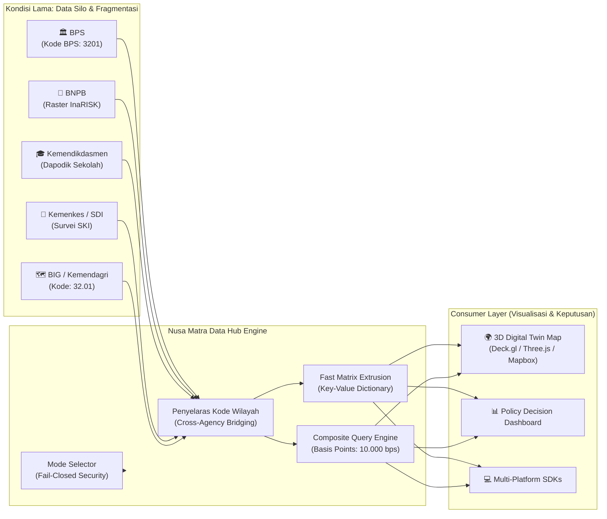

<div align="center">

# 🗺️ Nusa Matra Data Hub
### *National Geographic Decision-Support Engine & Unified Data Hub (WIA 2026)*

Backend API geospasial terintegrasi penyedia data 33 indikator pembangunan, kebencanaan, dan infrastruktur lintas-kementerian untuk 514 Kabupaten/Kota dan 38 Provinsi di Indonesia.

[](https://fastapi.tiangolo.com)
[](https://www.python.org/)
[](https://docs.pydantic.dev/)
[](https://www.sqlite.org/)
[-brightgreen.svg?style=flat&logo=pytest&logoColor=white)](tests/)
[]()
[](#-dokumentasi-interaktif-api)

---

[Ringkasan Eksekutif](#-ringkasan-eksekutif) •
[Masalah & Solusi](#-latar-belakang-masalah--solusi-inovatif) •
[Sumber Data Resmi](#-katalog-sumber-data-pemerintah-33-indikator) •
[Keunggulan Teknis](#-keunggulan-teknis--engineering-excellence) •
[Panduan Uji Juri](#-panduan-uji-coba-cepat-dewan-juri) •
[Dokumentasi Teknis](#-arsitektur--spesifikasi-teknis)

---

</div>

## 📌 Ringkasan Eksekutif

Dalam perencanaan pembangunan dan penanggulangan bencana nasional, pembuat kebijakan sering kali menghadapi kendala **fragmentasi data (*data silos*)**: data kemiskinan berada di BPS, risiko bencana di BNPB, fasilitas pendidikan di Kemendikdasmen, stunting di Kemenkes, dan batas batas peta wilayah di BIG/Kemendagri. Lebih parah lagi, sistem pengkodean wilayah antar-instansi sering tidak sinkron (misal kode titik Kemendagri `32.01` vs kode numerik BPS `3201`).

**Nusa Matra Data Hub** hadir sebagai **lapisan data agregasi dan mesin pendukung keputusan geospasial (*decision-support backend engine*)** yang:
1. **Menyatukan kode wilayah (*Bridging Master Code*)** seluruh 514 Kabupaten/Kota dan 38 Provinsi.
2. **Menyajikan 33 indikator pembangunan strategis** dalam 6 dimensi utama secara instan (*sub-10ms response time*).
3. **Menyediakan Dynamic Composite Query Engine berbasis integer basis-points**, memungkinkan simulasi pembobotan prioritas wilayah secara *real-time* tanpa risiko pembulatan pecahan (*zero floating-point drift*).
4. **Menerapkan Prinsip Integritas Data Tinggi (*Fail-Closed Architecture*)**: Menolak dengan tegas penyamaran data tiruan sebagai data live.

---

## 🎯 Latar Belakang Masalah & Solusi Inovatif



### Tabel Perbandingan Arsitektur

| Aspek | Kondisi Umum Saat Ini | Nusa Matra Data Hub |
|---|---|---|
| **Penyelarasan Wilayah** | Inkonsistensi format kode (rawan salah gabung baris data) | Master bridging terpadu Kemendagri, BPS, dan Kemendikdasmen untuk 514 Kab/Kota. |
| **Kalkulasi Komposit** | Hitung manual di spreadsheet atau di sisi klien (rawan floating drift) | Algoritma server-side berbasis **integer basis points** (sum = 10.000 bps / 100%). |
| **Kecepatan untuk Peta 3D** | Query berat lambat, respons array panjang | Format kamus ringkas `values_by_region` dengan respons <10ms untuk ekstrusi instan 514 wilayah. |
| **Integritas Data LIVE** | Sering kali simulasi pura-pura diklaim sebagai live data | **Fail-closed**: Permintaan LIVE yang belum terverifikasi otomatis ditolak (HTTP 503) demi kejujuran data. |
| **Titik Fokus Kamera 3D** | Menggunakan centroid geometris polos (sering jatuh di laut untuk kab. kepulauan) | Menggunakan **Anchor Point Daratan** yang diverifikasi di darat untuk penerbangan kamera 3D yang akurat. |

---

## 🏛️ Katalog Sumber Data Pemerintah (33 Indikator)

Data dikelompokkan ke dalam **6 Kategori Strategis** dari 5 kementerian dan lembaga resmi:

```
┌────────────────────────────────────────────────────────────────────────┐
│                   33 INDIKATOR NUSA MATRA DATA HUB                     │
├──────────────────┬──────────────────┬──────────────────┬───────────────┤
│ 🌋 Bencana (6)   │ 👥 Sosial-Ek (6) │ 🎓 Edukasi (5)   │ 🏥 Medis (5)  │
├──────────────────┼──────────────────┼──────────────────┼───────────────┤
│ • IRBI Multi     │ • Kemiskinan P0  │ • Angka RLS      │ • UHH         │
│ • Bahaya Banjir  │ • Kemiskinan P2  │ • Harapan RLS    │ • Stunting    │
│ • Bahaya Gempa   │ • IPM (HDI) Baru │ • APM SMP & SMA  │ • Rasio RS    │
│ • Bahaya Longsor │ • Pengeluaran/Kap│ • Rasio Murid/Gu │ • Rasio Nakes │
│ • Frekuensi (5Th)│ • PengangguranTPT│ • Ruang Rusak    │ • Cakupan JKN │
│ • Jiwa Terdampak │ • Dependency Ras │                  │               │
├──────────────────┴──────────────────┴──────────────────┴───────────────┤
│ ⚡ Infrastruktur (5): Air Bersih, Sanitasi, Listrik, Internet, Akses Jalan│
│ 📡 Data Reliability (4): Kelengkapan, Lag Data, Kepatuhan Dapodik, Flag│
└────────────────────────────────────────────────────────────────────────┘
```

> [!NOTE]  
> **Prinsip Transparansi & Kepatuhan Hukum:**  
> Dari 33 indikator yang dirancang, **31 indikator aktif dan tersedia**. Sebanyak **2 indikator** secara tegas dideklarasikan sebagai `UNAVAILABLE`:
> 1. *Waktu Tempuh Rumah-ke-Sekolah per Siswa*: Data titik alamat siswa dilindungi oleh **UU No. 27 Tahun 2022 tentang Perlindungan Data Pribadi (UU PDP)**.
> 2. *Ketersediaan Bed ICU Real-Time*: API SATUSEHAT Kemenkes mensyaratkan izin OAuth2 fasyankes berlisensi, bukan statistik terbuka agregat publik.

---

## ⚙️ Keunggulan Teknis & Engineering Excellence

### 1. Integer Basis Points Composite Algorithm
Perhitungan skor komposit multivariat menggunakan integer **basis points (bps)**, di mana $10.000\text{ bps} = 100\%$:
$$\text{Composite Score} = \sum_{i=1}^{n} \left( \text{Normalized Score}_i \times \frac{\text{Weight}_i}{10000} \right)$$
- Mencegah galat akumulasi pecahan (*IEEE-754 floating-point inaccuracies*).
- Sistem memvalidasi bahwa total bobot harus tepat **10.000**, jika tidak validasi HTTP 422 akan langsung memberikan penjelasan mendalam.

### 2. Arsitektur Fail-Closed & Header Audit
Jika klien meminta header `X-Data-Mode: LIVE` atau parameter `?mode=live` sebelum sumber terverifikasi resmi terhubung:
- API **TIDAK PERNAH** secara diam-diam menggantinya dengan data simulasi.
- API mengembalikan **HTTP 503 Service Unavailable** dengan kode `LIVE_UNAVAILABLE` dan header audit:
  - `X-NusaMatra-Mode: LIVE`
  - `X-Data-Fallback: UNAVAILABLE`

### 3. Skema Data Terstandarisasi Pydantic Generic Envelope
Semua endpoint membungkus respons dengan amplop konsisten dan ter-tipe kuat (`ApiResponse[T]`):
```json
{
  "status": "success",
  "meta": {
    "snapshot_id": "2026.10.0-wia-demo",
    "mode": "DEMO",
    "boundary_version": "BIG-Kepmendagri-300.2.2-2430-2025",
    "total_count": 514
  },
  "data": { ... }
}
```

---

## 🧪 Panduan Uji Coba Cepat Dewan Juri

### 1. Menjalankan Server Lokal (1 Menit)
```powershell
# Clone dan buka repository
cd d:\wia2

# Install dependensi
pip install -r requirements.txt

# Jalankan server
python -m uvicorn app.main:app --reload --port 8000
```

### 2. Menjalankan Suite Pengujian Otomatis
Seluruh 54 unit tests mencakup validasi batas, header fail-closed, bobot komposit, dan skema:
```powershell
python -m pytest -v
```
*(Hasil: **54 passed** dalam ~1-2 detik).*

---

### 3. Skenario Uji Coba Langsung (Live cURL Examples)

#### Skenario A: Mengambil Profil Lengkap Kabupaten Bogor (`3201`)
Melihat data indikator, skor per domain, dan bridging kode Kemendagri & BPS:
```bash
curl -X GET "http://127.0.0.1:8000/api/v1/regions/3201" -H "Accept: application/json"
```

#### Skenario B: Simulasi Formula Prioritas Tertimbang (*Dynamic Composite Query*)
Menghitung prioritas intervensi daerah berisiko tinggi (Bencana 35% + Kemiskinan 25% + Ruang Rusak 20% + Stunting 20% = 100% / 10.000 bps):
```bash
curl -X POST "http://127.0.0.1:8000/api/v1/indicators/composite-query" \
     -H "Content-Type: application/json" \
     -d '{
       "weights": {
         "dis_multihazard_index": 3500,
         "soc_poverty_rate": 2500,
         "edu_damaged_classrooms_pct": 2000,
         "hlt_stunting_prevalence": 2000
       }
     }'
```
*Hasil: Peringkat otomatis ke-514 Kabupaten/Kota dari prioritas tertinggi ke terendah.*

#### Skenario C: Menguji Integritas Fail-Closed (Mode LIVE)
Membuktikan bahwa API menolak pemalsuan data tiruan:
```bash
curl -i -X GET "http://127.0.0.1:8000/api/v1/health?mode=live"
```
*Hasil: HTTP 503 dengan kode `LIVE_UNAVAILABLE` dan `X-Data-Fallback: UNAVAILABLE`.*

---

## 📖 Dokumentasi Interaktif API

Server menyertakan antarmuka dokumentasi modern bertenaga **Scalar**:
- **🌟 Interactive API Reference (Scalar):** [http://127.0.0.1:8000/api/v1/docs](http://127.0.0.1:8000/api/v1/docs) *(atau [http://127.0.0.1:8000/docs](http://127.0.0.1:8000/docs))*
  - Layout 3-kolom modern ala Vercel / Linear dengan tema gelap eksklusif (*deepSpace*).
  - Dilengkapi live interactive request playground, syntax highlighter, pencarian cepat (`Ctrl+K`), dan contoh kode instan multi-bahasa (cURL, JavaScript, Python, Go, dll).
- **📖 ReDoc (Formal Schema View):** [http://127.0.0.1:8000/api/v1/redoc](http://127.0.0.1:8000/api/v1/redoc) *(atau [http://127.0.0.1:8000/redoc](http://127.0.0.1:8000/redoc))*
  - Format dokumentasi formal ala buku panduan standar data kementerian.
- **📄 OpenAPI 3.1 JSON Specification:** [http://127.0.0.1:8000/api/v1/openapi.json](http://127.0.0.1:8000/api/v1/openapi.json)

> [!TIP]  
> **Keamanan Lingkungan Produksi:**  
> Dokumentasi dapat disembunyikan sepenuhnya di production dengan menyetel variabel lingkungan `ENABLE_DOCS=false`.

---

## 📁 Struktur Repositori yang Tertata

```
d:\wia2\
├── app/
│   ├── middleware/          # ModeSelector (Fail-Closed, Header Injection)
│   ├── models/              # Pydantic v2 Type Envelopes & Schemas
│   ├── routers/             # Endpoint handlers: regions, indicators, boundaries, dll.
│   ├── services/            # Logika bisnis: Composite, Indicators, Regions, Snapshots
│   ├── static/              # Asset branding resmi (favicon.ico & favicon.png)
│   ├── config.py            # Konfigurasi aplikasi via pydantic-settings
│   ├── database.py          # Koneksi database aiosqlite asinkron
│   └── main.py              # Inisialisasi FastAPI & lifecycle management
├── data/
│   ├── INDICATOR_MAPPING.csv# Katalog 33 indikator pembangunan resmi
│   ├── nusa_matra_demo.db   # SQLite DB: 552 wilayah, 13 dataset, 15.934 fakta
│   └── seed_db.py           # Generator deterministik database demo
├── docs/                    # Dokumentasi riset & spesifikasi teknis
│   ├── API_CONTRACT_DRAFT.md
│   ├── DATASET_CATALOG.md
│   ├── DATA_HUB_ARCHITECTURE.md
│   ├── DATA_SOURCE_VERIFICATION.md
│   ├── GEOGRAPHY_AND_REGION_CODES.md
│   ├── GOVERNMENT_DATA_SOURCES.md
│   ├── IMPLEMENTATION_ROADMAP.md
│   ├── Nusa-Matra-API-Integration-Audit.md
│   └── REVIEW_AND_BLOCKERS.md
├── migrations/
│   └── 001_init_schema.sql  # Skema tabel star-schema geospasial
├── tests/                   # 54 Automated Pytest Suite
│   ├── test_audit_requirements.py
│   ├── test_boundaries_and_meta.py
│   ├── test_composite.py
│   ├── test_health.py
│   ├── test_indicators.py
│   └── test_regions.py
├── pyproject.toml           # Standar dependensi modern PEP 621
├── requirements.txt         # Daftar paket pip
├── Dockerfile               # Konfigurasi containerized deployment
└── README.md                # Dokumentasi utama proyek
```

---

## 📚 Arsitektur & Spesifikasi Teknis

Dokumen rancangan teknis mendalam tersimpan rapi di folder [`docs/`](docs/):
- [`docs/DATASET_CATALOG.md`](docs/DATASET_CATALOG.md): Daftar 13 dataset resmi dari BPS, BNPB, Kemendikbud, Kemenkes, dan BIG.
- [`docs/GOVERNMENT_DATA_SOURCES.md`](docs/GOVERNMENT_DATA_SOURCES.md): Rincian integrasi endpoint WebAPI BPS, CKAN BNPB, dan SDI.
- [`docs/REVIEW_AND_BLOCKERS.md`](docs/REVIEW_AND_BLOCKERS.md): Dokumentasi penyelesaian 9 audit blocker arsitektural.
- [`docs/GEOGRAPHY_AND_REGION_CODES.md`](docs/GEOGRAPHY_AND_REGION_CODES.md): Standarisasi kode wilayah Kepmendagri No. 300.2.2-2430 Tahun 2025.

---

<div align="center">

**Nusa Matra Data Hub — Wilayah Indonesia (WIA) 2026**  
*Membangun Fondasi Pengambilan Keputusan Geospasial yang Terukur, Transparan, dan Tepercaya untuk Indonesia.*

</div>
