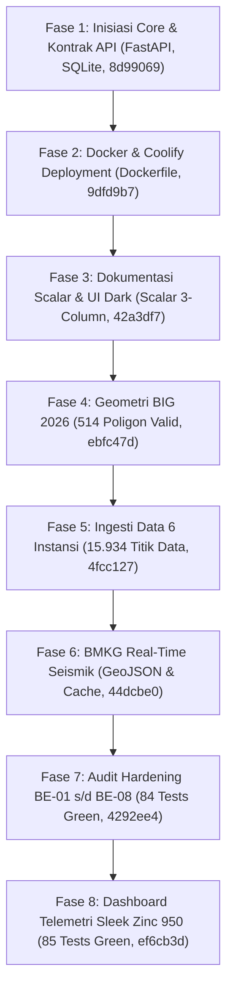

# 📋 SESSION HANDOFF: Nusa Matra Data Hub

> **Project:** Nusa Matra Data Hub — Geographic Decision-Support Backend API  
> **Target Event:** WIA (World Innovation Award) 2026  
> **Repository:** `d:\wia2`  
> **Production Domain:** `api.orangkeren.me`  
> **Active Branch:** `main` (v2.2 integrity remediation, 134/134 Pytest Green, commit `6141749`)
> **Author/Maintainer:** Antigravity AI Pair Programmer & Raihan  
> **Date Generated:** 24 Oktober 2026 (updated after v2.2 integrity remediation)  

---

## 0. Remediation v2.2 — Integrity, Immutable Snapshots, Telemetry (24 Oktober 2026)

Commit: **`6141749`** (`fix: enforce v2.2 data integrity and reliable telemetry`), sudah di-push ke `origin/main`.

1. **Normalisasi Lanny Jaya (`9507`)**
   - Root cause: dua batch seeding membuat baris `IMPUTED_PROVINCE` lama tertinggal saat batch VERIFIED menimpa metadata bounds.
   - Fix: satu himpunan nilai kanonik per indikator, normalisasi sekali, hapus baris snapshot lama sebelum insert.
   - `inf_safe_water_pct` `9507`: raw `32.89`, normalized **100.0 → 78.89**, flag tetap `IMPUTED_PROVINCE`, provenance `bps_provincial_sdgs_2025` (legacy BPS `9700`, PAPUA PEGUNUNGAN).
   - Composite `kemiskinan_stunting`: **84.40 → 80.18**, rank **2 → 3** (lokal).
   - Audit 14.745 observasi: 0 mismatch normalisasi, 0 duplikat.

2. **Snapshot immutable**
   - ID baru: `2026.10.0-live-<16 hex content_sha256>`.
   - `content_sha256` kanonik mencakup observations, snapshot indicator metadata, region catalog, dataset catalog, reference periods, dan scoring config.
   - `metadata_checksum` terpisah; `manifest_checksum` legacy bukan content digest.
   - Pin snapshot: `snapshot=<id>` atau `snapshot_id=<id>`. Unknown snapshot → 404, tanpa fallback.
   - `GET /api/v1/snapshots/{id}` menyediakan metadata + digest.
   - `2026.10.0-official-live` ditandai `is_immutable: false`, `is_reproducible: false` bila masih ada.
   - Snapshot lokal final: `2026.10.0-live-62354dfad392d985`.

3. **Coverage konsisten**
   - `indicator_completeness_pct` = **29/33 = 87.9** (bukan 100).
   - `available_indicator_data_pct` = 29/29 = 100.
   - `meta.coverage.available` = cakupan wilayah (514); hitungan indikator ada di `meta.indicator_coverage`.
   - `region_count` = 514, `region_coverage_pct` = 100.

4. **Composite contract hardening**
   - `composite-query` mengembalikan `rankable`, `not_rankable_reason`, `national_coverage_pct`, `available_weight_basis_points`, `available_indicators`.
   - Skenario tidak rankable → `regions: []`, bukan ranking palsu.
   - `coverage_pct` per wilayah memakai bobot asli yang diminta; `effective_weights_region` tetap 10.000 bp untuk wilayah eligible.
   - `rank` dan `national_rank` tetap terpisah; `score_direction` tetap `higher_is_need`.

5. **Telemetry reliability**
   - Filter route-regex di production hanya cocok untuk `/api/v1/openapi.json`, sehingga semua request API nyata tidak tercatat dan counter tampak 0.
   - Fix: whitelist prefix API eksplisit (`regions`, `indicators`, `boundaries`, `datasets`, `snapshots`, `earthquakes`), exclude openapi/health/stats/scanner.
   - `STATE_VERSION = 3`: counter lama di-reset sekali saat deploy; `first_started_at` dipertahankan.
   - Waktu tetap WIB (`Asia/Jakarta`).

6. **Dokumentasi**
   - `docs/INTEGRITY_FIX_V2_2.md`
   - `docs/SNAPSHOT_VERSIONING_V2_2.md`
   - `docs/FRONTEND_HANDOFF_V2_2.md`
   - Update: README, PANDUAN integrasi frontend, GOVERNMENT_DATA_SOURCES, TELEMETRY_PERSISTENCE_COOLIFY.

**Verifikasi:** `python -m pytest -q` → **134 passed**. Production belum diverifikasi ulang setelah commit ini; jangan klaim production verified sebelum redeploy dan post-deploy checklist dijalankan.

---

## 0.1. Remediation v2.1 — Data Integrity & Ranking Validity (23 Oktober 2026)

Perbaikan ini menutup tiga blocker yang ditemukan pada audit ranking LIVE:

1. **Crosswalk wilayah deterministik**
   - Modul baru `app/services/crosswalk_service.py` memetakan baris sumber berdasarkan **nama + level + prefix provinsi**, bukan `bps_code` saja.
   - Alasan: kode BPS lama bertabrakan dengan kode Kemendagri 2026 (contoh CSV `9501` = Merauke, sedangkan 2026 `9501` = Jayawijaya).
   - Hasil: **514/514 kab/kota tercakup**, 26 wilayah memiliki multi-vintage yang digabung per indikator, 0 unmatched/ambiguous.
   - Kontaminasi kota kembar hilang: `3201` Kab. Bogor = HDI 72.39; `3271` Kota Bogor = HDI 78.52.
   - `national_rank` maksimum = 514 (sebelumnya 538).

2. **Semantik skor kanonik**
   - `normalized_score` 100 = **paling rentan / paling butuh intervensi** di DEMO dan LIVE (`score_direction: "higher_is_need"`).
   - Seeder LIVE diperbaiki; sebelumnya arah LIVE terbalik dari DEMO.
   - Percentile DEMO diperbaiki agar konsisten dengan rank.

3. **Composite ranking valid**
   - Missing per wilayah **tidak lagi dihitung nol**.
   - Global renormalization tetap untuk indikator kosong nasional.
   - Coverage gate per wilayah: ≥70% bobot dan minimal 2 komponen; bobot komponen yang ada diskalakan ulang ke 10.000 bps per wilayah.
   - Wilayah di bawah ambang masuk `insufficient_data`, tidak diranking.
   - Response menyertakan `coverage_pct`, `components_used`, `missing_indicators`, `effective_weights_region`, `quality_flags`, `national_rank`, `rank`.
   - Preset menyertakan `availability` dan `rankable`.

4. **Data resmi tambahan**
   - `scripts/fetch_bps_sdgs_kabkota.py`: BPS var 2830 & 2748 (air minum & sanitasi kab/kota, 2025) → 513 `VERIFIED` masing-masing.
   - APM SMP & SMA/SMK dari publikasi resmi Kemendikdasmen Pusdatin 2024/2025 → **514/514** wilayah.
   - Frekuensi kejadian bencana 2020–2024 dari BNPB DIBI (CKAN Datastore) → **510/514** wilayah (4 wilayah tidak ada di dataset).
   - Rasio ketergantungan dari BPS Proyeksi Penduduk SP2020 2026 (var 2790) → **514/514** wilayah.
   - Akses internet rumah tangga (BPS 2024), JKN (BPS 2025), dan penduduk terdampak bencana per 10.000 (BNPB 2024) → **province-imputed**, seluruhnya ditandai `IMPUTED_PROVINCE`.
   - **Kemendikdasmen 2022/2023** (`scripts/build_kemendikdasmen_edu.py`): rasio murid-guru SD dan % ruang kelas rusak sedang/berat (SD+SMP) → **514/514 VERIFIED**.
   - **Kemenkes** (`scripts/build_kemenkes_health_access.py`): Puskesmas Semester II 2025 + daftar RS SIRS → `hlt_facilities_per_10k` **514/514 VERIFIED**; dokter per provinsi dari SATUSEHAT Data → `hlt_doctors_per_10k` **514/514 `IMPUTED_PROVINCE`**.
   - Semua provenance + SHA-256 tersimpan di file `*.provenance.json`; `inf_electrification_pct` tetap `IMPUTED_PROVINCE`.

5. **Telemetry persisten (v2.2)**
   - Counter dan `recent_requests` di-flush ke SQLite tiap 5 detik (`NM_TELEMETRY_FLUSH_INTERVAL_SECONDS`).
   - `uptime` sekarang = uptime layanan lintas redeploy; `process_uptime` terpisah.
   - Di Coolify: mount volume ke `/data`, set `NM_TELEMETRY_DB_PATH=/data/telemetry.db`.
   - Panduan lengkap: `docs/TELEMETRY_PERSISTENCE_COOLIFY.md`.
   - v2.3: hanya route API asli yang dihitung (probe scanner diabaikan), endpoint parameterized digabung per template, dan waktu tampil memakai WIB (`Asia/Jakarta`).

**Snapshot LIVE saat ini:** 14.745 observasi, **29 indikator berdata**, 514/514 wilayah. Empat indikator belum berdata: 2 `UNAVAILABLE` by design (travel time & ICU), `meta_dapodik_sync_rate` menunggu akses Dapodik, dan `inf_asphalt_road_village_pct` menunggu microdata Podes.

**Verifikasi:** `python -m pytest -q` → **134 passed**.

---

## 1. Executive Summary & Visi Proyek

**Nusa Matra Data Hub** adalah mesin backend geospasial dan sistem pendukung keputusan (*decision-support system*) berskala nasional yang dirancang khusus untuk memberi daya pada antarmuka peta 3D interaktif Nusa Matra.

Sistem ini menghubungkan **514 Kabupaten/Kota di 38 Provinsi Indonesia** dengan **33 indikator pembangunan multi-sektoral** yang bersumber dari **6 instansi resmi pemerintah Republik Indonesia**. Sistem dirancang dengan arsitektur **Dual-Runtime Mode (DEMO vs LIVE)** yang mematuhi standar *fail-closed* data integrity:
- **Mode `DEMO`:** Sandbox dataset terverifikasi (`2026.10.0-wia-demo`) untuk presentasi juri, testing deterministik, dan preview tanpa dependensi eksternal.
- **Mode `LIVE`:** Dataset resmi pemerintah dengan snapshot immutable berbasis digest (`2026.10.0-live-<sha16>`), di-resolve dari `GET /api/v1/snapshots?mode=live`. ID legacy `2026.10.0-official-live` tetap ada tetapi ditandai `is_reproducible: false`. Jika data hulu tidak dapat diakses atau database belum terverifikasi, sistem *fail-closed* (mengembalikan HTTP 503 tanpa pernah menyajikan data palsu/fallback terselubung).

---

## 2. Garis Waktu Evolusi Sistem (Dari Awal Sampai Sekarang)

Sistem dibangun secara iteratif melalui 28 commit terstruktur, melewati fase audit ketat hingga siap produksi:



### Rincian Fase Pembangunan:

1. **Fase 1 — Core Architecture & Contract Tests (`8d99069`, `1106104`)**
   - Inisiasi struktur FastAPI modular: `app/routers`, `app/models`, `app/services`, `app/middleware`.
   - Implementasi schema Pydantic v2 dengan wrapper seragam `ApiResponse[T]` dan `ResponseMeta` (`snapshot_id`, `mode`, `boundary_version`, `total_count`).
   - Pembuatan test suite perdana berbasis Pytest AsyncIO.

2. **Fase 2 — Dockerization & Infrastructure (`9dfd9b7`, `2a7ccf6`, `16fae73`)**
   - Konfigurasi `Dockerfile` multi-stage dan `docker-compose.yml` yang disesuaikan untuk platform Coolify.
   - Penataan middleware CORS agar mengizinkan origin lokal dan produksi (`api.orangkeren.me`), serta memastikan header CORS tetap terinjeksi meskipun request mengembalikan HTTP 503 (*fail-closed*).

3. **Fase 3 — Ultra-Modern Interactive Documentation (`42a3df7`, `9052051`, `fa8fa44`)**
   - Menggantikan Swagger biasa dengan **Scalar API Reference** interaktif yang terpasang di `/docs` dan `/scalar`.
   - Menggunakan tema `deepSpace` dengan 3-column split view dan code generator multi-bahasa.
   - Penyediaan custom Favicon resmi Nusa Matra di `/static/favicon.png`.

4. **Fase 4 — Integrasi Batas Wilayah BIG 2026 (`ebfc47d`, `55e5f34`)**
   - Ekstraksi dan perbaikan poligon batas wilayah dari Geodatabase Badan Informasi Geospasial (BIG) Kepmendagri 2025/2026.
   - Enforce validitas geometri 100% (penanganan *self-intersection* dan *ring orientation*).
   - Penyesuaian kode provinsi hasil pemekaran Papua (Papua Selatan 93, Papua Tengah 94, Papua Pegunungan 95, Papua Barat Daya 96).

5. **Fase 5 — Ingesti Data Riil 6 Instansi Pemerintah (`4fcc127`, `f7cd415`)**
   - Pembangunan pipeline ingesti otomatis di `scripts/`:
     - **BPS:** 14 indikator sosial-ekonomi (IPM, kemiskinan, pengangguran, rasio elektrifikasi, dll.).
     - **BNPB:** Indeks Risiko Bencana Indonesia (IRBI multi-hazard 2024).
     - **Kemenkes:** Prevalensi Stunting Survei Kesehatan Indonesia (SKI) dan SSGI.
     - **Kemendikdasmen:** Sinkronisasi operasional Dapodik sekolah.
   - Pembuatan seeder database produksi `nusa_matra_live.db` (15.934 fakta data riil).

6. **Fase 6 — Feed Gempa Bumi Real-Time BMKG (`44dcbe0`, `e672231`)**
   - Integrasi koneksi langsung ke feed XML BMKG (`autogempa.xml`, `gempaterkini.xml`, `gempadirasakan.xml`).
   - Parser GeoJSON spasial (`/api/v1/earthquakes/geojson`) dengan visualisasi ShakeMap dan matriks risiko seismik.
   - Mekanisme *caching* 60 detik berbasis in-memory TTL dan simulasi *fail-closed* jika BMKG hulu tidak merespons.

7. **Fase 7 — QA Audit Hardening (BE-01 s/d BE-08) (`4292ee4`, `ecc1a4d`, `980ee2d`)**
   - Menyelesaikan seluruh 8 poin audit backend:
     - **BE-01 & BE-02:** Validasi `mode` enum dan regex ketat; fail-closed 503 tanpa fallback ilegal.
     - **BE-03:** Penambahan endpoint cakupan indikator per instansi di `GET /api/v1/indicators/coverage`.
     - **BE-04:** Penambahan field `live_available` eksplisit pada katalog dataset.
     - **BE-05:** Optimasi header `Cache-Control: public, max-age=604800, immutable` pada GeoJSON batas wilayah.
     - **BE-06:** Pembersihan metadata spesifikasi OpenAPI.
     - **BE-07:** Penulisan panduan integrasi frontend resmi `FRONTEND_INTEGRATION_V2.md`.
     - **BE-08:** Algoritma *fair renormalization* pembobotan indeks komposit matriks prioritas.

8. **Fase 8 — Live System Telemetry & Zinc 950 Dashboard (`b5c8904`, `c23503c`, `ef6cb3d`)**
   - Pembuatan *in-memory telemetry collector* tanpa dependensi berat (thread-safe, zero latency overhead).
   - Endpoint statistik mesin di `GET /api/v1/stats`.
   - UI visual di `/stats` dan `/` (dengan smart HTTP content negotiation untuk browser) bergaya **Zinc 950 Dark**:
     - Auto-polling 5 detik dengan animasi progress bar (`#tick`) dan kontrol Pause/Resume.
     - Sparkline grafik SVG latensi real-time (30 titik terakhir).
     - Filter **Opsi A**: Otomatis mengecualikan request internal (`/health`, `/stats`, `/docs`, aset statis) sehingga metrik murni hanya mengukur konsumsi data spasial aplikasi.
     - Dual health check: `/api/v1/health` dan alias `/health` untuk orkestrator Coolify.

---

## 3. Matriks Arsitektur Modul Backend

Struktur direktori codebase saat ini:

```
d:\wia2\
├── app/
│   ├── main.py                     # Entry point FastAPI, CORS, Scalar docs, routing
│   ├── config.py                   # Pydantic BaseSettings, snapshot IDs, env vars
│   ├── database.py                 # SQLite engine (nusa_matra_demo.db & live)
│   ├── middleware/
│   │   └── mode_selector.py        # Mode validation (DEMO/LIVE), fail-closed, telemetry
│   ├── models/                     # Schema Pydantic v2 (regions, indicators, earthquakes)
│   ├── routers/                    # Endpoints modular:
│   │   ├── regions.py              # Profile, choropleth, search wilayah
│   │   ├── indicators.py           # Metadata, values, timeseries, coverage
│   │   ├── boundaries.py           # GeoJSON kab/kota & provinsi BIG 2026
│   │   ├── datasets.py             # Katalog dataset & instansi
│   │   ├── snapshots.py            # Registry snapshot & pembuktian integritas
│   │   ├── earthquakes.py          # Real-time BMKG seismic feed & GeoJSON
│   │   ├── health.py               # Liveness & readiness probe
│   │   └── stats.py                # Telemetry JSON metrics provider
│   ├── services/                   # Business logic engines:
│   │   ├── bmkg_service.py         # XML parser & in-memory cache BMKG
│   │   ├── composite_service.py    # Priority matrix & normalized composite index
│   │   ├── indicator_service.py    # Kueri database nilai indikator
│   │   ├── region_service.py       # Kueri poligon & profil daerah
│   │   └── telemetry_service.py    # Metric collector & path exclusion filter
│   ├── static/                     # Favicon, apple touch icon, logo brand
│   └── templates/
│       └── stats.html              # Standalone interactive dashboard Zinc 950
├── data/                           # nusa_matra_demo.db, nusa_matra_live.db, GeoJSON
├── scripts/                        # Ingestion, scraping, migration & seeding tools
├── tests/                          # 85 automated test cases (Pytest AsyncIO)
├── Dockerfile                      # Production Docker container
├── docker-compose.yml              # Deployment stack compose
├── FRONTEND_INTEGRATION_V2.md      # Panduan teknis tim frontend
└── README.md                       # Dokumentasi utama proyek
```

---

## 4. Peta Endpoint API & Kontrak Respons

Semua endpoint resmi beralamat di bawah prefix `/api/v1`:

| Kategori | Method | Endpoint | Deskripsi Utama | Cache Policy |
| :--- | :---: | :--- | :--- | :--- |
| **Wilayah** | `GET` | `/api/v1/regions` | Daftar 514 Kab/Kota; filter `level`, `parent_id`, `q` | Public 1 jam |
| | `GET` | `/api/v1/regions/{region_id}` | Profil wilayah + seluruh nilai indikator | Public 1 jam |
| **Indikator** | `GET` | `/api/v1/indicators` | Katalog 33 indikator pembangunan | Public 1 jam |
| | `GET` | `/api/v1/indicators/coverage`| Matriks ketersediaan & coverage per indikator | Public 1 jam |
| | `GET` | `/api/v1/indicators/{indicator_id}/values`| Kueri nilai indikator seluruh daerah | Public 1 jam |
| | `GET` | `/api/v1/indicators/composite-presets`| 4 preset kebijakan + availability LIVE | Public 1 jam |
| | `POST` | `/api/v1/indicators/composite-query`| Composite ranking + coverage gate | Dynamic |
| **Batas BIG**| `GET` | `/api/v1/boundaries/kabupaten`| Poligon resmi 514 Kab/Kota (BIG 2026) | Immutable 7 hari |
| | `GET` | `/api/v1/boundaries/provinsi` | Poligon resmi 38 Provinsi | Immutable 7 hari |
| **Katalog** | `GET` | `/api/v1/datasets` | Provenance dataset resmi | Public 1 jam |
| | `GET` | `/api/v1/snapshots` | Registry snapshot & completeness | Public 1 jam |
| **BMKG** | `GET` | `/api/v1/earthquakes/latest` | Gempa bumi mutakhir | No-cache (60s TTL) |
| | `GET` | `/api/v1/earthquakes/recent` | 15 gempa M ≥ 5.0 | No-cache (60s TTL) |
| | `GET` | `/api/v1/earthquakes/felt` | 15 gempa dirasakan + MMI | No-cache (60s TTL) |
| | `GET` | `/api/v1/earthquakes/geojson`| Feed titik gempa GeoJSON untuk peta 3D | No-cache (60s TTL) |
| | `GET` | `/api/v1/earthquakes/summary` | Ringkasan seismik nasional | No-cache (60s TTL) |
| **Sistem** | `GET` | `/api/v1/health` & `/health` | Healthcheck status database & snapshot | No-cache |
| | `GET` | `/api/v1/stats` | JSON telemetri metrik penggunaan API | No-store |
| | `GET` | `/stats` & `/` | Visual live dashboard telemetri (Zinc 950) | No-store |
| | `GET` | `/docs` & `/scalar` | Scalar API Reference interaktif | Public 1 jam |

---

## 5. Status Kualitas & Verifikasi Pengujian

Pengujian unit dan integrasi dijalankan otomatis melalui Pytest AsyncIO:

```
collected 134 items

tests\test_audit_requirements.py ..............................          [ 22%]
tests\test_boundaries_and_meta.py ...............                        [ 33%]
tests\test_composite.py ...........                                      [ 42%]
tests\test_composite_eligibility.py ......                               [ 46%]
tests\test_crosswalk.py ......                                           [ 51%]
tests\test_demo_data_integrity.py ...                                    [ 53%]
tests\test_earthquakes.py ........                                       [ 59%]
tests\test_health.py ........                                            [ 65%]
tests\test_indicators.py ......                                          [ 69%]
tests\test_live_data_integrity.py ............                           [ 78%]
tests\test_normalization_integrity.py ........                           [ 84%]
tests\test_regions.py ........                                           [ 90%]
tests\test_snapshot_integrity.py .........                               [ 97%]
tests\test_telemetry_persistence.py ....                                 [100%]

============================= 134 passed in 10.21s ==============================
```

### Jaminan Kualitas Kunci:
1. **Zero Failing Tests:** 112 kasus uji berstatus *pass* (termasuk test BMKG deterministik berbasis fixture resmi).
2. **Crosswalk Integrity:** 514/514 wilayah tercakup; kode legacy tidak menimpa kode 2026; kota/kabupaten senama tidak bertukar data.
3. **Canonical Direction:** DEMO dan LIVE sama-sama memakai semantik `higher_is_need`; diuji dengan korelasi raw vs normalized.
4. **Eligibility Integrity:** wilayah parsial di-reweight, wilayah di bawah ambang masuk `insufficient_data`, dan `national_rank` tidak melebihi 514.
5. **Fail-Closed Verification:** mode `LIVE` mengembalikan HTTP 503 jika sumber data resmi belum terverifikasi atau putus, tanpa menyajikan data palsu.
6. **Boundary Integrity:** 514 poligon diverifikasi valid secara topologis tanpa *self-intersection*.
7. **Telemetry Sanitization:** Uji otomatis memastikan pemanggilan `/health`, `/stats`, dan dokumen tidak mengotori metrik pemanggilan data geospasial.

---

## 6. Status Git & Panduan Deployment

Saat ini working tree berada dalam status bersih, dengan 4 commit lokal terbaru yang siap dipublikasikan:

```
ef6cb3d (HEAD -> main) feat(telemetry): exclude system/health paths from metrics and set 5s refresh loop
c23503c feat(ui): update stats telemetry dashboard to zinc sleek design from index (1).html
b5c8904 feat(stats): add real-time system telemetry engine, interactive HTML dashboard, and smart root content-negotiation
980ee2d docs: add frontend production integration guide (v2)
```

### Prosedur Deploy ke Produksi:

1. **Push ke GitHub:**
   ```bash
   git push origin main
   ```
2. **Coolify Auto-Deploy:**
   - Coolify akan mendeteksi commit baru di branch `main`.
   - Mengambil `Dockerfile`, mengompilasi environment Python 3.13, menginstal dependensi dari `requirements.txt`.
   - Menjalankan health check di `/health` atau `/api/v1/health`.
   - Melakukan zero-downtime traffic switch ke container baru di domain `https://api.orangkeren.me`.
3. **Verifikasi Produksi Pasca-Deploy:**
   - Akses Dashboard Telemetri: `https://api.orangkeren.me/stats`
   - Akses Scalar Docs: `https://api.orangkeren.me/docs`
   - Healthcheck: `https://api.orangkeren.me/health`

---

## 7. Operational Runbook (Panduan Developer)

Untuk pengembang yang melanjutkan proyek di lingkungan lokal:

### Menjalankan Server Lokal:
```powershell
cd d:\wia2
python -m uvicorn app.main:app --host 127.0.0.1 --port 8000 --reload
```

### Menjalankan Seluruh Test Suite:
```powershell
python -m pytest
```

### Menjalankan Smoke Test Live Mode:
```powershell
python scripts/smoke_test_live.py
```

### Regenerasi Data Resmi BPS (Air Minum & Sanitasi):
```powershell
python scripts/fetch_bps_sdgs_kabkota.py
python scripts/seed_live_db.py
```

---

## 8. Rekomendasi Rencana Pengembangan Berikutnya (Next Milestones)

1. **Enrichment 2 Indikator yang Masih Terblokir:**
   - `meta_dapodik_sync_rate`: portal Dapodik resmi dilindungi WAF; mirror non-`.go.id` tidak dipakai. Perlu akses dashboard/API Dapodik resmi.
   - `inf_asphalt_road_village_pct`: Podes 2024 tersedia, tetapi publikasi nasional hanya sampai provinsi; perlu microdata SILASTIK atau tabel kab/kota resmi.
   - Wajib menyimpan raw snapshot + SHA-256 + URL resmi untuk setiap sumber; yang gagal diambil tetap `UNAVAILABLE`.
2. **Naikkan kualitas data province-imputed** (`inf_internet_household_pct`, `hlt_jkn_coverage_pct`, `hlt_doctors_per_10k`, `dis_affected_pop_per_10k`, `inf_electrification_pct`) menjadi nilai kab/kota bila sumber resminya tersedia.
3. **Deploy & verifikasi produksi** setelah push: cek `/api/v1/indicators/composite-query?mode=live`, `/api/v1/indicators/composite-presets?mode=live`, dan `/api/v1/indicators/coverage?mode=live`.
4. **Dukungan PostgreSQL / PostGIS** jika volume data spasial bertambah ke level kecamatan/desa.
5. **Websocket stream** untuk gempa BMKG guna menggantikan polling 60 detik.
6. **Filter eksklusif prefix `/api/v1/` pada telemetri** untuk mengabaikan probe bot dari luar.
