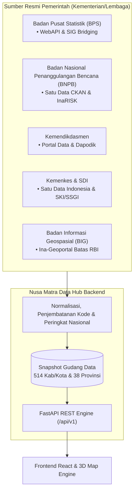

# 🏛️ Katalog Sumber Data Resmi Pemerintah Indonesia
### **Nusa Matra Data Hub — WIA 2026**

Dokumen ini memuat pemetaan komprehensif sumber data resmi pemerintah Indonesia yang diintegrasikan ke dalam **Nusa Matra Data Hub**. Meliputi **5 Instansi Pemerintah Pusat**, **7 Portal/Endpoint Web API Resmi**, dan **33 Indikator Pembangunan** untuk 514 Kabupaten/Kota dan 38 Provinsi.

---

## 📊 1. Ringkasan Eksekutif Sumber Data

| Instansi / Lembaga | Portal & Endpoint Utama | Tipe Protokol | Granularitas Wilayah | Siklus Pembaruan |
| :--- | :--- | :---: | :---: | :---: |
| **BPS** | `webapi.bps.go.id/v1/api/` | REST JSON API | Kab/Kota (514), Prov (38) | Tahunan (Susenas, IPM, Sakernas) |
| **SIG-BPS** | `sig.bps.go.id/bridging-kode/` | Web XHR & CSV | Provinsi s.d. Desa | Semesteran (Master File Desa) |
| **BNPB** | `data.bnpb.go.id/api/3/action/` | CKAN API v3 | Kab/Kota (514), Prov (38) | Tahunan (IRBI & Bencana) |
| **BNPB InaRISK** | `gis.bnpb.go.id/server/rest/` | ArcGIS REST | Grid Raster $100\text{ m} \times 100\text{ m}$ | Tahunan (Multi-Hazard) |
| **BIG** | `tanahair.indonesia.go.id/` | GeoPackage / WMS | Provinsi s.d. Desa | Per Regulasi Kepmendagri |
| **Kemendikdasmen**| `data.kemendikdasmen.go.id/` | Batch XLSX / CSV | Kab/Kota (514), Sekolah | Semesteran (Statistik Persekolahan) |
| **Dapodik** | `dapo.kemendikdasmen.go.id/` | Web XHR Internal | Kab/Kota (514), Sekolah | Semesteran (Sinkronisasi Sekolah) |
| **Kemenkes & SDI** | `data.go.id/` | CKAN API / Batch | Kab/Kota (514), Prov (38) | Tahunan (Profil Kesehatan & SKI) |

---

## 🔍 2. Rincian per Instansi & Indikator yang Diambil

### 🏛️ 1. Badan Pusat Statistik (BPS)
Sistem statistik resmi nasional yang menjadi rujukan utama indikator sosial, demografi, dan ekonomi makro daerah.

* **Endpoint & Sistem:**
  * **BPS WebAPI:** [`https://webapi.bps.go.id/v1/api/`](https://webapi.bps.go.id/developer/) (Akses terstruktur via parameter `domain=0000`)
  * **SIG-BPS Bridging Kode:** [`https://sig.bps.go.id/bridging-kode/`](https://sig.bps.go.id/bridging-kode/) (Penyelaras kode wilayah statistik BPS `3201` $\leftrightarrow$ kode administrasi Kemendagri `32.01`)
* **Daftar Indikator:**
  1. `soc_poverty_rate` — **Persentase Penduduk Miskin (P0)** (Susenas Maret)
  2. `soc_poverty_severity_p2` — **Indeks Keparahan Kemiskinan (P2)** (Susenas Maret)
  3. `soc_hdi` — **Indeks Pembangunan Manusia (IPM / HDI)** Metode Baru
  4. `soc_expenditure_per_capita` — **Pengeluaran per Kapita Disesuaikan** (Rupiah/orang/tahun riil PPP)
  5. `soc_unemployment_rate` — **Tingkat Pengangguran Terbuka (TPT)** (Sakernas Agustus)
  6. `soc_dependency_ratio` — **Rasio Ketergantungan (Dependency Ratio)** (Beban usia non-produktif terhadap usia kerja)
  7. `edu_mean_years_schooling` — **Rata-rata Lama Sekolah (RLS / MYS)** (Populasi usia 25+ tahun)
  8. `edu_expected_years_schooling` — **Harapan Lama Sekolah (HLS / EYS)** (Populasi usia 7+ tahun)
  9. `edu_net_enrollment_smp` — **Angka Partisipasi Murni (APM) SMP/MTs**
  10. `edu_net_enrollment_sma` — **Angka Partisipasi Murni (APM) SMA/SMK/MA**
  11. `hlt_life_expectancy` — **Umur Harapan Hidup Saat Lahir (UHH)**
  12. `inf_safe_water_pct` — **Persentase Rumah Tangga Akses Air Minum Layak** (Target SDGs)
  13. `inf_safe_sanitation_pct` — **Persentase Rumah Tangga Akses Sanitasi Layak** (Target SDGs)
  14. `inf_electrification_pct` — **Rasio Elektrifikasi Rumah Tangga** (Pengguna Listrik PLN & Non-PLN)
  15. `inf_internet_household_pct` — **Persentase Rumah Tangga Mengakses Internet** (Susenas TIK)
  16. `inf_asphalt_road_village_pct` — **Persentase Desa dengan Jalan Utama Aspal/Beton** yang dapat dilalui kendaraan roda 4 sepanjang tahun (Pendataan Potensi Desa / Podes 2024)

---

### 🌋 2. Badan Nasional Penanggulangan Bencana (BNPB)
Penyedia data kebencanaan spasial dan tabular tingkat nasional untuk mengukur kerentanan fisik dan risiko bencana.

* **Endpoint & Sistem:**
  * **Satu Data Bencana (CKAN Action API v3):** [`https://data.bnpb.go.id/api/3/action/`](https://data.bnpb.go.id/)
  * **InaRISK ArcGIS Server:** [`https://gis.bnpb.go.id/server/rest/services/inarisk/`](https://gis.bnpb.go.id/)
* **Daftar Indikator:**
  1. `dis_multihazard_index` — **Indeks Risiko Bencana Indonesia (IRBI) Multi-Bencana** (Skor komposit per Kab/Kota)
  2. `dis_flood_hazard_idx` — **Indeks Bahaya Banjir** (*Zonal mean* piksel raster InaRISK $100\text{ m}$ berpotongan poligon Kab/Kota)
  3. `dis_earthquake_hazard_idx` — **Indeks Bahaya Gempabumi** (*Zonal mean* piksel raster InaRISK)
  4. `dis_landslide_hazard_idx` — **Indeks Bahaya Tanah Longsor** (*Zonal mean* piksel raster InaRISK)
  5. `dis_events_5yr_freq` — **Frekuensi Kejadian Bencana (Akumulasi 5 Tahun)** (Total kejadian per wilayah kurun 2021–2025)
  6. `dis_affected_pop_per_10k` — **Penduduk Terdampak & Mengungsi per 10.000 Jiwa** (Agregasi dampak dibagi proyeksi populasi BPS)

---

### 🎓 3. Kementerian Pendidikan Dasar dan Menengah (Kemendikdasmen)
Basis data kondisi infrastruktur persekolahan dan ketercukupan tenaga pendidik nasional.

* **Endpoint & Sistem:**
  * **Portal Data Pendidikan:** [`https://data.kemendikdasmen.go.id/`](https://data.kemendikdasmen.go.id/) (Publikasi master *Statistik Persekolahan* & *Neraca Pendidikan Daerah*)
  * **Dataset Ruang Kelas SD:** [`kondisi-ruang-kelas-rusak-berat-sd`](https://data.kemendikdasmen.go.id/dataset/p/sarana-dan-prasarana/kondisi-ruang-kelas-rusak-berat-sd) (XLSX resmi, kondisi baik/ringan/sedang/berat per kab/kota)
  * **Dataset Rasio SD:** [`rasio-murid-guru-sd`](https://data.kemendikdasmen.go.id/dataset/p/sarana-dan-prasarana/rasio-murid-guru-sd) (XLSX resmi per kab/kota)
  * **Portal Dapodik:** [`https://dapo.kemendikdasmen.go.id/`](https://dapo.kemendikdasmen.go.id/) (Telemetri progres pengiriman data; butuh login untuk data sinkronisasi)
* **Daftar Indikator:**
  1. `edu_student_teacher_ratio_sd` — ✅ **514/514 VERIFIED**, TA 2022/2023 (dataset resmi)
  2. `edu_damaged_classrooms_pct` — ✅ **514/514 VERIFIED**, TA 2022/2023 (SD+SMP, rusak sedang+berat)
  3. `meta_dapodik_sync_rate` — ❌ **belum tersedia**; progres sinkronisasi ada di dashboard Dapodik yang perlu akun operator/dinas

> **Catatan provenance:** dataset_id `kemendikdasmen_statistik_2026` dipertahankan demi kompatibilitas kontrak, tetapi judul dataset dan `reference_year` yang benar adalah **TA 2022/2023**. Kedua indikator di atas berasal dari XLSX resmi tingkat kab/kota (bukan agregasi provinsi); SHA-256 file mentah dan CSV turunan ada di `data/kemendikdasmen_edu_kabkota_2023.provenance.json`.

---

### 🏥 4. Kementerian Kesehatan (Kemenkes) & Satu Data Indonesia (SDI)
Penyedia data status kesehatan masyarakat, prevalensi gizi buruk, serta ketersediaan sarana dan tenaga medis.

* **Endpoint & Sistem:**
  * **Portal Satu Data Indonesia (SDI):** [`https://data.go.id/`](https://data.go.id/)
  * **Layanan Permintaan Data Kemenkes:** [`https://layanandata.kemkes.go.id/`](https://layanandata.kemkes.go.id/)
  * **Registrasi Puskesmas:** [`https://regpus.kemkes.go.id/publikasi/`](https://regpus.kemkes.go.id/publikasi/) (PDF resmi jumlah Puskesmas per kab/kota)
  * **RS Online (SIRS):** [`https://sirs.kemkes.go.id/fo/home/dashboard_rs`](https://sirs.kemkes.go.id/fo/home/dashboard_rs) (daftar RS per kab/kota, endpoint JSON publik)
  * **SATUSEHAT Data:** [`https://satusehat.kemkes.go.id/data/`](https://satusehat.kemkes.go.id/data/) (dataset dokter per provinsi)
* **Daftar Indikator:**
  1. `hlt_stunting_prevalence` — **Prevalensi Balita Stunting** (Persentase balita pendek/sangat pendek hasil survei SKI/SSGI)
  2. `hlt_facilities_per_10k` — ✅ **514/514 VERIFIED** (Puskesmas Semester II 2025 + RS SIRS / penduduk 2026)
  3. `hlt_doctors_per_10k` — ✅ **514/514 `IMPUTED_PROVINCE`** (dokter per provinsi dari SATUSEHAT Data)
  4. `hlt_jkn_coverage_pct` — **Cakupan Kepesertaan Jaminan Kesehatan Nasional (JKN/BPJS)**

---

### 🗺️ 5. Badan Informasi Geospasial (BIG) & Kemendagri
Pondasi data geospasial tunggal (*One Map Policy*) untuk batas administrasi negara.

* **Endpoint & Sistem:**
  * **Ina-Geoportal (TanahAir Indonesia):** [`https://tanahair.indonesia.go.id/`](https://tanahair.indonesia.go.id/)
  * **Rujukan Hukum:** Keputusan Menteri Dalam Negeri (**Kepmendagri**) No. 300.2.2-2430 Tahun 2025
* **Daftar Fitur Spasial:**
  1. **Poligon Batas Administrasi Resmi:** 38 Provinsi dan 514 Kabupaten/Kota (skala RBI terintegrasi)
  2. **Tabel Master Kode Wilayah:** Standarisasi pasangan kode Kemendagri bertitik (contoh `32.01`) vs kode BPS (contoh `3201`)
  3. **Titik Jangkar Daratan (`anchor_point`):** Dihitung menggunakan kalkulasi geospasial `ST_PointOnSurface(geom)` agar titik fokus kamera 3D dan label teks dijamin berada di atas pulau utama, bukan jatuh di laut (sangat penting untuk kepulauan seperti Kep. Seribu, Maluku, dan Raja Ampat).

---

## 🔒 3. Catatan Transparansi: 2 Indikator Dinyatakan `UNAVAILABLE`

Sesuai prinsip kepatuhan hukum dan transparansi ilmiah, Nusa Matra Data Hub **menolak memalsukan data** dan secara tegas menandai 2 indikator berikut berstatus **`UNAVAILABLE`** (Tidak Tersedia):

| Indikator | Alasan Perlindungan Data & Regulasi | Solusi Proksi Resmi yang Digunakan |
| :--- | :--- | :--- |
| **`edu_school_travel_time_p90`** (Waktu Tempuh Riil Rumah ke Sekolah Siswa) | **UU Perlindungan Data Pribadi (UU PDP No. 27/2022)**. Koordinat alamat rumah dan titik tinggal peserta didik pada Dapodik dilindungi ketat dan dilarang dipublikasikan secara terbuka. | Digantikan dengan data proksi resmi **Podes BPS** (rata-rata kemudahan/jarak desa ke fasilitas SMP/SMA terdekat) serta persentase ruang kelas rusak. |
| **`hlt_realtime_icu_occupancy`** (Keterisian Bed ICU Rumah Sakit Real-Time) | **Batasan Autentikasi Klinis**. API SATUSEHAT Kemenkes (berbasis HL7 FHIR R4) mewajibkan autentikasi OAuth2 fasilitas kesehatan berizin untuk pertukaran rekam medis, bukan untuk konsumsi data analitik publik. | Digantikan dengan **Rasio Fasilitas Faskes** (`hlt_facilities_per_10k`) dan **Rasio Tenaga Medis** (`hlt_doctors_per_10k`) dari Profil Kesehatan Indonesia & BPS. |

---

## 📐 4. Standar Normalisasi Indikator ($0 - 100$)

Untuk menggabungkan berbagai satuan (persentase, skor IRBI, rupiah, rasio) menjadi **Indeks Prioritas Wilayah Terpadu**, setiap indikator dinormalisasi dengan **min-max full-range** (`v2.2-minmax-full-range`). Tidak ada Winsorized clipping pada implementasi saat ini; outlier tetap dipertahankan dan tercakup dalam `content_sha256` snapshot.

1. **Batas nasional:** $x_{\min}$ dan $x_{\max}$ dihitung dari seluruh observasi kanonik indikator pada snapshot yang sama, bukan per batch sumber.
2. **Penyelarasan polaritas:**
   - **Polaritas Negatif** *(semakin tinggi angka mentah, semakin rentan daerahnya — misal Kemiskinan, Stunting, Bencana)*:
     $$S_{\text{score}} = \frac{x - x_{\min}}{x_{\max} - x_{\min}} \times 100$$
   - **Polaritas Positif** *(semakin rendah angka mentah, semakin rentan daerahnya — misal IPM, Air Bersih, Listrik)*:
     $$S_{\text{score}} = \left(1 - \frac{x - x_{\min}}{x_{\max} - x_{\min}}\right) \times 100$$
3. **Degenerate distribution:** jika $x_{\max} = x_{\min}$, skor netral 50 diberikan dan tidak ada klaim urutan yang dibuat.

> **Catatan Penggunaan:** Pada seluruh output API, nilai skor ternormalisasi yang mendekati angka **$100$** selalu mengindikasikan **tingkat kebutuhan intervensi / kerentanan yang paling tinggi**.
