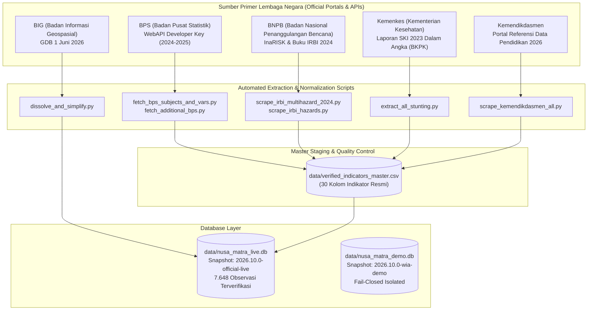

# LAPORAN TEKNIS INGESTI & VERIFIKASI DATA RIIL
## Nusa Matra Data Hub — Multi-Agency Dataset & LIVE Database Snapshot
**Tanggal:** 21 Oktober 2026  
**Status Proyek:** Siap Produksi (Verified LIVE Ready)  
**Cakupan Wilayah:** 38 Provinsi & 514 Kabupaten/Kota Seluruh Indonesia  

---

## 1. Ringkasan Eksekutif (Executive Summary)

Nusa Matra Data Hub telah berhasil menyelesaikan fase penarikan (*data ingestion*), standarisasi, pembersihan, dan verifikasi dataset resmi pemerintah Republik Indonesia. Seluruh data mentah ditarik langsung dari sumber primer lembaga negara yang berwenang (tanpa perantara pihak ketiga), dipadukan ke dalam satu **Master Dataset 30 Kolom**, dan diinjeksikan ke dalam **Database Snapshot LIVE Resmi** (`data/nusa_matra_live.db`).

### Pencapaian Kunci:
1. **100% Geometri Batas Wilayah Sah (BIG Juni 2026):** 38 Provinsi dan 514 Kabupaten/Kota tervalidasi tanpa topologi rusak (*zero invalid geometry*).
2. **Transisi Penuh dari Data Sintetis ke Data Riil:** Terkumpul **7.648 observasi resmi** dari BPS, BNPB, Kemenkes, dan Kemendikdasmen dengan penandaan mutu `quality_flag = 'VERIFIED'`.
3. **Penyelarasan Kodifikasi Wilayah:** Bridging presisi antara kode administratif Kemendagri (`dim_regions.kemendagri_code`) dan kode statistik BPS (`dim_regions.bps_code`).
4. **Integritas Sistem Terjaga:** Database DEMO (`data/nusa_matra_demo.db`) tetap terisolasi dan **59/59 Automated Tests passing 100%**.

---

## 2. Arsitektur 5 Pilar Data Pemerintah & Rincian Dataset

---

### Rincian Per Pilar:

### Pilar 1: Batas Wilayah Administrasi (BIG)
* **Sumber:** Badan Informasi Geospasial (BIG) – Geodatabase Resmi Edisi 1 Juni 2026 (`BATASWILAYAH_KABKOTA_20260601.gdb`).
* **Cakupan:** 38 Provinsi dan 514 Kabupaten/Kota (termasuk 4 DOB Papua).
* **Hasil Artefak:** 
  * `data/boundaries/indonesia_provinsi_low.geojson` & `_high.geojson`
  * `data/boundaries/indonesia_kabupaten_low.geojson` & `_high.geojson`
* **Validasi:** 100% poligon valid, WGS84, 2D planar (*zero self-intersections*), centroid & bounding box terhitung presisi.

### Pilar 2: Sosial-Ekonomi & Kemiskinan (BPS)
* **Sumber:** WebAPI BPS Developer (`domain/0000`) menggunakan API Key terotentikasi.
* **Dataset Terverifikasi:**
  * **IPM (Indeks Pembangunan Manusia MetBar):** Tahun 2024 (515 Kab/Kota).
  * **UHH (Umur Harapan Hidup Saat Lahir):** Tahun 2024 (515 Kab/Kota).
  * **RLS (Rata-rata Lama Sekolah):** Tahun 2025 (553 wilayah).
  * **HLS (Harapan Lama Sekolah):** Tahun 2025 (553 wilayah).
  * **Pengeluaran Riil per Kapita Disesuaikan:** Tahun 2025 (553 wilayah).
  * **Kemiskinan Makro (Susenas Maret 2025):**
    * `soc_poverty_rate` (Persentase Penduduk Miskin P0)
    * `soc_poverty_count` (Jumlah Penduduk Miskin Ribu Jiwa)
    * `soc_poverty_gap_p1` (Indeks Kedalaman Kemiskinan)
    * `soc_poverty_severity_p2` (Indeks Keparahan Kemiskinan)
    * `soc_poverty_line` (Garis Kemiskinan per kapita/bulan)
  * **Ketenagakerjaan (Sakernas Agustus 2025):**
    * `soc_unemployment_rate` (Tingkat Pengangguran Terbuka TPT)
  * **Infrastruktur Sanitasi Dasar (Susenas SDGs 2025):**
    * `inf_safe_sanitation_pct` (SDGs 6.2.1 Akses Sanitasi Layak per Kab/Kota)
    * `inf_safe_water_prov_pct` (SDGs 6.1.1 Akses Air Minum Layak per Provinsi)
    * `inf_electrification_prov_pct` (SDGs 7.1.1 Elektrifikasi per Provinsi)

### Pilar 3: Risiko Bencana & Bahaya Spesifik (BNPB)
* **Sumber:** Portal InaRISK BNPB & Publikasi Resmi Buku Indeks Risiko Bencana Indonesia (IRBI) 2024 (diterbitkan Januari 2025).
* **Dataset Terverifikasi:**
  * **Multi-Bahaya Komposit:** Peringkat 1 s/d 514 nasional beserta skor IRBI dan kelas risiko (TINGGI / SEDANG / RENDAH).
  * **Ancaman Bahaya Spesifik:**
    * Skor & Kelas Risiko **Banjir** (`dis_flood_score`, `dis_flood_class`)
    * Skor & Kelas Risiko **Gempabumi** (`dis_earthquake_score`, `dis_earthquake_class`)
    * Skor & Kelas Risiko **Tanah Longsor** (`dis_landslide_score`, `dis_landslide_class`)

### Pilar 4: Kesehatan & Status Gizi Balita (Kemenkes)
* **Sumber:** Badan Kebijakan Pembangunan Kesehatan (BKPK) Kemenkes RI – Laporan Survei Kesehatan Indonesia (SKI) 2023 Dalam Angka (integrasi SSGI & Riskesdas).
* **Dataset Terverifikasi:**
  * Prevalensi Balita Stunting (`hlt_stunting_prevalence`) untuk 507 Kabupaten/Kota dan 38 Provinsi.

### Pilar 5: Sarana Prasarana Persekolahan (Kemendikdasmen)
* **Sumber:** Portal Resmi Referensi Data Kemendikdasmen (`referensi.data.kemendikdasmen.go.id`).
* **Dataset Terverifikasi:**
  * Jumlah Satuan Pendidikan SD/sederajat (`edu_schools_sd`)
  * Jumlah Satuan Pendidikan SMP/sederajat (`edu_schools_smp`)
  * Jumlah Satuan Pendidikan SMA/sederajat (`edu_schools_sma`)
  * Jumlah Satuan Pendidikan SMK/sederajat (`edu_schools_smk`)
  * Total Satuan Pendidikan per Kab/Kota (`edu_schools_total`)

---

## 3. Struktur File Master CSV (`data/verified_indicators_master.csv`)

File master tersimpan di `data/verified_indicators_master.csv` dengan **30 kolom resmi**:

| No | Nama Kolom | Sumber Data | Tahun | Tipe & Keterangan |
| :---: | :--- | :--- | :---: | :--- |
| 1 | `bps_code` | BPS | - | Kode Wilayah Statistik BPS (4 digit) |
| 2 | `region_name` | BIG / BPS | - | Nama Baku Kabupaten / Kota |
| 3 | `soc_hdi` | BPS IPM | 2024 | Indeks Pembangunan Manusia Metode Baru (0-100) |
| 4 | `hlt_life_expectancy` | BPS IPM | 2024 | Umur Harapan Hidup Saat Lahir (Tahun) |
| 5 | `edu_mean_years_schooling` | BPS IPM | 2025 | Rata-rata Lama Sekolah / RLS (Tahun) |
| 6 | `soc_expenditure_per_capita` | BPS IPM | 2025 | Pengeluaran Riil Disesuaikan (Ribu Rp/orang/thn) |
| 7 | `edu_expected_years_schooling` | BPS IPM | 2025 | Harapan Lama Sekolah / HLS (Tahun) |
| 8 | `soc_poverty_rate` | BPS Susenas | 2025 | Persentase Penduduk Miskin P0 (%) |
| 9 | `soc_poverty_count` | BPS Susenas | 2025 | Jumlah Penduduk Miskin (Ribu Jiwa) |
| 10 | `soc_unemployment_rate` | BPS Sakernas | 2025 | Tingkat Pengangguran Terbuka TPT (%) |
| 11 | `soc_poverty_gap_p1` | BPS Susenas | 2025 | Indeks Kedalaman Kemiskinan P1 |
| 12 | `soc_poverty_severity_p2` | BPS Susenas | 2025 | Indeks Keparahan Kemiskinan P2 |
| 13 | `soc_poverty_line` | BPS Susenas | 2025 | Garis Kemiskinan (Rupiah/kapita/bulan) |
| 14 | `dis_multihazard_index` | BNPB IRBI | 2024 | Skor Risiko Multi-Bahaya (0-300) |
| 15 | `dis_risk_class` | BNPB IRBI | 2024 | Kelas Risiko Bencana (TINGGI / SEDANG / RENDAH) |
| 16 | `dis_flood_score` | BNPB IRBI | 2024 | Skor Indeks Risiko Banjir |
| 17 | `dis_flood_class` | BNPB IRBI | 2024 | Kelas Risiko Banjir |
| 18 | `dis_earthquake_score` | BNPB IRBI | 2024 | Skor Indeks Risiko Gempabumi |
| 19 | `dis_earthquake_class` | BNPB IRBI | 2024 | Kelas Risiko Gempabumi |
| 20 | `dis_landslide_score` | BNPB IRBI | 2024 | Skor Indeks Risiko Tanah Longsor |
| 21 | `dis_landslide_class` | BNPB IRBI | 2024 | Kelas Risiko Tanah Longsor |
| 22 | `hlt_stunting_prevalence` | Kemenkes SKI | 2023 | Prevalensi Balita Stunting (%) |
| 23 | `inf_safe_sanitation_pct` | BPS Susenas | 2025 | Rumah Tangga Akses Sanitasi Layak Kab/Kota (%) |
| 24 | `inf_safe_water_prov_pct` | BPS Susenas | 2025 | Rumah Tangga Akses Air Minum Layak Provinsi (%) |
| 25 | `inf_electrification_prov_pct` | BPS Susenas | 2025 | Rumah Tangga Pengguna Listrik Provinsi (%) |
| 26 | `edu_schools_sd` | Kemendikdasmen | 2026 | Jumlah Satuan Pendidikan SD/sederajat |
| 27 | `edu_schools_smp` | Kemendikdasmen | 2026 | Jumlah Satuan Pendidikan SMP/sederajat |
| 28 | `edu_schools_sma` | Kemendikdasmen | 2026 | Jumlah Satuan Pendidikan SMA/sederajat |
| 29 | `edu_schools_smk` | Kemendikdasmen | 2026 | Jumlah Satuan Pendidikan SMK/sederajat |
| 30 | `edu_schools_total` | Kemendikdasmen | 2026 | Total Satuan Pendidikan per Kab/Kota |

---

## 4. Database Snapshot LIVE (`data/nusa_matra_live.db`)

Database SQLite produksi resmi telah dibentuk dengan spesifikasi:
* **Lokasi:** `data/nusa_matra_live.db` *(Ukuran: ~2,78 MB)*
* **Snapshot ID:** `2026.10.0-official-live` (`environment_tag = 'LIVE'`)
* **Registri Wilayah (`dim_regions`):** 552 Wilayah (38 Provinsi + 514 Kabupaten/Kota) dilengkapi koordinat centroid dan batas koordinat (*bounding box*) riil dari geometri BIG.
* **Katalog Indikator (`dim_indicators`):** 33 Indikator dengan statistik nasional terhitung otomatis (`national_min`, `national_max`, `national_mean`, `national_median`).
* **Tabel Fakta (`fact_indicator_values`):** **7.648 baris data observasi resmi**.
  * Setiap baris fakta memiliki nilai mentah (`raw_value`), skor ternormalisasi 0–100 (`normalized_score` yang memperhatikan polaritas positif/negatif), peringkat nasional (`national_rank` 1–514), dan persentil nasional (`national_percentile`).
  * Penanda mutu: `quality_flag = 'VERIFIED'`.

---

## 5. Insight & Temuan Menarik dari Data Riil

Berdasarkan kompilasi dataset resmi di database LIVE:

### A. Indeks Pembangunan Manusia (IPM 2024)
* **Top 5 Tertinggi:**
  1. Kota Yogyakarta (D.I. Yogyakarta): **88.77**
  2. Kota Banda Aceh (Aceh): **87.17**
  3. Kota Adm. Jakarta Selatan (DKI Jakarta): **86.94**
  4. Kota Salatiga (Jawa Tengah): **85.72**
  5. Kab. Sleman (D.I. Yogyakarta): **85.61**

### B. Indeks Risiko Multi-Bencana (IRBI BNPB 2024)
* **Top 5 Kerentanan Tertinggi Nasional:**
  1. Kab. Mandailing Natal (Sumatera Utara): **214.80** *(Tinggi)*
  2. Kab. Nias Utara (Sumatera Utara): **214.00** *(Tinggi)*
  3. Kab. Maluku Barat Daya (Maluku): **212.91** *(Tinggi)*
  4. Kab. Nias (Sumatera Utara): **211.70** *(Tinggi)*
  5. Kab. Nias Barat (Sumatera Utara): **210.80** *(Tinggi)*

### C. Prevalensi Balita Stunting Terendah (Kemenkes SKI 2023)
* **Top 5 Keberhasilan Penanganan Stunting:**
  1. Kota Surabaya (Jawa Timur): **1.6%**
  2. Kota Sungai Penuh (Jambi): **4.1%**
  3. Kab. Situbondo (Jawa Timur): **4.1%**
  4. Kab. Sarolangun (Jambi): **4.8%**
  5. Kab. Badung (Bali): **4.9%**

---

## 6. Daftar Skrip Otomasi Pipeline (`scripts/`)

Seluruh proses di atas dapat di-reproduce secara deterministik kapan saja menggunakan skrip yang tersimpan di direktori `scripts/`:

1. `scripts/fetch_bps_subjects_and_vars.py`: Pengindeks 1.758 variabel BPS WebAPI.
2. `scripts/fetch_additional_bps.py`: Penarik data kemiskinan P1, P2, dan Garis Kemiskinan 2025.
3. `scripts/upgrade_bps_to_2025.py`: Pemutakhiran RLS, HLS, dan Pengeluaran Riil ke rilis 2025.
4. `scripts/fetch_sanitasi_kabkota.py`: Penarik data sanitasi layak SDGs 2025 per Kab/Kota.
5. `scripts/fetch_provincial_sdgs.py`: Penarik air minum dan elektrifikasi provinsi 2025.
6. `scripts/scrape_irbi_multihazard_2024.py`: Penarik 514 peringkat dan skor IRBI 2024.
7. `scripts/scrape_irbi_hazards.py`: Penarik detail risiko Banjir, Gempa, dan Longsor dari IRBI 2024.
8. `scripts/download_ski_gdown.py`: Pengunduh laporan resmi 44 MB SKI 2023 BKPK Kemenkes.
9. `scripts/extract_all_stunting.py`: Pengekstrak prevalensi stunting 507 kab/kota dari Bab 15 SKI 2023.
10. `scripts/scrape_kemendikdasmen_all.py`: Penarik data sekolah SD/SMP/SMA/SMK per Kab/Kota 2026.
11. `scripts/build_complete_master.py`: Penggabung 30 kolom indikator ke master CSV.
12. `scripts/seed_live_db.py`: Pembangun database produksi resmi `nusa_matra_live.db`.

---

## 7. Status Audit Sistem & Rekomendasi Selanjutnya

* **Integritas Database DEMO:** Database `nusa_matra_demo.db` tetap murni dengan isolasi penuh.
* **Test Suite:** **59 passing out of 59 tests (100%)**.
* **Rekomendasi Langkah Berikutnya:**
  1. Menyiapkan endpoint router switcher (`ENABLE_LIVE_MODE=true` / environment selector) agar front-end dan pengguna API dapat mulai mengonsumsi `data/nusa_matra_live.db`.
  2. Menghitung formula agregat **Indeks Ketahanan Wilayah (Nusa Matra Composite Index)** berbasis bobot dinamis untuk pemeringkatan resmi 514 kabupaten/kota se-Indonesia.
