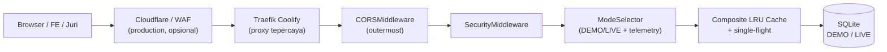

# 🛡️ Rencana Implementasi Keamanan & Anti-Abuse API (v2.3)

> **Status:** Diimplementasikan di working tree. Rate limiter berjalan dalam mode **report-only** secara default; aktifkan enforcement setelah masa pengukuran.  
> **Scope:** Anti-abuse, rate limiting, API key opsional, hardening middleware, dan perlindungan endpoint berat.  
> **Prinsip utama:** Tidak mengubah kontrak frontend, tidak membuat juri ribet, dan tidak memberi bypass keamanan total kepada API key mana pun.

## Status Implementasi

- `app/middleware/security.py` — trusted proxy IP, API key, rate limit, body limit, security headers, request ID.
- `app/services/rate_limiter.py` — token bucket in-memory.
- `app/services/api_key.py` — hash, scope, quota.
- `app/services/composite_service.py` — LRU cache + single-flight.
- `app/main.py` — middleware, CORS, TrustedHost.
- `app/config.py` — seluruh environment variable keamanan.
- `app/models/indicators.py` — batas 33 komponen composite.
- `app/routers/stats.py` — stats publik tanpa detail persistence.
- `app/routers/earthquakes.py` dan `app/database.py` — error internal disanitasi.
- `tests/test_security.py` dan `tests/test_composite_cache.py` — regression tests.

**Default rollout:** `NM_RATE_LIMIT_REPORT_ONLY=true`. Set `false` setelah log 429 dianalisis.

### Mengaktifkan enforcement

```env
NM_RATE_LIMIT_ENABLED=true
NM_RATE_LIMIT_REPORT_ONLY=false
NM_ALLOWED_HOSTS=api.orangkeren.me,localhost
NM_CORS_ORIGINS=https://domain-web-lomba.example
NM_TRUSTED_PROXY_IPS=10.0.0.0/8
```

### Membuat hash API key

```bash
python -c "import hashlib; print(hashlib.sha256(b'GANTI-DENGAN-KEY-RAHASIA').hexdigest())"
```

Simpan hasil hash ke `NM_APP_API_KEY_HASH`, `NM_JUDGE_API_KEY_HASH`, atau `NM_ADMIN_TOKEN_HASH`. Jangan simpan key mentah di repository.

---

## 1. Tujuan & Prinsip Desain

1. **Zero Frontend Changes**
   - Frontend tetap memanggil API seperti biasa.
   - Nama field, struktur response, dan perilaku endpoint data tidak berubah.
   - FE **tidak perlu** menambahkan header API key; `nm_app_...` bersifat opsional.
   - Frontend hanya perlu menangani `429` yang sudah dikenali sebagai `RATE_LIMITED`.

2. **Docs dan Stats Tetap Publik**
   - `/docs`, `/scalar`, `/redoc`, dan `/openapi.json` tetap bisa dibuka juri.
   - `/stats` dan `/api/v1/stats` tetap publik, tetapi datanya disanitasi.
   - Tidak ada setting yang perlu diubah saat juri datang.

3. **Read Endpoint Tidak Wajib API Key**
   - Pengunjung dan juri tetap bisa membaca data tanpa key.
   - API key hanya menaikkan kuota dan memberi atribusi.
   - Ini mencegah docs/juri terhambat dan FE mati total jika key bermasalah.

4. **API Key di Browser Bukan Rahasia**
   - Key `nm_app_...` yang dipakai FE akan terlihat di Network tab.
   - Karena itu key ini hanya punya scope `read` + `composite`, tidak pernah `admin`.
   - Key admin dipisahkan dan tidak diberikan ke frontend.

5. **Aman untuk Wi-Fi Presentasi**
   - Limit dihitung dari pemakaian nyata FE, bukan asumsi “satu user satu IP”.
   - 10–15 orang di satu Wi-Fi harus tetap bisa memakai aplikasi.
   - Bot yang mengirim ratusan request per detik tetap diblokir.

6. **Lindungi Endpoint Berat Secara Spesifik**
   - `POST /api/v1/indicators/composite-query` dan `GET /api/v1/boundaries/*` punya bucket sendiri.
   - Keduanya tidak digabung menjadi satu tier “heavy” yang terlalu kasar.

7. **Tanpa OAuth/JWT/User Account**
   - API ini menyajikan data agregat publik, bukan data per pengguna.
   - Tidak ada kebutuhan login.
   - API key cukup sebagai identitas aplikasi/klien, bukan autentikasi user.

---

## 2. Threat Model & Non-Goals

### Yang dilindungi

| Ancaman | Dampak | Kontrol |
|---|---|---|
| Bot spam ke endpoint baca | CPU/DB penuh, pengguna asli lambat | Rate limit per IP + global |
| Spam `composite-query` | Perhitungan 514 wilayah berulang | Bucket khusus + cache + single-flight |
| Unduhan `boundaries` berulang | Transfer 5,5 MB berulang | Bucket khusus + cache browser/CDN |
| Payload JSON raksasa | Memori/CPU habis | Body limit 16 KB + batas komponen |
| `weights` berisi ribuan key | Amplifikasi query SQL | Maksimal 33 komponen |
| Spoof `X-Forwarded-For` | Rate limit bisa dilewati | Hanya percaya proxy tepercaya |
| API key bocor | Kuota disalahgunakan | Scope terbatas, hash, rotasi, tanpa bypass total |
| Docs/stats di-hammer | CPU dan query telemetry | Bucket terpisah, bukan exempt |
| Cache stampede | Perhitungan identik berjalan bersamaan | Single-flight |
| Scanner menembak endpoint internal | Informasi/operasional bocor | Admin token + sanitasi response |

### Non-goals

- Bukan pengganti WAF/DDoS protection.
- Bukan sistem login/user account.
- Bukan enkripsi data at-rest.
- Bukan audit log immutable untuk aksi admin.
- Bukan perlindungan terhadap scraping data publik—datanya memang publik.
- Bukan pengganti hardening container, dependency pinning, atau rotasi secret. Itu ada di backlog terpisah.

---

## 3. Arsitektur Berlapis



`SecurityMiddleware` berada **di dalam** `CORSMiddleware` agar response `429` dan `413` tetap memiliki header CORS yang bisa dibaca frontend React.

Urutan kerja `SecurityMiddleware`:

1. Resolve IP client dari proxy tepercaya.
2. Baca `X-API-Key` jika ada; validasi hash dan scope.
3. Cek body size sebelum body diproses Pydantic.
4. Tentukan bucket rate limit berdasarkan method + path.
5. Cek limit per IP, per key, dan global.
6. Tambahkan security headers dan `X-Request-ID`.
7. Teruskan request ke `ModeSelector`.

---

## 4. Model Akses & API Key

### 4.1 Tabel akses

| Client | Key | Scope | Akses | Limit |
|---|---|---|---|---|
| Publik / juri | Tanpa key | — | Read dasar, docs, stats | Baseline per IP |
| FE lomba | `nm_app_...` | `read`, `composite` | Read + composite | Kuota lebih tinggi, bukan unlimited |
| Juri testing | `nm_judge_...` | `read`, `composite` | Read + composite | Kuota per key, expire setelah lomba |
| Admin/internal | `nm_admin_...` | `admin` | Admin/maintenance | Token terpisah, 60/menit |

### 4.2 Prinsip key

- Header: `X-API-Key`.
- Jangan pernah lewat query string.
- Simpan **hash** key, bukan plaintext.
- Bandingkan dengan `hmac.compare_digest`.
- Key memiliki prefix yang bisa dikenali: `nm_app_`, `nm_judge_`, `nm_admin_`.
- Key bisa dicabut/dirotasi tanpa mengubah kode FE.
- Key tidak boleh muncul di log, response, atau pesan error.
- Key FE **tidak boleh** memiliki scope `admin`.
- Key juri **tidak boleh** memiliki scope `admin`.
- Tidak ada key yang membebaskan rate limit sepenuhnya.

### 4.3 Perilaku error

| Kondisi | Status | Code |
|---|---|---|
| Key tidak ada | lanjut sebagai anonymous | — |
| Key ada tapi tidak valid | `401` | `INVALID_API_KEY` |
| Key valid tapi scope kurang | `403` | `INSUFFICIENT_SCOPE` |
| Key expired | `401` | `API_KEY_EXPIRED` |
| Limit terlampaui | `429` | `RATE_LIMITED` |
| Body terlalu besar | `413` | `PAYLOAD_TOO_LARGE` |

Catatan: key tidak valid tidak otomatis memblokir semua akses publik; endpoint read tetap bisa diakses sebagai anonymous. Key hanya diperlukan untuk scope khusus atau kuota tambahan.

---

## 5. Rate Limit

### 5.1 Dasar perhitungan

Dari `hasil-diskusi.md`:

- Satu user aktif: **10–20 request/menit**.
- Membuka halaman: **4–8 request sekaligus**.
- Lab aktif: **10–30 request/menit**.
- 15 user di satu Wi-Fi: sekitar **150–300 request/menit**.

Artinya:

- Limit read umum harus **di atas 300/menit per IP**.
- Burst harus cukup untuk **15 user × 8 request page-load = 120 request** dalam waktu singkat.
- `boundaries` dan `composite` tidak boleh digabung.
- Limit harus dijalankan **log-only** dulu sebelum enforcement.

### 5.2 Bucket awal

Angka berikut adalah default awal yang longgar. Tuning dilakukan setelah pengukuran.

| Bucket | Anonymous per IP | Catatan |
|---|---:|---|
| Read umum (`regions`, `indicators`, `snapshots`, `datasets`) | 900/menit, burst 200 | Headroom untuk 15–20 user aktif |
| Search `regions?q=` | 180/menit, burst 60 | FE tetap disarankan debounce |
| `GET /boundaries/*` | 60/menit, burst 30 | Response 5,5 MB; browser cache 7 hari |
| `POST /composite-query` | 240/menit, burst 80 | Lab aktif 10–30 req/menit per user |
| `GET /earthquakes/*` | 20/menit, burst 10 | Polling 120 detik |
| `/docs`, `/scalar`, `/openapi.json` | 240/menit, burst 60 | Bucket terpisah; cukup untuk dashboard polling 5 detik |
| `/stats`, `/api/v1/stats` | 240/menit, burst 60 | Bucket terpisah |
| `/health`, `/api/v1/health` | exempt | Kebutuhan healthcheck Coolify |
| Global per IP | 1.200/menit, burst 300 | Selalu lebih tinggi dari bucket terbesar |

### 5.3 Kuota key

| Key | Limit | Catatan |
|---|---:|---|
| `nm_app_...` | 5.000/menit agregat | Pengaman agregat, bukan pengganti limit per IP |
| `nm_judge_...` | 300/menit per key | Read + composite |
| `nm_admin_...` | 60/menit | Hanya endpoint admin |

Penting:

- Satu `nm_app_...` dipakai semua user FE.
- Jangan menghitung kuota global per key sebagai satu-satunya kontrol.
- Limit utama tetap **per IP**.
- Kuota key berguna untuk atribusi dan mencegah satu key dipakai sebagai bot farm.
- Jika banyak user berada di belakang NAT yang sama, pantau dan naikkan limit per IP.

### 5.4 Respons `429`

```json
{
  "status": "error",
  "code": "RATE_LIMITED",
  "message": "Terlalu banyak permintaan dalam waktu singkat. Silakan tunggu beberapa detik lalu coba lagi."
}
```

Header wajib:

- `Retry-After`
- `X-RateLimit-Limit`
- `X-RateLimit-Remaining`
- `X-RateLimit-Reset`
- `X-Request-ID`
- Header CORS yang berlaku

### 5.5 Implementasi limiter

- Sliding window atau token bucket per bucket.
- Hapus entry lama secara periodik agar memori tidak bocor.
- Untuk satu proses/worker, in-memory cukup.
- Untuk multi-worker/multi-replica, gunakan Redis agar counter dibagi.
- Jangan mencatat IP mentah di log; hash jika perlu analitik.
- Endpoint `/health` tidak dihitung.
- Docs/stats dihitung di bucket sendiri.
- Request yang ditolak tetap mendapat header keamanan dan CORS.

---

## 6. Resolusi IP di Balik Proxy

Rencana lama berisiko karena mempercayai `X-Forwarded-For` pertama. Client bisa memalsukannya jika aplikasi masih bisa diakses langsung.

Aturan baru:

1. Tentukan IP peer dari `request.client.host`.
2. Hanya jika peer berasal dari `NM_TRUSTED_PROXY_IPS` (CIDR Traefik/Coolify), baca header proxy.
3. Jika memakai Cloudflare:
   - Gunakan `CF-Connecting-IP`.
   - Hanya percaya jika peer adalah IP Cloudflare.
   - Kunci origin agar tidak bisa diakses langsung.
4. Jangan mengambil elemen paling kiri dari `X-Forwarded-For` secara membabi buta.
5. Fallback ke `request.client.host`.
6. Tambahkan test yang memastikan XFF palsu tidak mengubah identitas IP.

Contoh konfigurasi:

```env
NM_TRUSTED_PROXY_IPS=10.0.0.0/8,172.16.0.0/12,192.168.0.0/16
```

Di production, isi dengan CIDR proxy yang sebenarnya, bukan semua private range jika tidak diperlukan.

---

## 7. Middleware Keamanan

### 7.1 Body size guard

- Maksimum default: **16 KB**.
- Berlaku untuk `POST`, `PUT`, dan `PATCH`.
- Cek `Content-Length` **dan** batasi pembacaan stream.
- Tolak request chunked yang melebihi batas, meskipun tanpa `Content-Length`.
- Batasi juga di reverse proxy/Cloudflare sebagai lapisan pertama.
- Batas `weights` composite: **maksimal 33 komponen**.
- Batas panjang `snapshot`, `snapshot_id`, `q`, dan `region_id` di Pydantic.

Respons:

```json
{
  "status": "error",
  "code": "PAYLOAD_TOO_LARGE",
  "message": "Ukuran request melebihi batas yang diizinkan."
}
```

### 7.2 Security headers

Untuk semua response:

- `X-Content-Type-Options: nosniff`
- `X-Frame-Options: DENY`
- `Referrer-Policy: strict-origin-when-cross-origin`
- `Permissions-Policy: geolocation=(), microphone=(), camera=()`
- `Cross-Origin-Opener-Policy: same-origin`
- `Cross-Origin-Resource-Policy: same-origin`
- `Strict-Transport-Security` (hanya jika HTTPS)

Untuk `/docs`, `/scalar`, `/stats`:

- CSP yang mengizinkan aset yang memang dipakai.
- Jangan memakai `unsafe-inline` untuk halaman yang menampilkan input pengguna.

Untuk response API JSON:

- CSP `default-src 'none'`.

### 7.3 TrustedHost

- `TrustedHostMiddleware` dengan `api.orangkeren.me`.
- Tolak Host header asing.
- Jangan mengaktifkan `allowed_hosts=["*"]` di production.

### 7.4 CORS

- Hapus wildcard `"*"`.
- Daftar origin eksplisit: domain web lomba + localhost hanya untuk development.
- `allow_credentials=False` karena API tidak memakai cookie.
- Method: `GET`, `POST`, `OPTIONS`.
- Header yang diizinkan: `Content-Type`, `Accept`, `X-API-Key`, `X-Data-Mode`, `X-NusaMatra-Snapshot`, `X-Request-ID`.
- Expose header rate limit dan `Retry-After`.
- Jangan membuka origin development di production.

### 7.5 Request ID

- Terima `X-Request-ID` jika formatnya valid.
- Jika tidak ada, generate UUID.
- Kembalikan di response dan sertakan di log.
- Jangan memasukkan token/key ke log.

---

## 8. Composite LRU Cache + Single-Flight

`POST /composite-query` adalah endpoint terberat: perhitungan untuk 514 wilayah dan 14.745 observasi.

### Cache key

```text
(mode, snapshot_id, filter_province_id, sorted_weights, scoring_config_version)
```

### Aturan

- Snapshot v2.2 immutable, jadi hasil untuk key yang sama bersifat deterministik.
- Gunakan `OrderedDict` LRU atau implementasi cache yang setara.
- Batasi berdasarkan jumlah entry **dan** total byte.
- Jangan cache exception, timeout, atau response yang bergantung pada waktu.
- Jangan cache response yang tidak rankable sebagai “sukses ranking”; cache apa adanya termasuk `rankable=false`.
- Tambahkan single-flight/lock per cache key:
  - satu request menghitung;
  - request identik menunggu hasil yang sama;
  - tidak ada 10 perhitungan paralel untuk preset yang sama.
- Catat hit/miss dan latency untuk tuning.
- Cache in-memory bersifat per-worker. Jika multi-worker, hit rate lebih rendah; pertimbangkan Redis jika perlu.

Target:

- Cache hit: sub-milidetik sampai beberapa milidetik.
- Cache miss: tetap dibatasi rate limit dan timeout.

---

## 9. Docs & Stats untuk Juri

### Publik

- `/docs`
- `/scalar`
- `/redoc`
- `/openapi.json`
- `/stats`
- `/api/v1/stats`

### Stats yang ditampilkan

- uptime
- total request
- success rate
- latency min/avg/max
- status code histogram
- top endpoint
- DEMO/LIVE split
- snapshot aktif

### Stats yang disembunyikan

- path database
- detail persistence internal
- exception mentah
- data sensitif lain
- raw request log yang tidak perlu

### Catatan

- Docs/stats tetap punya rate limit sendiri (240/menit/IP, burst 60).
- Docs tidak perlu key.
- Juri bisa mencoba endpoint read tanpa key.
- Jika memakai `nm_judge_...`, docs bisa menampilkan tombol **Authorize** (`APIKeyHeader`) agar juri bisa paste key.
- Karena docs berada di domain API yang sama, request “Try it” bersifat same-origin; CORS tidak menjadi masalah untuk juri.

---

## 10. Konfigurasi Environment

| Variable | Default | Fungsi |
|---|---|---|
| `NM_RATE_LIMIT_ENABLED` | `true` | Saklar utama rate limiter |
| `NM_RATE_LIMIT_READ_PER_MINUTE` | `900` | Bucket read umum |
| `NM_RATE_LIMIT_READ_BURST` | `200` | Burst read umum |
| `NM_RATE_LIMIT_SEARCH_PER_MINUTE` | `180` | Bucket search |
| `NM_RATE_LIMIT_SEARCH_BURST` | `60` | Burst search |
| `NM_RATE_LIMIT_BOUNDARIES_PER_MINUTE` | `60` | Bucket boundaries |
| `NM_RATE_LIMIT_BOUNDARIES_BURST` | `30` | Burst boundaries |
| `NM_RATE_LIMIT_COMPOSITE_PER_MINUTE` | `240` | Bucket composite |
| `NM_RATE_LIMIT_COMPOSITE_BURST` | `80` | Burst composite |
| `NM_RATE_LIMIT_EARTHQUAKES_PER_MINUTE` | `20` | Bucket gempa |
| `NM_RATE_LIMIT_EARTHQUAKES_BURST` | `10` | Burst gempa |
| `NM_RATE_LIMIT_DOCS_PER_MINUTE` | `240` | Bucket docs/stats |
| `NM_RATE_LIMIT_DOCS_BURST` | `60` | Burst docs/stats |
| `NM_RATE_LIMIT_GLOBAL_PER_MINUTE` | `1200` | Batas total per IP |
| `NM_RATE_LIMIT_GLOBAL_BURST` | `300` | Burst global |
| `NM_RATE_LIMIT_APP_KEY_PER_MINUTE` | `5000` | Kuota agregat key FE |
| `NM_RATE_LIMIT_JUDGE_KEY_PER_MINUTE` | `300` | Kuota key juri |
| `NM_RATE_LIMIT_ADMIN_KEY_PER_MINUTE` | `60` | Kuota admin |
| `NM_RATE_LIMIT_REPORT_ONLY` | `true` | Log-only sebelum enforcement |
| `NM_ALLOWED_HOSTS` | `api.orangkeren.me,localhost,127.0.0.1` | Host header yang diterima |
| `NM_CORS_ORIGINS` | localhost + `https://api.orangkeren.me` | Origin frontend yang diizinkan |
| `NM_MAX_REQUEST_BODY_BYTES` | `16384` | Body maksimum |
| `NM_MAX_COMPOSITE_COMPONENTS` | `33` | Batas jumlah indikator |
| `NM_COMPOSITE_CACHE_MAX_ENTRIES` | `256` | Kapasitas cache |
| `NM_COMPOSITE_CACHE_MAX_BYTES` | `67108864` | Batas memori cache (64 MB) |
| `NM_APP_API_KEY_HASH` | kosong | Hash key FE |
| `NM_JUDGE_API_KEY_HASH` | kosong | Hash key juri |
| `NM_ADMIN_TOKEN_HASH` | kosong | Hash admin |
| `NM_TRUSTED_PROXY_IPS` | kosong | CIDR proxy tepercaya |
| `NM_ENABLE_DOCS` | `true` | Docs publik selama lomba |
| `NM_STATS_PUBLIC` | `true` | Stats publik tersanitasi |
| `NM_ENABLE_TEST_HOOKS` | `false` | Matikan hook test di production |

Semua nilai harus bisa diubah dari Environment Variables Coolify tanpa rebuild kode.

---

## 11. Perubahan File

### Dokumen

- `docs/security/SECURITY_PLAN.md` — dokumen ini.

### Kode (setelah dokumen disetujui)

- `app/config.py` — setting rate limit, body limit, key hash, trusted proxy, docs/stats.
- `app/middleware/security.py` — middleware baru.
- `app/services/rate_limiter.py` — sliding window/token bucket, cleanup, header `429`.
- `app/services/api_key.py` — hash, scope, expiry, constant-time compare.
- `app/services/composite_service.py` — LRU cache + single-flight.
- `app/main.py` — registrasi middleware, CORS, TrustedHost, expose header.
- `app/routers/stats.py` — response publik tersanitasi.
- `tests/test_security.py` — header, body limit, CORS error.
- `tests/test_rate_limit.py` — bucket, spoofed IP, health exempt.
- `tests/test_api_keys.py` — scope, expiry, rotasi, tanpa bypass.
- `tests/test_composite_cache.py` — cache key, hit/miss, stampede.

---

## 12. Rencana Test

1. Security headers ada di response sukses dan error.
2. `429` memiliki `code: RATE_LIMITED`, `Retry-After`, `X-RateLimit-*`, dan header CORS.
3. XFF palsu tidak mengubah IP efektif.
4. IP A kena limit, IP B tetap lancar.
5. Docs/stats punya bucket sendiri dan tidak menghabiskan kuota bisnis.
6. Healthcheck tetap exempt.
7. Body > 16 KB ditolak `413`, termasuk chunked tanpa `Content-Length`.
8. `weights` > 33 komponen ditolak.
9. API key salah/expired/scope kurang menghasilkan `401`/`403`, bukan bypass.
10. Key valid menaikkan kuota, tetapi tidak unlimited.
11. Cache mengembalikan hasil sama untuk key yang sama.
12. Cache tidak mencampur snapshot, mode, filter, atau weights berbeda.
13. Request identik bersamaan tidak menyebabkan perhitungan ganda.
14. `159` test (134 lama + 25 security/cache/retirement) lulus.
15. Tidak ada key/secret di log atau response.
16. CORS menolak origin asing dan tetap mengizinkan origin lomba.
17. Simulasi 15 user membuka halaman bersamaan (burst page-load) tidak menghasilkan `429`.

---

## 13. Rollout

1. Tulis dokumen dan konfigurasi.
2. Aktifkan middleware dalam **report-only/log-only**; jangan blokir.
3. Ukur request per IP, per endpoint, p95, dan burst selama 1–2 hari.
4. Set limit 2–3× di atas pemakaian normal.
5. Aktifkan enforcement.
6. Pasang Cloudflare/WAF dan origin lock.
7. Pantau `429`, `5xx`, latency, dan cache hit.
8. Siapkan rollback: set `NM_RATE_LIMIT_ENABLED=false` tanpa rebuild.

---

## 14. Acceptance Criteria

- Juri bisa membuka `/docs` dan `/stats` tanpa key dan tanpa mengubah setting.
- FE dapat memanggil API seperti biasa; tidak ada perubahan kontrak.
- FE tidak perlu mengirim API key; `nm_app_...` hanya opsional untuk kuota tambahan.
- 15 user di satu Wi-Fi tidak terkena `429` pada pemakaian normal, termasuk saat membuka halaman bersamaan (burst page-load).
- Tidak ada API key yang membebaskan rate limit total.
- XFF spoof tidak bisa mengganti identitas IP.
- `composite-query` identik dilayani dari cache.
- `159` test lulus (134 lama + 25 security/cache/retirement).
- Tidak ada key/secret yang muncul di log atau response.
- Body di atas batas ditolak sebelum Pydantic/database.
- `boundaries` dan `composite` memiliki bucket terpisah.

---

## 15. Hardening Backlog (Di Luar Scope)

Hal-hal berikut penting, tetapi tidak termasuk implementasi rate limiter ini:

1. **Rotasi API key BPS** yang ada di `.env` dan pemindahan ke Coolify Secrets.
2. **Container non-root**, dependency pinning, image digest, dan penghapusan `scripts/` dari runtime image.
3. **Sanitasi error** `/health` dan endpoint earthquake agar tidak membocorkan `str(exc)`.
4. **Nonaktifkan `simulate_upstream_failure`** di production.
5. **CORS wildcard** dan `allow_credentials=True` — sudah dicakup di middleware baru, tetapi perlu diverifikasi ulang.
6. **TrustedHostMiddleware** — termasuk dalam middleware baru.
7. **WAF, origin lock, dan monitoring alert** untuk production.
8. **Security CI**: `pip-audit`, `bandit`, `semgrep`, `trivy`, secret scanning.
9. **Audit log admin** jika nanti ada endpoint admin.
10. **Backup dan restore drill** untuk database.

---

## 16. Ringkasan Keputusan

| Keputusan | Pilihan |
|---|---|
| Login/OAuth | Tidak |
| Read publik | Ya |
| API key wajib | Tidak |
| Key FE | `nm_app_...`, read + composite, bukan rahasia |
| Key juri | `nm_judge_...`, read + composite, expire |
| Key admin | `nm_admin_...`, terpisah |
| Bypass rate limit | Tidak ada |
| Perubahan FE | Tidak perlu kirim key; app key opsional |
| Limit read | 900/menit/IP, burst 200 |
| Limit composite | 240/menit/IP, burst 80 |
| Limit boundaries | 60/menit/IP, burst 30 |
| Docs/stats | Publik, bucket terpisah |
| Cache composite | LRU + single-flight |
| Proxy IP | Hanya dari proxy tepercaya |
| Rollout | Log-only → enforce |

Rencana ini sengaja **tidak** membuat juri atau FE membutuhkan konfigurasi tambahan. Yang dikunci hanyalah permukaan internal dan abuse, bukan akses data publik.
